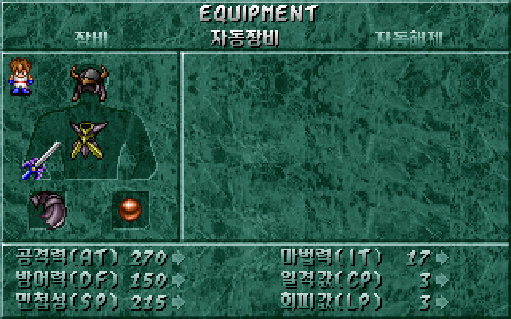
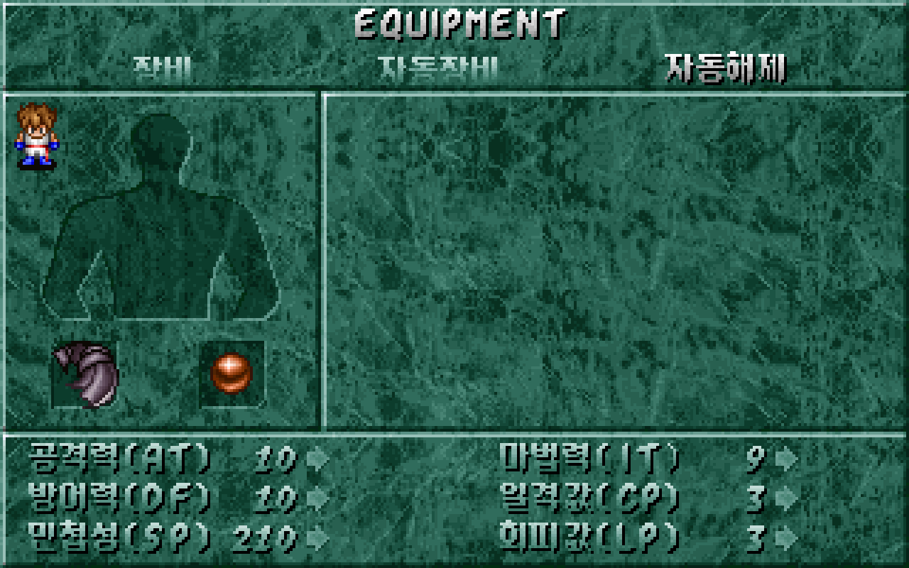

# 자동 장비·자동 해제 복원

장비 화면에서 좌우로 수동 장비·자동 장비·자동 해제를 고르고 Enter·Space로 실행할 수 있다. 위·아래는 현재 참가 중인 파티원을 바꾼다. 자동 실행 후에는 같은 탭에 머물며, Esc로 나간다. [이슈 #25](https://github.com/bnjjong/protocoss-remaster/issues/25)의 범위다.

## 원작 선택 규칙

자동 장비는 먼저 선택한 인물의 투구·갑옷·무기·방패를 소지품으로 반환한다. 이후 같은 순서로 각 슬롯에서 착용 가능한 소지 장비를 고른다. **장신구 두 자리와 구슬 상태, 망토에 따른 이동 속도는 그대로 유지한다.** 자동 해제도 네 슬롯만 비운다.

| 조건 | 원작 결과 |
| --- | --- |
| 선택 점수 | 장비의 여섯 능력치 보정 값을 부호 있는 수로 더한다. |
| 동점 | 먼저 나타나는 작은 장비 ID를 유지한다. |
| 합계가 0 이하 | 장착하지 않는다. |
| 양손 무기 선택 | 방패를 비운다. 무기·방패 조합의 전체 합을 비교하지 않는다. |
| 후보 없음 | 해당 슬롯을 비운다. |
| 반환 후 수량이 255를 넘음 | 원작 1바이트 수량처럼 0으로 돌아간다. |
| 실행 대상 외 인물 | 장비·능력치를 바꾸지 않는다. |

현재 능력치와 장신구 효과까지 포함한 능력치는 장비 변경 후 다시 계산한다. 장비 자체의 여섯 보정 합으로 선택하므로 현재 표시 능력치의 총합을 최대화하는 기능과는 다르다. 원작의 순서와 수량 넘침도 보존했다.

| 자동 장비 | 자동 해제 |
| --- | --- |
|  |  |

두 화면에서 장신구·구슬은 그대로 남고 투구·갑옷·무기·방패만 바뀐다.

## 원작 근거와 검사

원본 DOS 파일은 읽기만 한다. 압축을 푼 실행 파일은 메모리에서만 사용한다. 원작 저장 읽기 함수에 입력을 배치한 뒤 아래 기계어를 실행해 결과를 수집한다. 화면 출력·입력 대기·효과음은 검사 도구가 대신 처리하고, 장비·수량·능력치 변경 함수는 원작 그대로 실행한다.

| 원작 함수 | 확인한 동작 |
| --- | --- |
| `0x16658(character)` | 네 슬롯 반환·해제, 능력치 재계산 |
| `0x166D0(character)` | 해제 후 슬롯별 보정 합 비교와 장착 |
| `0x16890(partyIndex)` | 탭 끝에서 멈춤, 인물 순환, 자동 실행 후 화면 유지 |
| `0x151B8(tab, partyIndex)` | 선택 탭의 그림·위치와 현재 장비·능력치 표시 |

[원작 상태 기록](automatic-equipment-native.json)은 **157개 표본의 942회 변경**과 탭·파티 조작 **5개 입력 순서**를 보존한다. 11명 각각의 일반·빈 소지품·수량 넘침·양손 무기·방패만 소지·장신구 없음·고정 난수 표본을 포함한다. 각 표본에서 해제 두 번→장착 두 번→해제→장착을 실행하고 저장 2,944바이트 전체와 이동 속도를 대조한다. 다른 파티원·장신구·구슬·진행·좌표 보존도 전체 바이트 비교에 포함된다.

별도 세 표본은 동점·0 이하·음수 보정 합산을 확인한다. 원작 장비 DB는 디스크에서 수정하지 않고 검사 메모리의 보정 값만 바꾼다. 같은 보정 값을 Kotlin 검사에도 넣어 실제 원작 비교 분기를 확인한다. 참가자 표는 원작 메모리의 다섯 자리 범위 안에서 구성하며, 준비 직후 저장 상태가 입력과 같은지도 검사한다.

실제 앱의 `verifyAutomaticEquipment`는 NEW START부터 단검 회수까지 기존 468걸음을 진행한다. 수동 장비 검사에 이어 참가자 11명의 자동 장비·해제를 각각 시험하고 Enter·Space, 반복 실행, 탭 경계·인물 순환, 필드·주민 정지, 저장 후 재개, 구슬·망토 속도 유지도 확인한다. 후반 인물·장비는 저장 표본 검사이며 후반 스토리나 전투를 플레이했다는 뜻은 아니다. 시험 저장은 별도 임시 폴더를 쓰고, 시험 앱의 소리만 음소거한다.

[화면 비교 기록](automatic-equipment-render.json)은 기존 30장과 새 자동 장비 화면 39장을 합친 **69장·4,416,000픽셀**의 일치를 보존한다. 동일한 저장 상태·인물·탭에서 원작 그리기 명령을 실행하고, 원작 스프라이트·글꼴로 조합한 화면과 실제 GPU 출력을 비교한다. 전체 중 67장은 원작 메뉴 함수 기반이며, 기존 장비 소지품 조회 2장은 별도 배치와 원작 그림의 조합이다. 자동 탭 두 그림은 원작 그대로 추출했고 선택 위치도 원작 `0x151B8`에서 수집했다. 전체 장비 자산 **311,174픽셀**도 원작 스프라이트 함수와 일치한다.

Kotlin **81개**, Python **31개** 검사와 실제 앱의 자동 장비·건물·마을·주민·필드 이동·오프닝·프롤로그·저장·필드 경계 검사를 통과했다. 아래 명령으로 재현할 수 있다.

## 재현

```bash
./gradlew test :desktop:verifyAutomaticEquipment :desktop:verifyBuildings \
  :desktop:verifyTownTravel :desktop:verifyNpcs :desktop:verifyFieldTravel \
  :desktop:verifyOpening :desktop:verifyPrologue :desktop:verifyTitleSave \
  :desktop:verifyFieldBounds
python3 -m unittest discover -s tools/extractor/tests
```

원작 비교에는 Pillow·Unicorn이 설치된 Python을 사용한다. 그래픽 실행 검사 다음에 화면 비교를 실행한다.

```bash
python3 tools/extractor/decode_equipment.py --game-dir /path/to/Protocoss_Game
python3 tools/extractor/automatic_equipment.py --game-dir /path/to/Protocoss_Game
python3 tools/extractor/verify_equipment_render.py --game-dir /path/to/Protocoss_Game \
  --report-name automatic-equipment-render.json
```

이 문서는 자동 장비 복원 시점의 기록이다. 파티원 대상 아이템 사용은 [후속 복원 기록](field-items.md)에서 연결했다. 버리기·거래·전투 효과와 다른 지역은 후속 작업이다. 진입은 현재 앱의 Esc 메뉴를 유지한다. 마우스·키 반복 속도·커서 전체 애니메이션·팔레트 전환은 이번 범위에 포함하지 않는다.
