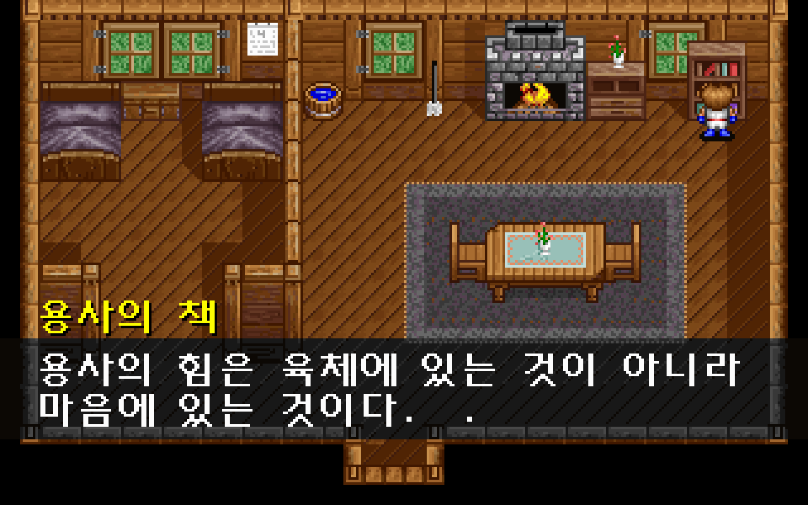
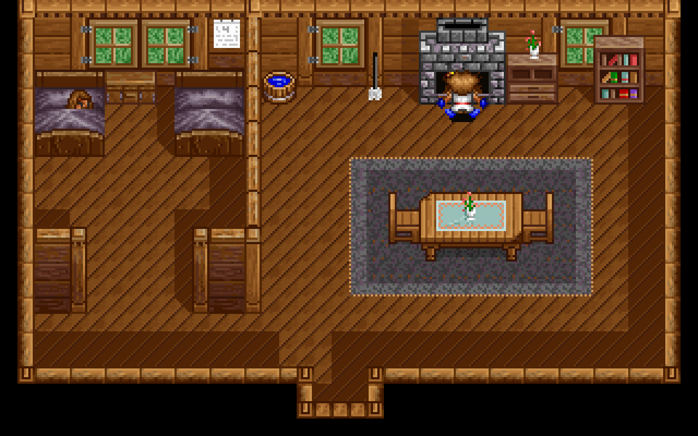

# 오두막 배경 조사키 수정

오두막에서 물체를 바라보고 **Space·Enter·E**를 누르면 원작 조사 대화가 나온다. 벽난로에서는 불에 데이는 동작을 한 뒤 뒤로 물러나 “앗!! 뜨거워.....”라고 말한다. [이슈 #35](https://github.com/bnjjong/protocoss-remaster/issues/35)의 수정이다.

## 원인과 변경

기존 `FieldRules.interaction`에는 원작 조사 타일 판정이 있었지만 실제 입력에서 호출하지 않았다. 입력 코드는 주민 대화만 조회했고, 주민이 없는 오두막에서는 그 분기에도 들어가지 않았다. 조사 대사를 담은 자산도 일부 빠져 있었다.

주민 대상을 먼저 확인하고, 주민 대상이 없는 오두막에서 정면 조사 이벤트를 확인하도록 연결했다. 조사는 원작처럼 맵 1·2, 이벤트 그룹 0에서만 실행한다. 새로 연결한 물체는 아래와 같다.

| 물체 | 원작 인자 | 반응 |
| --- | ---: | --- |
| 물통 | 5 | 물이 남아 있어 내일 길어도 된다는 대화 |
| 삽 | 6 | 아버지가 반지를 준 이유에 대한 혼잣말 |
| 빗자루 | 7 | 지금 대걸레를 볼 때가 아니라는 대화 |
| 꽃 | 9 | 엔키드가 알려준 꽃 이름에 대한 대화 |
| 책장 | 10 | ‘용사의 책’의 힘과 마음에 대한 문장 |
| 벽난로 | 15 | AUTOANI.002 → 화상 동작·이동 → 인자 8의 대화 |

물체 그림 어느 곳에서나 반응하도록 범위를 넓히지 않는다. 원작 `0x1204C`처럼 발 앞 타일의 속성 4와 이벤트 사각형을 모두 확인한다. 다른 방향이나 한 칸 먼 위치에서는 조사하지 않는다. 이동 이벤트의 속성 8과도 구분한다. 일반 물체 조사는 대화가 끝날 때까지 플레이어 이동과 Esc 메뉴를 막고, 입력 한 번으로 다음 페이지를 건너뛰지 않는다.

## 벽난로 연출

원작 이벤트 15는 단순 대화가 아니라 `0x10A54(2,0,25)`로 `DATA/AUTOANI.002`를 호출한다. 이 자료의 화상 그림·교대 프레임·뒤로 이동·대화 호출을 추출했다. 대화 시점과 종료 시점의 카만은 원작 좌표 **x=200, y=48, 자세 8**이다.

호출 모드 0은 현재 필드를 유지한다. 그래서 연출 파일의 맵 번호 1을 적용해 다른 오두막 상태로 바꾸지 않고, 현재 맵 1 또는 2와 배경을 그대로 사용한다. 잠든 벨슨그를 포함한 기존 인물을 유지하고 페이드 전환 없이 같은 렌더러를 사용하며, 진행 변수 6·8도 바꾸지 않는다. 끝나면 마지막 대화 인자 8과 원작 최종 위치·자세로 필드 조작을 돌려준다. 조사에 사용한 E도 벽난로 대화를 넘길 수 있다.

기존 기상 연출·문 출입·검 수리 스토리와 구분한다. 새 이벤트나 대사를 추측해 추가하지 않았으며 원본의 문구를 보존한다. 다른 건물의 상자·책·가구 조사를 복원한 단계는 아니다.

| 책 조사 | 벽난로 반응 |
| --- | --- |
|  |  |

## 원작 비교

[원작 기록](cabin-interaction-native.json)은 다음을 보존한다.

- `0x1204C`를 실행한 **8,032개 위치·방향 표본**. 오두막 두 맵의 격자와 비정렬 좌표, 반응하는 위치·잘못된 방향·거리를 포함한다.
- 기상 상태 0·1·2와 스토리 진행 0·3·4에서 조사 이벤트를 실행한 **108개 분기**. 일반 대화는 원문과 저장 전체 2,944바이트를 대조한다.
- 벽난로 이벤트의 원작 연출 호출과 `AUTOANI.002` 명령·대화/종료 시점의 인물 상태. 이벤트 실행 기록에서는 연출 호출을 반환하고, 연출의 실제 이동은 별도로 원작 동작 함수를 실행해 수집한다.

누락된 조사 대사와 벽난로 프로그램을 기존 시작 연출 자산 추출기에 포함했다. 전체 글자 284개를 원작 글꼴로 다시 생성하고 한글 조합을 대조했다. 필드 인물 그림 145,152픽셀도 원작 스프라이트 함수와 다시 비교했다.

[화면 기록](cabin-interaction-render.json)은 실제 앱의 조사·화상·대화 화면 **34장·2,176,000픽셀**을 같은 타일·인물·스크롤 상태의 원작 VGA 함수·글꼴 출력과 대조한다. 정지 화면과 지정 상태의 검사이며 DOS 부팅부터의 시계 위상 전체를 재현한 것은 아니다.

## 실행 검사와 재현

`verifyCabinInteraction`은 새 게임에서 검 회수까지 기존 468걸음을 실행한 뒤, 두 오두막 맵에서 Space·Enter·E로 일반 물체 대화 **30회**와 벽난로 연출 **6회**를 실행한다. 잘못된 방향·거리의 무반응, 대화·연출 중 이동 잠금, 맵·배경 유지, 최종 위치·자세, 저장·불러오기와 진행 보존을 검사한다. 기상 전 맵의 조사 표본은 침대 밖 유효 위치에서 시작한다.

```bash
./gradlew test :desktop:verifyCabinInteraction :desktop:verifyIndoor \
  :desktop:verifyBuildings :desktop:verifyTownTravel :desktop:verifyNpcs \
  :desktop:verifyFieldTravel :desktop:verifyOpening :desktop:verifyPrologue \
  :desktop:verifyTitleSave :desktop:verifyFieldBounds
PYTHONPATH=tools/extractor python3 -m unittest discover -s tools/extractor/tests
```

원작 자료 재추출과 화면 비교에는 Pillow·Unicorn을 사용한다. EXE는 메모리에서만 압축 해제한다. 화면 비교는 그래픽 실행 검사가 끝난 뒤 실행한다.

```bash
python3 tools/extractor/decode_opening.py --game-dir /path/to/Protocoss_Game
python3 tools/extractor/cabin_interaction.py --game-dir /path/to/Protocoss_Game
python3 tools/extractor/verify_npc_render.py --game-dir /path/to/Protocoss_Game \
  --folder desktop/build/reports/cabin-interaction --report-name cabin-interaction-render.json
```

Kotlin **97개**, Python **31개** 검사와 기존 전체 실행 검사를 통과했다.

일반 게임은 패키지 자산으로 실행하며, 자동 검사는 임시 저장 폴더와 시험 앱 음소거를 사용한다. 원본 게임·사용자 저장·실행 중인 다른 앱은 수정하거나 중지하지 않는다.
