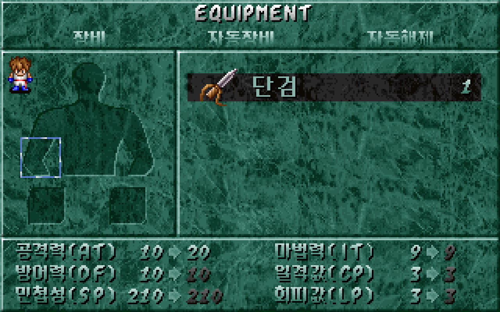
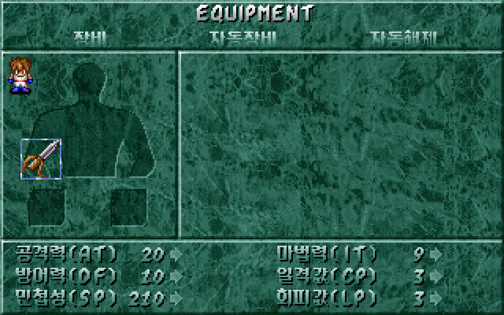
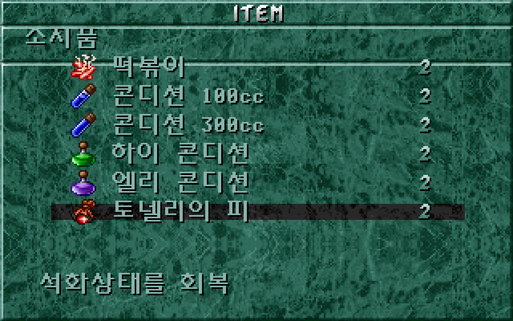
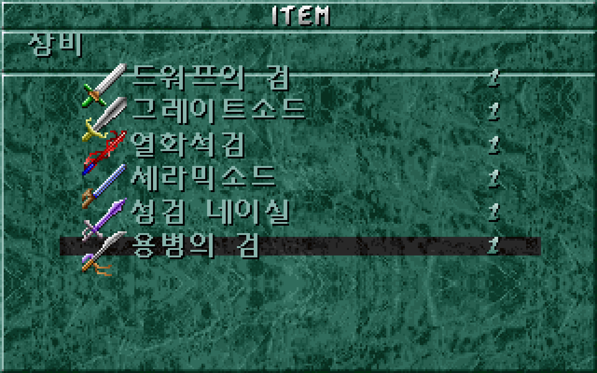

# 소지품 조회와 카만의 무기 장착

잡화점에서 받은 단검을 메뉴에서 장착하고, 저장한 뒤 같은 장비와 능력치로 이어갈 수 있다. [이슈 #21](https://github.com/bnjjong/protocoss-remaster/issues/21)의 가 안에 따라 카만의 무기부터 복원했다. 소지품 조회는 일반 아이템 39종과 장비 175종을 읽으며, 장착 변경은 카만에게 허용된 무기 32종만 다룬다.

## 조작과 범위

필드에서 Esc를 누르면 기존 일시 정지 메뉴 끝에 `소지품`과 `무기 장비`가 나온다. `무기 장비`에서 Enter·Space로 장비 탭 → 무기 슬롯 → 선택 목록으로 들어간다. 위·아래로 무기를 고르고 Enter·Space로 장착한다. Esc는 한 단계씩 돌아간다. 카만이 파티에 없는 저장에서는 무기 메뉴를 열지 않는다.


**원작은 무기 선택 목록을 여는 순간 현재 무기를 소지품으로 돌려보낸다.** 여기서 Esc를 누르면 해제된 상태로 돌아간다. 무기를 바꾸지 않으려면 목록에서 기존 무기를 다시 선택해야 한다. 목록이 비었으면 장착하지 않고 돌아간다. 방패가 장착돼 있으면 양손 무기 선택은 거부하며 원작 오류 효과음 번호 13을 재생한다.

`소지품`에서는 좌·우로 일반 아이템과 장비를 전환하고, 위·아래로 목록을 넘긴다. 이름·그림·수량을 표시하며 일반 아이템은 설명도 표시한다. 조회 중 확인 키는 소지품을 소비하지 않는다. 메뉴 동안 플레이어·주민은 멈추고 필드 음악은 이어진다.

| 무기 선택과 능력치 미리보기 | 단검 장착 후 |
| --- | --- |
|  |  |
| 일반 소지품 | 장비 소지품 조회 |
|  |  |

다른 파티원, 방어구·장신구 변경, 자동 장비·자동 해제, 아이템 사용·버리기, 거래·전투는 이번 범위에 없다. 원작 장비 화면에 들어 있는 자동 장비·해제 문구는 그림으로 남아 있지만 해당 탭으로 이동하지 않는다. 다른 장비는 현재 아이콘과 능력치 계산에만 반영한다.

## 원작에서 확인한 규칙

`AMOS.EXE`의 다음 함수를 실행하고 Kotlin 결과와 대조했다. [원작 실행 기록](equipment-native-verification.json)은 입력·출력 DOS 저장 2,944바이트와 선택 목록·미리보기·거부 효과음을 보존한다.

| 원작 함수 | 확인한 내용 |
| --- | --- |
| `0x15298(2,0)` | 소지 수량이 있고 카만의 허용 값이 0이 아니며 종류가 2·5인 무기를 번호순으로 선택 |
| `0x160D8(2,0)` | 현재 무기 반환·해제 후 목록 진입. 취소해도 해제 상태 유지 |
| `0x15E88(0,2,id)` | 방패와 양손 무기 제한, 무기 슬롯 기록, 소지 수량 1개 차감 |
| `0x1A204(0)` | 기본 능력치와 기존 장비·장신구를 반영한 현재 능력치 재계산 |
| `0x15808(0,2,id)` | 선택한 무기의 능력치 미리보기와 증감 색상 |

장비 여섯 슬롯은 저장 오프셋 473~478이다. **무기는 475**, 방패는 476이다. 소지 장비의 개수는 162부터 175바이트, 일반 아이템은 123부터 39바이트다. 무기를 반환할 때는 보상 수령 함수의 최대 99 제한을 적용하지 않는다. 원작처럼 1바이트로 더하므로 99는 100, 255는 0이 된다. 장착·반환과 능력치 외의 파티·소지품·진행·좌표 바이트는 보존한다.

카만의 기본 능력치 여섯 값은 360부터 4바이트 간격, 현재 값은 362부터 같은 간격이다. 무기만 바꿔도 투구·갑옷·방패와 두 장신구를 포함해 다시 계산한다. 장비의 부호 있는 보정값, 장신구의 비율·고정 보정, 16비트 넘침과 미리보기의 계산 순서도 원작과 대조했다.

상태 검증은 무기 32종 × 3개 조건의 **96개**, 방패가 있는 양손 무기 거부 **6개**, 수량 0·99·255에서 해제 **3개**로 총 **105개**다. 다른 파티원의 장비, 기존 무기 반환, 큰 기본 능력치, 장신구 보정 여러 종류, 변신 구슬을 포함한다. 화면·음악 출력과 키 입력은 원작 상태 검사에서 대신 처리하며 장착·반환·능력치 계산 자체는 원작 기계어를 실행한다.

## 그림·화면 검증

`IMENU.IMG`, `COMMON.IMG`, `PEOPLE.SPR`의 메뉴 그림·숫자·단검·카만 등을 추출했다. 사용 그림 **304,425픽셀**을 원작 스프라이트 함수 출력과 비교했고, 사용 글자 **293개**를 추출하고 한글 조합을 원작 글꼴 함수와 비교했다. 빈 VGA 평면이 뒤에 오는 2픽셀 폭 IMG도 읽도록 공통 추출기를 고치고 원작 그림과 별도 검사로 확인했다. 새 그림을 그리거나 기존 수치 DB의 추정 필드에 의존하지 않았다.

[화면 기록](equipment-render-verification.json)의 총 **13장·832,000픽셀**을 비교했다.

- 무기 화면 **8장·512,000픽셀**: `0x151B8`, `0x156F8`, `0x15808`, `0x15518`이 내는 그리기 명령·글자를 같은 저장 상태에서 수집하고 원작 스프라이트 출력과 조합했다. 초기 화면·무기 슬롯·미리보기·장착·취소 후 해제·빈 목록·스크롤·방패 제한을 포함한다.
- 일반 소지품 **3장·192,000픽셀**: 원작 `0x19930`의 목록·수량·설명 출력과 대조했다. 사용 가능 종류에 따른 어두운 아이콘·글자·수량도 비교한다. 현재 메뉴에 맞춘 분류 이름은 별도로 더한다.
- 장비 소지품 **2장·128,000픽셀**: ITEM의 여섯 줄 배치에 전체 장비를 조회하도록 추가한 화면이다. 원작 그림·글꼴과 정해진 배치의 조합을 비교하며, 이 두 장을 원작의 전체 메뉴 실행 결과라고 보지는 않는다.

기존 Esc 메뉴를 진입점으로 유지했고 분류 전환을 추가했다. 원작 메뉴 전체의 진입 연출·키 반복 속도·모든 탭·캐릭터 선택·마우스 조작을 복원한 단계는 아니다. 선택 테두리는 원작 세 프레임 중 첫 프레임을 사용한다. 커서 전체 애니메이션·팔레트 전환과 DOSBox 전체 녹화의 시점은 비교하지 않았다. 효과음은 원작 번호 8·12·13에 기존 WAV를 연결했으며 음원 변환 자체를 다시 검증하지는 않았다.

## 실제 앱 검사와 재현

Kotlin **74개**, Python **31개** 검사를 통과했다. `verifyEquipment`는 원본 폴더 없이 NEW START부터 **468걸음**으로 검을 회수하고, 단검 장착 → 저장·불러오기 → 목록에서 취소해 해제 → 저장 재개를 실제 키 입력으로 검사한다. 추가 저장 표본으로 목록 스크롤·다른 장비 조회·방패 제한·빈 목록·메뉴 중 필드 정지도 확인한다. 기존 건물·마을·주민·오두막·오프닝·프롤로그·저장·필드 경계 검사도 모두 통과했다.

```bash
./gradlew test :desktop:verifyEquipment :desktop:verifyBuildings \
  :desktop:verifyTownTravel :desktop:verifyNpcs :desktop:verifyFieldTravel \
  :desktop:verifyOpening :desktop:verifyPrologue :desktop:verifyTitleSave \
  :desktop:verifyFieldBounds
python3 -m unittest discover -s tools/extractor/tests
```

Pillow·Unicorn이 설치된 Python에서 원작 자료를 다시 추출할 수 있다.

```bash
python3 tools/extractor/decode_equipment.py --game-dir /path/to/Protocoss_Game
./gradlew :desktop:verifyEquipment
python3 tools/extractor/verify_equipment_render.py --game-dir /path/to/Protocoss_Game
```

시험 앱은 임시 저장 폴더를 쓰고 자체 음악·효과음만 음소거한다. 사용자 원본·DOS 저장·다른 앱의 소리는 바꾸지 않는다. 비교 PNG와 상태는 `desktop/build/reports/equipment`에 생성된다. 일반 실행은 `./gradlew :desktop:run`이다.
