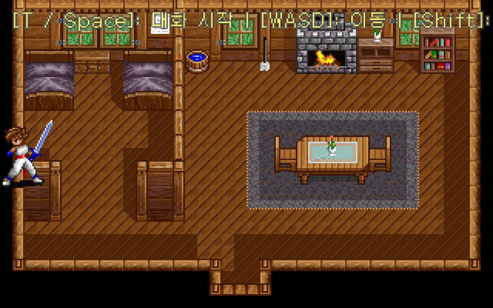
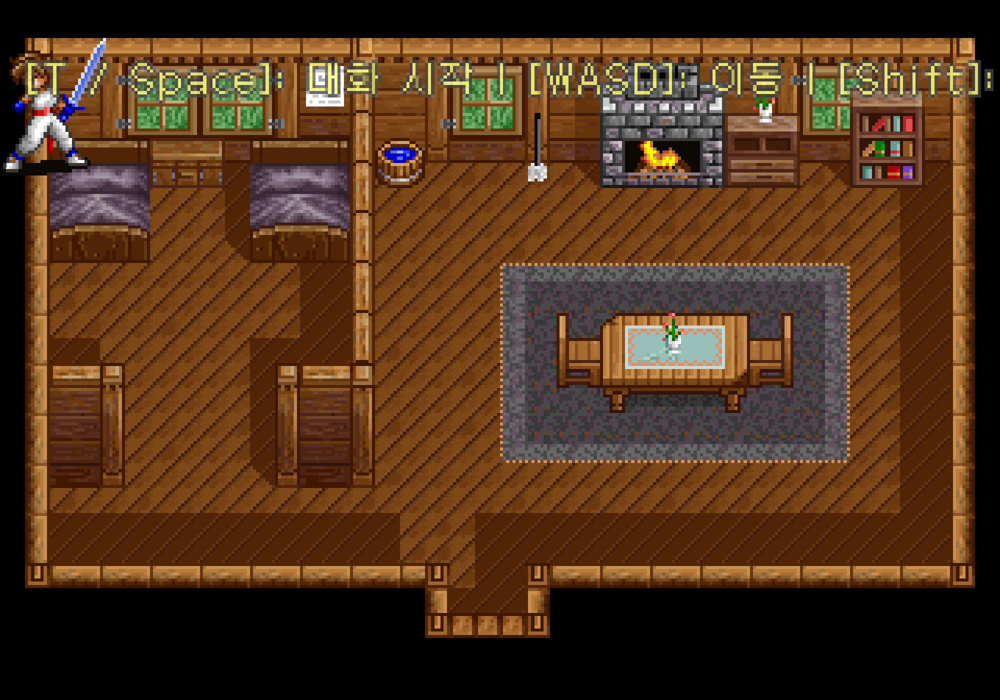

# 필드 이동과 화면 경계 수정

카만을 이동했을 때 카메라가 맵 밖으로 나가 오두막이 잘리고 검은 영역이 커지던 문제를 수정했다. 캐릭터도 스프라이트 전체가 맵 안에 남도록 제한한다. 창 크기 변경 뒤에는 매 프레임 표시 영역을 복구해 320×200 비율을 유지한다.

현재 오두막은 맵과 화면이 모두 320×200이므로 카메라는 `(160, 100)`에 머문다. 더 큰 맵에서는 기존의 부드러운 추적을 유지하면서 화면이 맵 끝을 넘지 않도록 한다. 작은 맵은 축별로 중앙에 맞춘다. 이 제한은 맵이 표시되는 모드에서만 적용하며, 갤러리에서 돌아오는 첫 프레임에도 범위 밖 위치를 바로 복구한다.

카만을 왼쪽으로 계속 이동한 뒤의 화면이다. 맵 전체가 유지되고 스프라이트도 화면 밖으로 나가지 않는다.



1000×700 창으로 바꾼 뒤에는 같은 배경 비율을 유지하며 위아래에 여백을 둔다. 창의 비율 때문에 생기는 여백과 맵 밖으로 밀려나 생기던 검은 영역은 구별한다.



## 변경 내용

- `FieldBounds.constrainPlayer`: 캐릭터를 그리는 사각형 전체가 맵에 들어오도록 중심 좌표를 제한한다. 현재 34×44 스프라이트의 허용 중심은 X `17..303`, Y `22..178`이다.
- `FieldBounds.constrainCamera`: 화면 크기와 확대 배율을 반영해 카메라 중심을 제한한다. 해당 축에서 맵이 화면보다 작거나 같으면 맵 중앙을 사용한다.
- `ProtocossGame.updateFieldView`: 입력 처리 뒤 캐릭터 범위를 제한하고 카메라를 추적·제한한다. 필드 모드에서만 적용한다.
- `ProtocossGame.render`: 실제 표시 영역을 매 프레임 적용한다. 창·전체화면 전환 과정에서 그래픽 백엔드가 전체 창 크기로 덮어써도 올바른 비율로 그린다.
- 초기화와 크기 변경에서도 즉시 범위를 반영한다.

타일·스프라이트 추출 데이터는 바꾸지 않았다. 벽·가구를 통과할 수 있는지 판정하는 원작 충돌 데이터와 모션 연결은 별도 작업이다. 이번 제한은 맵 바깥 사각형에 대한 것이다.

## 재현 검사

```bash
./gradlew test
./gradlew :desktop:verifyFieldBounds
```

첫 명령은 Kotlin 검사 22개를 실행한다. 추가한 7개 검사는 화면과 같은 맵, 큰 맵, 한 축만 작은 맵, 확대 배율, 8방향 걷기·대시, 범위 밖 위치 복구와 아주 작은 맵을 다룬다.

두 번째 명령은 그래픽 실행 환경이 있는 macOS에서 실제 게임을 숨겨진 창으로 실행한다. 외부 키 입력을 분리하고 프레임당 시간을 고정해 다음을 검사한다.

1. 최초 화면.
2. 걷기 8방향과 대시 8방향으로 끝까지 이동하는 동안 매 프레임 캐릭터·카메라 범위 확인.
3. 갤러리에서는 범위 제한을 강제하지 않으며, 맵 밖 위치에서 필드로 돌아오는 첫 프레임에 복구.
4. 실제 창을 640×400에서 1000×700으로 바꾼 뒤 필드 범위와 표시 영역 확인.

20개 시나리오가 모두 통과했다. 갤러리를 제외한 19개 화면에서 상단 안내 문구를 뺀 배경·캐릭터 합성 54,400픽셀씩, **합계 1,033,600픽셀**을 비교해 차이가 없었다. 고해상도 화면 배율과 표시 영역의 위아래 여백을 반영해 비교한다.

검사 결과와 PNG는 `desktop/build/reports/field-bounds/`에 저장한다. 이 검사는 실제 게임 호출을 확인하기 위해 검사 런처에서만 내부 상태를 읽으며, 제품에 검사 메뉴나 별도 입력 동작을 추가하지 않는다. 자동 검사는 창 크기 변경을 실행하며 F11 전체화면 전환 자체는 이번 자동 시나리오에 포함하지 않았다.
