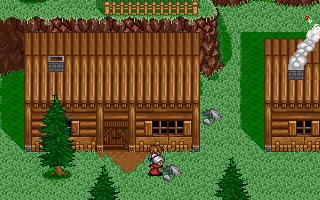
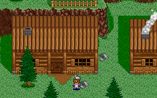

# NPC와 카만의 앞뒤 표시

카만과 NPC를 함께 정렬해 화면 아래쪽 인물을 나중에 그린다. 카만이 NPC보다 위에 있어도 NPC를 가리던 문제를 수정했다. 일반 필드·대화창·장소명 표시가 같은 정렬을 사용한다. [Issue #37](https://github.com/bnjjong/protocoss-remaster/issues/37)의 작업이다.

NPC가 카만보다 아래쪽에 있으면 NPC가 앞에 보인다.



카만이 아래쪽으로 이동하면 카만이 앞에 보인다.



## 원작에서 확인한 순서

AMOS.EXE의 `0x243F0`을 재배치한 메모리에서 실행했다. 카만을 첫 항목으로 넣고, MAP에 기록된 순서대로 모든 NPC를 덧붙인다. 각 항목은 화면 Y 좌표 4바이트, 지형의 높이 층 1바이트, 인물 번호 1바이트다. 목록은 `0x7E08C`에 있다.

카만의 Y는 `0x7E1E8`이며, NPC의 Y는 54바이트 레코드의 `+8`에서 타일·픽셀 스크롤을 빼고 화면 여백 16픽셀을 더한 값이다. 따라서 두 좌표를 같은 월드 좌표계에서 비교할 수 있다. 이동 목표 격자나 지형의 높이 층으로 순서를 정하지 않는다.

`0x244DB`부터 앞 항목 `i`와 그 뒤의 각 항목 `j`를 비교한다. Y가 더 크면 즉시 두 항목 전체를 교환한다. 같은 Y끼리는 직접 교환하지 않지만, 다른 항목과 교환하면서 동률 순서가 바뀔 수 있다. 예를 들어 카만·NPC 1·NPC 2의 Y가 `[480,480,472]`이면 그리는 순서는 `[NPC 2,NPC 1,카만]`이다. 같은 높이에서 최초 순서를 항상 유지하는 정렬과 다르다.

정렬을 마치는 `0x24530`까지 실행한 결과를 [561개 대조 표본](field-draw-order-native.json)으로 기록했다. 음수·화면 밖 좌표, 같은 Y의 조합, 서로 다른 높이 층, 픽셀 단위 스크롤, 최대 51개 인물 목록을 포함한다. 실행 파일은 판본 해시를 확인하고 메모리에서만 압축 해제한다.

각 인물을 그린 직후에 원작 `0x20CE8`에 해당하는 지형 가림을 적용한다. 기존처럼 모든 NPC 뒤에 카만을 덧그리지 않는다. 연출 파일이 직접 정하는 인물 순서는 이번 수정에서 유지했다.

## 검사 결과

- Kotlin 94개와 Python 31개 검사 통과. 정렬 검사는 원작 함수가 만든 561개 표본과 직접 대조한다.
- [겹침 화면 비교](field-draw-order-render.json): 실제 GPU 화면 89장·5,696,000픽셀이 원작 VGA 출력과 일치한다. 마을·실내·잠든 인물·빈 맵, 여러 NPC의 동률·높이 층, 1픽셀씩 앞뒤가 바뀌는 17장, 대화창·장소명 영역을 포함한다.
- 화면의 예상 인물 순서는 Kotlin 정렬 결과를 재사용하지 않고 원작 `0x243F0`으로 결정한다. 실제 픽셀은 원작 스프라이트·지형 가림 함수를 실행해 만든다. 이전 방식인 NPC→카만 순서와 비교하면 같은 표본에서 색 번호가 다른 픽셀 11,127개가 생겨, 기존 오류를 드러내는 표본임도 확인했다.
- 기존 주민 대화 17건과 저장 재개, 실내 대화·거래·장비·아이템·휴식, 건물 왕복·마을 이동·첫 오두막·시작 연출·프롤로그·타이틀 저장·필드 경계 검사 통과. 기존 주민 대화 10장·실내 63장·검 수리 10장·건물 12장도 원작 순서를 적용해 다시 비교했다.

시험 앱은 패키지 자산과 임시 저장을 사용하고 음악을 음소거한다. 사용자 저장과 실행 중인 게임을 건드리지 않는다. 기록한 표본과 지정한 필드 화면에 대한 검증이며, 다른 지역과 전투 복원은 기존 후속 범위다.

## 재현

일반 게임에는 원본 폴더나 Python이 필요 없다. NPC의 위아래를 지나며 겹침을 확인할 수 있다.

```bash
./gradlew test :desktop:verifyActorDepth :desktop:verifyNpcs
./gradlew :desktop:verifyIndoor :desktop:verifyBuildings :desktop:verifyTownTravel \
  :desktop:verifyFieldTravel :desktop:verifyOpening :desktop:verifyPrologue \
  :desktop:verifyTitleSave :desktop:verifyFieldBounds
python3 -m unittest discover -s tools/extractor/tests
```

원작과 다시 대조할 때는 Pillow·Unicorn을 설치하고 다음을 실행한다.

```bash
python3 tools/extractor/field_draw_order.py --game-dir /path/to/Protocoss_Game
./gradlew test :desktop:verifyActorDepth
python3 tools/extractor/verify_npc_render.py \
  --game-dir /path/to/Protocoss_Game \
  --folder desktop/build/reports/actor-depth \
  --report-name field-draw-order-render.json --compare-legacy-order
```

대화·건물·검 수리 화면을 다시 비교할 때는 해당 실행 검사로 화면을 새로 기록한다. 검 수리 검사 기록의 `cinematic` 항목이 연출과 자유 이동 화면을 구분한다.
