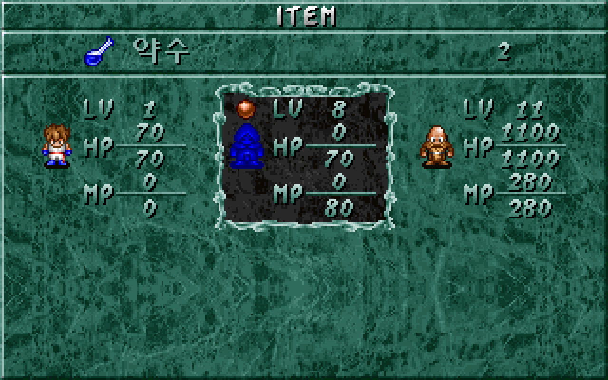
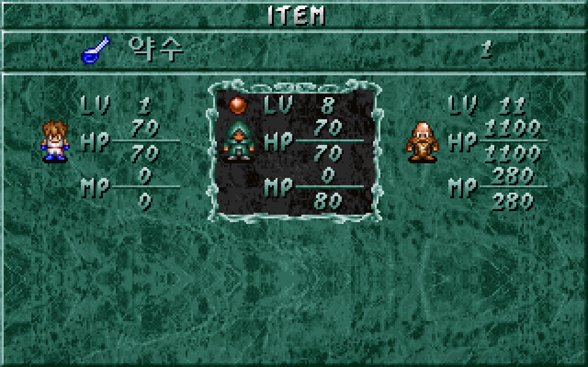
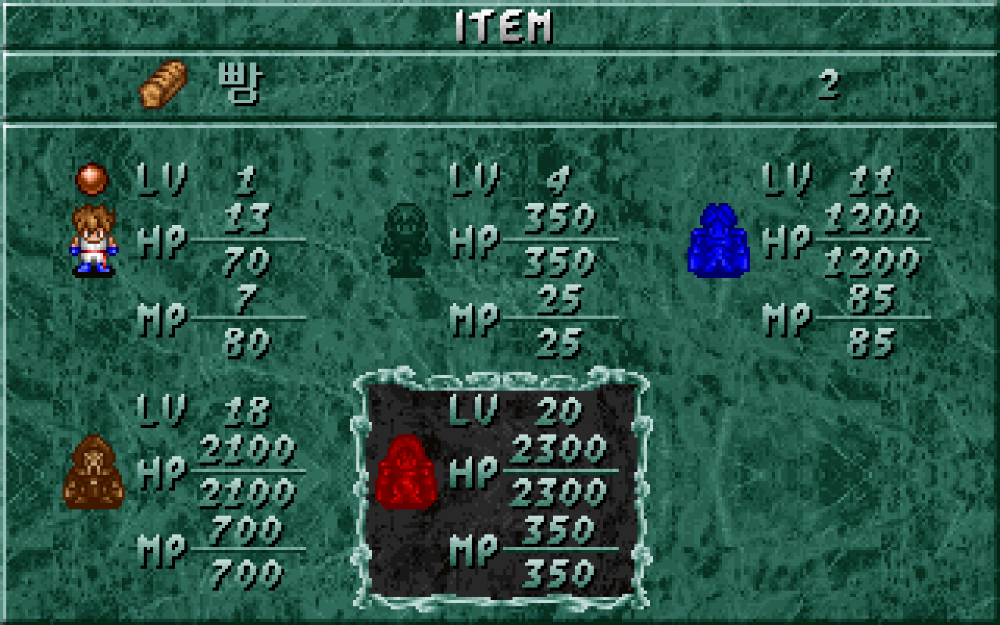

# 파티원 대상 소지품 사용

소지품에서 회복·치료·부활·경험치·잠재력 아이템 19종을 골라 참가 중인 파티원에게 사용할 수 있다. 효과가 있으면 한 개를 소비하고, 사용 전 취소·효과 없음·죽은 대상에 대한 일반 아이템 사용은 수량을 유지한다. [이슈 #27](https://github.com/bnjjong/protocoss-remaster/issues/27)의 대상 선택 흐름을 복원했다.

## 조작과 이번 범위

필드에서 Esc → `소지품` → 위·아래로 아이템 → Enter·Space로 대상 선택을 연다. 방향키로 최대 다섯 참가자를 3열·2행에서 고르고 **Enter로 사용**한다. 원작 대상 선택에서 Space는 사용 키가 아니므로 소비하지 않는다. 대상 선택의 Esc는 목록으로 돌아가며 이미 사용한 결과를 되돌리지는 않는다. 한 개도 남지 않았다면 Esc 메뉴로 돌아간다. 목록에서 Esc를 한 번 더 누르면 Esc 메뉴로 돌아간다.

대상 화면에는 원작의 참가자 그림·상태별 색 변환·레벨·현재/최대 체력(HP)·마력(MP)과 구슬 잔량 그림, 선택 테두리, 선택한 아이템의 이름·그림·수량을 표시한다. 사용 후 같은 대상 화면에 머물러 다른 인물에게도 계속 쓸 수 있다. 수량이 0이 되면 같은 화면에서 더 소비할 수 없다. 목록으로 돌아갈 때 소진한 항목을 빼고 선택 위치·스크롤을 보정한다. 메뉴 중 필드와 주민은 멈추며 현재 음악은 유지한다.

| 종류 | 아이템 |
| --- | --- |
| HP 회복 | 빵, 생선, 고기, 떡볶이, 콘디션 100cc·300cc, 하이 콘디션, 엘리 콘디션 |
| HP 회복·해독 | 약수 |
| 상태 치료 | 토넬리의 피, 독초, 용기의 풀, 만능 치료제 |
| MP 회복·복합 회복 | 솔레노, 하이솔레노, 태초의 흙 |
| 부활 | 생명의 가루약 |
| 경험치·잠재력 | 아슈람의 돌, 고대의 마법서 |

**이번 단계는 파티원 대상 사용에 한정한다.** 이 문서는 파티원 대상 사용 복원 시점의 기록이다. 텐트는 [후속 휴식 복원](tent-rest.md)에서 연결했다. 방울·장소별 퀘스트 아이템은 후속 단계로 남겼다. 방울·장소별 항목은 이 화면에서 확인해도 수량을 바꾸지 않는다. 전투 전용 강화제, 버리기·거래·전투 중 사용도 연결하지 않았다. 후반 인물은 저장 표본으로 검사했으며 해당 지역 스토리·전투까지 복원한 것은 아니다.

| 약수 사용 전 | 약수 사용 후 |
| --- | --- |
|  |  |



아이템은 소지 수량이 있을 때 사용할 수 있다. 새 게임에 지급하거나 거래·획득 경로를 추가하지는 않았다.

## 원작 효과와 저장 상태

`ITEM.LST`의 58바이트 레코드에서 종류는 23, 효과 번호는 24, 효과량은 25~26 오프셋이다. 설명 문장을 읽고 수치를 추정하지 않고 실제 원작 분기를 따른다.

| 원작 함수 | 검증한 내용 |
| --- | --- |
| `0x173B4` | 목록에서 대상 사용으로 진입, 돌아올 때 소진 항목 제거·위치 보정 |
| `0x1B844` | 대상 방향 이동, Enter·Esc, 소지 수량·죽음 상태 판정 |
| `0x1B2F8` | 회복·치료·경험치·잠재력 효과와 효과가 있을 때만 수량 차감 |
| `0x1B218`·`0x19A6C` | 아이템 한 줄과 참가자 상태 화면 |

캐릭터 레코드의 간격은 153바이트다. 캐릭터 0 기준으로 남은 경험치는 348의 32비트 값, HP는 352·354, MP는 356·358, 잠재력은 384의 16비트 값이다. 레벨은 386, 구슬 상태는 387, 일반 상태는 472다. 소지품 수량은 123부터 39바이트다.

HP·MP 회복은 현재 값이 최대보다 작을 때 적용한다. 원작의 16비트 덧셈 후 최대값 보정을 그대로 따른다. 약수는 HP 회복과 독 치료를 각각 판정하며, 둘 중 하나라도 적용하면 한 개만 소비한다. 만능 치료제는 석화·독·주문 봉쇄를 치료한다. 일반 회복제는 죽음 상태에서 거부한다.

**원작 부활약은 죽음 상태를 정상으로 바꾸지만 HP를 별도로 채우지 않는다.** HP가 0인 저장에서도 이 결과를 보존한다. 아슈람의 돌은 다음 성장까지 남은 경험치를 줄이고 최소 1로 보정한다. 고대의 마법서는 잠재력을 더하며 원작 16비트 넘침을 유지한다. 이 두 효과는 언제나 수량을 차감한다. 레벨 상승·전투 판정은 이번 사용 함수의 범위 밖이다.

다른 인물·장비·구슬·망토 이동 속도·진행·좌표는 보존한다. 결과는 기존 2,944바이트 DOS 저장 형식에 남으므로 저장 후 이어서 사용할 수 있다.

## 검사 근거

[원작 상태 기록](field-items-native.json)은 11명 × 상태·체력·수량 표본 10개 × 아이템 19종 = **2,090개 표본**이다. 각 표본에서 대상 선택 함수로 Enter를 두 번 실행해 **4,180회 사용 시도**를 확인하고, 저장 전체와 이동 속도·효과음을 대조한다. 원작의 저장 읽기·대상 판정·효과·수량 변경 코드는 그대로 실행하며 화면·키 대기·효과음 출력만 검사 도구에서 대신 처리한다. 소진한 뒤의 재사용과 회복 불필요, 석화·독·봉쇄·죽음, HP가 0인 부활, 16비트 경계, 수량 1·2·255를 포함한다. 최대 5명 대상 선택의 모든 **60개 방향 전환**도 원작에서 수집해 비교한다.

실제 앱의 `verifyFieldItems`는 NEW START부터 단검 회수까지 기존 468걸음과 수동·자동 장비 검사를 포함한다. 이어 19종을 실제 메뉴 입력으로 사용하고 참가자 11명·상태별 그림·5명 배치·Space 무소비·취소·마지막 한 개·목록 갱신·필드 정지·저장 재개를 검사한다. 원본 게임·사용자 저장은 읽기만 하며 시험 앱은 임시 저장 폴더와 자체 음소거를 사용한다.

[화면 비교 기록](field-items-render.json)은 **118장·7,552,000픽셀**의 일치를 보존한다. 기존 69장과 새 대상 사용 49장이며, 전체 중 116장은 원작 메뉴 함수 기반이고 기존 장비 소지품 조회 2장은 별도 배치에 원작 그림을 조합한 결과다. 전체 장비 자산 **342,384픽셀**도 원작 스프라이트 함수와 대조했다. Kotlin **84개**, Python **31개** 검사와 기존 건물·마을·주민·필드 이동·오프닝·프롤로그·저장·경계 실행 검사를 통과했다.

화면 비교는 같은 저장·선택 상태에서 원작 그리기 명령을 실행하고 원작 스프라이트·글꼴로 조합한 화면과 실제 앱 출력을 비교한다. 정지 화면 비교이며 커서 전체 애니메이션·사용 성공 전환의 프레임 타이밍까지 복원한 것은 아니다.

## 재현

```bash
./gradlew test :desktop:verifyFieldItems :desktop:verifyBuildings \
  :desktop:verifyTownTravel :desktop:verifyNpcs :desktop:verifyFieldTravel \
  :desktop:verifyOpening :desktop:verifyPrologue :desktop:verifyTitleSave \
  :desktop:verifyFieldBounds
python3 -m unittest discover -s tools/extractor/tests
```

원작 비교에는 Pillow·Unicorn이 설치된 Python을 사용한다. 그래픽 실행 검사 다음에 화면 비교를 실행한다.

```bash
python3 tools/extractor/field_items.py --game-dir /path/to/Protocoss_Game
python3 tools/extractor/decode_equipment.py --game-dir /path/to/Protocoss_Game
python3 tools/extractor/verify_equipment_render.py --game-dir /path/to/Protocoss_Game \
  --report-name field-items-render.json
```
