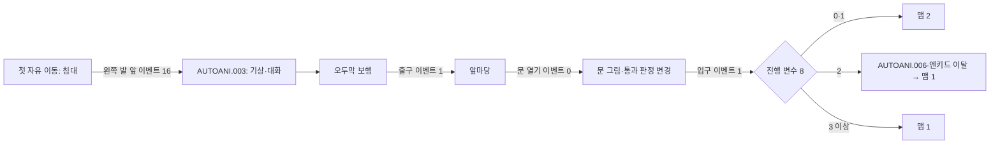

# 오두막 보행·출입구·기상 연출

오두막의 벽·가구·벨슨 NPC와 마당의 높이 층을 원작 함수로 판정한다. 침대에서 일어나는 연출을 거쳐 오두막을 나갔다가 돌아올 수 있다. 진행 변수 8이 2인 저장은 원작의 쪽지 연출과 엔키드 이탈을 거친다. [Issue #11](https://github.com/bnjjong/protocoss-remaster/issues/11)의 작업이다.



[기상 화면](images/field-travel/waking.png) · [마당](images/field-travel/yard.png) · [쪽지 연출](images/field-travel/letter.png)

## 원작 판정과 실행 자산

추측한 가구 사각형으로 통과를 막지 않는다. `original_field.py`는 원작의 LE 실행 파일에서 주소 재배치 항목을 적용한 뒤 아래 함수를 실행한다. LE는 DOS 확장 프로그램의 실행 파일 형식이며, 재배치는 로딩할 주소에 맞춰 코드의 참조 주소를 바꾸는 과정이다. 16비트·32비트 대상 주소를 함께 처리한다. 형식 상수는 [Open Watcom exeflat.h](https://github.com/open-watcom/open-watcom-v2/blob/master/bld/watcom/h/exeflat.h)를 따른다. 원본 실행 파일과 해제한 실행 파일은 저장소에 복사하지 않는다.

| 원작 함수 | 확인한 역할 |
| --- | --- |
| `0x23154`, `0x210F4`, `0x1FD84` | 경사로 방향 전환, NPC·타일 통과, 화면 경계 |
| `0x20C10`, `0x25738` | 충돌 검사보다 먼저 발 앞의 이벤트 타일과 사각형 검사 |
| `0x11CDC` | 마당 문 3×3 그림의 다음 타일과 통과 플래그 변경 |
| `0x25304` | AREA00.G&M의 이벤트 그룹·조건 분기 |
| `0x11328`, `0x10810` | 연출 인물의 자세와 이동 |
| `0x12F4C(1)` | 엔키드의 파티 참가 해제와 두 장신구의 소지품 반환 |

맵 0·1·2의 8픽셀 간격 좌표, 세 높이 층, 네 기본 방향을 판정한 표를 `assets/data/field`에 넣었다. 문을 연 마당의 별도 표까지 **120,000개 판정, 120,000바이트**다. 표의 3번은 열린 문을 가진 맵 0의 판정 변형이며 원작의 서브맵 3과 다르다. 게임 실행에는 원본 폴더·Python·Unicorn이 필요 없다.

`FieldMovement`는 70Hz에서 한 번에 1픽셀, Shift 때 2픽셀씩 움직이며 8픽셀 단위로 다음 보행을 판정한다. 화면 지연으로 한 프레임의 시간이 길어져도 보행마다 검사한다. 불러온 비정렬 좌표는 강제로 타일에 맞추지 않는다. 기존 리마스터의 대각선 동시 입력은 유지하고, 두 축의 이동 순서를 모두 검사해 모서리를 통과하지 않게 한다. 원작 키 입력의 우선순위까지 동일하다고 주장하지 않는다.

## 출입구와 저장 상태

좌표는 원작의 화면 좌표이며 인물 그림의 왼쪽 위보다 16픽셀 크다.

| 조건 | 맵 | 스크롤 | 화면 좌표 | 자세·높이 층 |
| --- | --- | --- | --- | --- |
| 실내에서 나감 | 0 | 24,16 | 160,104 | 8·1 |
| 마당에서 들어감, 변수 8이 0·1 | 2 | 0,0 | 160,184 | 0·0 |
| 변수 8이 2 | 연출 6 뒤 1 | 0,0 | 200,120 | 8·0 |
| 변수 8이 3 이상 | 1 | 0,0 | 160,184 | 0·0 |
| 침대에서 일어남 | 연출 3 뒤 1 | 0,0 | 72,56 | 10·0 |

외출 때 이벤트 그룹 0→1, 재진입 때 1→0을 바꾼다. 기상 완료는 변수 6=1, 쪽지 연출 완료는 변수 8=3이다. 시작 프롤로그나 AUTOANI.000·001을 재호출하지 않는다. 각 분기가 바꾸지 않는 파티·소지품·장비·이벤트 상태는 그대로 보존한다. 마당에서 연 문은 원작처럼 맵을 새로 읽을 때 초기화한다.

진행 상태 2의 원작 분기 실행 기록은 AUTOANI를 가로채므로 호출 인자 변수 1이 1로 남는다. 실제 연출의 마지막 `/C7`은 대화 없이 반환하지만 변수 1을 7로 바꾸므로 완료 저장에는 7을 기록한다. 기상 연출도 마지막 `/C17`의 인자를 보존한다.

## 검증

- 수정 전 `./gradlew test` 통과. 기존 시작 연출·프롤로그·저장·경계 실행 검사를 유지했다.
- 추출에 사용하지 않은 비정렬 좌표 1,000개와 출입구 8개 분기를 원작 함수로 다시 검사했다. [실행 기록](field-native-verification.json)에 판정 표의 해시를 남겼다.
- Kotlin 단위 검사 43개 통과. 새 검사는 침대·식탁·문 주변 통과, 높이 층 전환, 대각선 모서리, 긴 프레임·대시, 한 걸음 완료, 이벤트 우선 실행과 저장 바이트 보존을 확인한다.
- 기상·쪽지 연출의 대화 호출 시점과 마지막 상태에서 모든 인물의 좌표·종류·자세를 주소 재배치한 원작 함수 결과와 비교한다.
- `verifyFieldTravel`은 원본 폴더 없이 실제 입력으로 기상, 42걸음 보행, 초기·진행 상태 2·3의 문 왕복, 저장 메뉴를 통한 기록·불러오기를 실행한다. 사용자 저장과 원본 파일을 수정하지 않고, 시험 앱의 음악만 음소거한다.
- 추가 연출 네 대화의 첫 페이지에서 **254,464픽셀**이 원작 인물·가림 함수와 조합 글꼴로 만든 기준 이미지와 일치한다. 기존 시작 대화 세 개의 **190,848픽셀**도 유지한다. 불꽃 24×16 영역만 타이머 위상 차이로 제외한다. 새 대화 검사는 대화창 뒤의 인물과 가구가 원작 팔레트로 어두워지는 처리도 포함한다.
- 원작 저장 로딩 함수가 읽은 상태에서 파티 이탈 함수를 실행해, 엔키드 참가 플래그와 장신구 반환 후 2,942바이트를 대조했다. 마지막 2바이트는 원작의 파일 시각 검사값이다.

이 검사는 지정한 장면과 이동 경로의 결과를 확인한다. 모든 시간의 화면이 DOSBox 녹화와 일치한다는 뜻이 아니다. 문 효과음·열림 지연, 초상화 등장·줄 스크롤의 세부 시간은 아직 대조하지 않았다. 다른 지역과 동적으로 움직이는 NPC, 다른 문·침대·가구 대화, 마을·상점·전투 및 전체 AREA 이벤트 실행은 다음 범위다.

## 재현

```bash
python3 tools/extractor/original_field.py /path/to/Protocoss_Game --verify
python3 tools/extractor/decode_opening.py --game-dir /path/to/Protocoss_Game
./gradlew test :desktop:verifyFieldTravel :desktop:verifyOpening \
  :desktop:verifyTitleSave :desktop:verifyFieldBounds :desktop:verifyPrologue
./gradlew :desktop:run
```

추출 도구에는 Pillow와 Unicorn이 필요하다. 압축 해제는 원작 로더를 실행하므로 시간이 걸린다. 일반 실행은 패키지 자산만 사용한다. NEW START 후 시작 대화를 마치고 왼쪽으로 움직이면 기상 연출이 이어진다. 마을로 나가는 다음 출구는 아직 연결하지 않았다.
