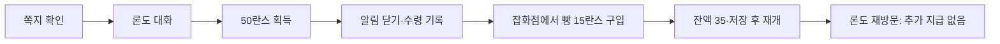
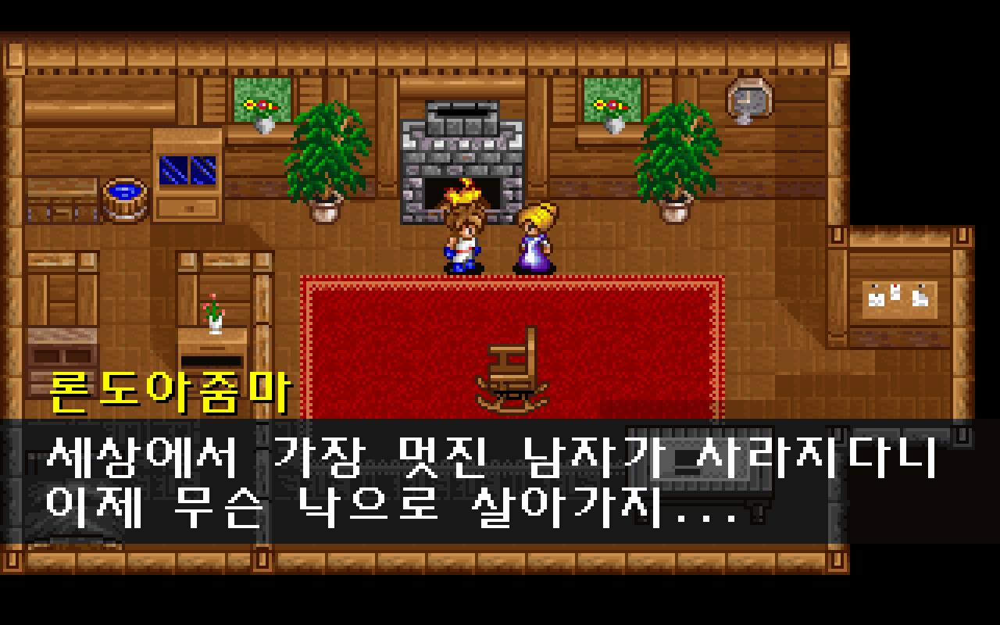
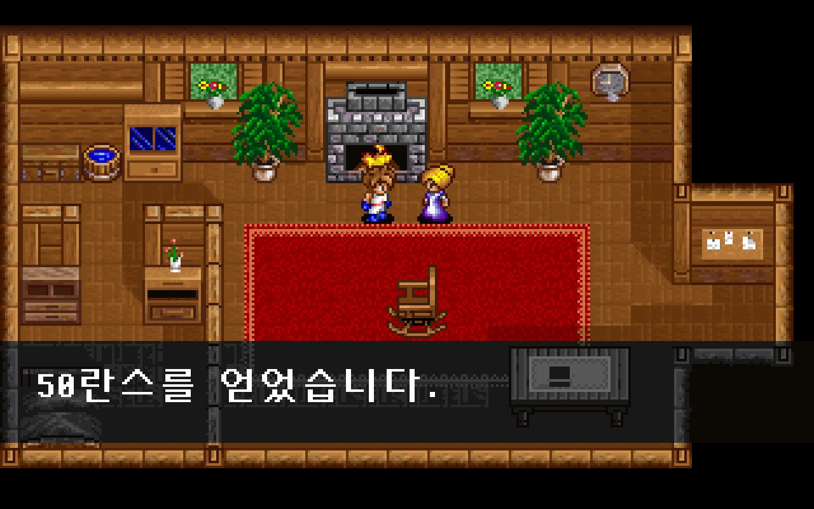

# 엘가임 실내 주민 대화와 첫 여비

엘가임 실내 주민 8명에게 원작의 진행 상태에 맞는 말을 들을 수 있다. 쪽지를 확인한 뒤 론도아줌마를 찾아가면 **50란스를 한 번 받아 잡화점에서 물건을 구입**할 수 있다. [이슈 #33](https://github.com/bnjjong/protocoss-remaster/issues/33)의 대화·보상 범위이며, [잡화점 거래](shop-trading.md)와 이어진다.

## 플레이 흐름

쪽지 확인 이후 론도의 집에 들어가 주인을 바라보고 Space·Enter·E로 말을 건다. 같은 키로 글자를 모두 표시하거나 다음 페이지로 넘기고, 획득 알림을 닫는다. 대화·알림 중에는 카만이 움직이거나 Esc 저장 메뉴를 열지 않는다. 대화를 마치면 기존 Esc 메뉴에서 저장할 수 있다.



| 주민 | 맵·이벤트 그룹·인자 | 분기 |
| --- | --- | --- |
| 뱅뱅이 | 6·9·1 | RPG의 보물상자·항아리 대화 |
| 죠엘 | 7·10·1 | 첫 인사 후 방문 기록 변경, 이후 인사 생략 |
| 죠엘부인 | 7·10·2 | 아버지를 걱정하는 대화 |
| 식모 | 8·5·2 | 축제 준비 대화 |
| 촌장부인 | 8·5·3 | 진행에 따라 엔키드 찾기·싸우지 말라는 말·신전 방문 권유 |
| 촌장 | 8·5·4 | 아버지 안부·행방 대화 |
| 론도아줌마 | 10·7·1 | 쪽지 전 안부, 이후 첫 여비, 수령 뒤 반복 인사 |
| 아들 | 11·8·1 | 부모의 축제 준비 대화 |

실내에서는 맵·이벤트 그룹·인자를 함께 확인한다. 마을 주민 대화 표를 실내 이벤트 번호에 그대로 적용하지 않는다. 책·가구·상자 등의 이벤트를 주민 대화로 열지도 않는다. 잡화점 주인은 기존 검 수리·회수·거래 흐름을 유지한다.

죠엘의 원작 이벤트에는 인사 이후 숙박 서비스 호출이 있다. 이번에는 **인사와 방문 기록까지만 연결**했다. 원작 상태 비교에서도 숙박 화면에서 취소한 경우처럼 서비스 호출을 반환한다. 숙박 UI·요금·회복, 상자·가구 조사, 전투·다음 지역은 이번 범위에 없다. 방문 기록이 있는 죠엘은 원작의 인사를 생략하므로 현재는 새 대화창이 열리지 않는다.

## 지급 조건과 저장

원작 `AREA00.G&M`의 그룹 7·인자 1을 실제 이벤트 함수 `0x25304`로 실행했다. 론도는 진행 변수 8이 3 이상이고 수령 변수 50이 0일 때 `0x12924(0,50,2)`로 돈을 준다. 알림을 마친 뒤 변수 50을 1로 기록한다. 이미 수령했으면 “50란스가 부족하니?”라는 인사만 한다. 쪽지 전에는 소지금과 수령 변수를 바꾸지 않는다.

소지금은 DOS 저장 오프셋 119의 부호 있는 int32다. `0x12A72`처럼 **32비트 덧셈을 먼저 한 뒤 999,999 상한을 적용**한다. 저장에 큰 양수가 있어 덧셈이 음수로 넘치는 원작 결과도 보존한다. 다른 소지품·장비·파티·위치 바이트는 보상으로 바꾸지 않는다.

돈은 획득 알림에 들어갈 때 한 번만 더하고, 알림을 기다리는 동안 다시 더하지 않는다. 수령 변수는 알림을 닫아 대화를 끝낼 때 기록한다. [원작 상태 기록](indoor-native.json)의 `reward_states`는 보상 함수 진입 때 **돈 0·수령 0**, 알림 진입 때 **돈 50·수령 0**, 이벤트 종료 때 **수령 1**인 순서를 보존한다. 대화 중 저장할 수 없으므로 이 중간 상태를 저장해 중복 수령하는 경로는 열지 않는다.

죠엘의 첫 인사는 원작처럼 변수 7을 2로 기록한다. 인사가 없는 반복 분기와 원래 마을·오두막 이동도 함께 검사한다. 2,944바이트 저장 형식을 확장하지 않는다.

| 론도의 대화 | 여비 획득 |
| --- | --- |
|  |  |

## 원작 비교와 실행 검사

- [상태 기록](indoor-native.json): 주민 8명 × 진행 값 0·1·2·3·4·5·65535 × 방문·수령 값 0·1·2·65535 = **224개 분기**. 대화 원문·보상 호출과 저장 전체 2,944바이트를 대조했다. 소지금의 음수·정상·상한·넘침 **9개 경계**도 별도로 비교했다.
- [화면 기록](indoor-render.json): 실제 앱의 대화·획득 알림 **63장·4,032,000픽셀**이 같은 타일·인물·스크롤 상태에서 원작 VGA 함수·조합 글꼴로 그린 화면과 일치한다. 화면 가장자리에서 일부가 잘린 주민도 원작 16픽셀 작업 여백 안에서 직접 그려 비교했다.
- 새 대화에 필요한 글자 **45개**를 기존 글꼴에 추가했다. 한글은 원작 조합 글꼴 함수와 대조하며 기존 시작 연출의 글자 배치를 바꾸지 않는다.
- `verifyIndoor`: 새 게임→검 수리·회수와 기존 장비·아이템·텐트·잡화점 검사에 이어 224개 대화를 실제 입력으로 실행한다. 첫 여비 수령→빵 구입→잔액 35→저장 재개→재방문 무지급, 대화 중 이동·메뉴 잠금, 죠엘 방문 기록과 반복을 확인한다.

Kotlin **93개**, Python **31개** 검사와 기존 전체 실행 검사를 통과했다.

정지 화면과 지정 상태·동작의 비교다. 획득 알림 퇴장 중간 프레임, DOS 부팅부터의 시계 위상·키 반복 속도까지 녹화 전체와 일치한다고 주장하지 않는다. 보상의 문구·대기 위치는 원작 형식 문자열과 그리기 좌표(x=14, y=144)를 따른다.

## 재현

일반 플레이에는 원본 폴더나 Python이 필요 없다. `./gradlew :desktop:run`으로 실행한다. 자동 검사는 패키지 자산·임시 저장 폴더와 시험 앱 음소거를 사용한다. 사용자 원본 게임과 저장은 수정하지 않는다.

```bash
./gradlew test :desktop:verifyIndoor :desktop:verifyBuildings \
  :desktop:verifyTownTravel :desktop:verifyNpcs :desktop:verifyFieldTravel \
  :desktop:verifyOpening :desktop:verifyPrologue :desktop:verifyTitleSave \
  :desktop:verifyFieldBounds
PYTHONPATH=tools/extractor python3 -m unittest discover -s tools/extractor/tests
```

원작 추출과 화면 대조에는 Pillow·Unicorn을 사용한다. 압축 해제한 EXE와 재배치한 메모리는 파일로 저장하지 않는다. 앱 실행 검사가 끝난 뒤 화면 비교를 실행한다.

```bash
python3 tools/extractor/indoor_dialogues.py --game-dir /path/to/Protocoss_Game
python3 tools/extractor/verify_npc_render.py --game-dir /path/to/Protocoss_Game \
  --folder desktop/build/reports/indoor --report-name indoor-render.json
```

빠른 대화 검사만 실행하려면 `./gradlew :desktop:verifyIndoor -PindoorOnly`를 사용한다. 기본 `verifyIndoor`는 기존 장비·아이템·텐트·잡화점 검사까지 포함한다.
