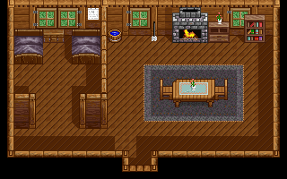
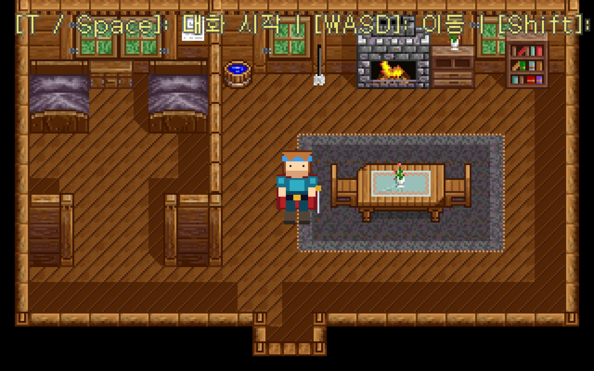

# 벨슨의 오두막 배경 복원

벨슨의 오두막은 **40×25셀, 셀당 8×8픽셀인 320×200 배경**이다. 원작의 타일 그리기 함수를 실행한 결과와 추출 이미지가 64,000픽셀 모두 일치한다. LibGDX의 실제 타일 렌더러가 그린 결과도 같은 이미지와 일치했다.



배경은 한 타일셋의 원본 번호를 그대로 참조한다. 마루·마당을 임의로 채우거나 여러 블록에서 섞어 가져올 필요가 없다.

## 실제 SOC 블록 구조

`AREA00.SDA`의 uint32 오프셋 목록으로 `AREA00.SOC` 블록을 찾는다. 블록 하나는 70,818바이트다.

| 블록 내 시작 위치 | 바이트 수 | 내용 |
| --- | ---: | --- |
| 0 | 2 | `01 01` |
| 2 | 768 | 256색 VGA 팔레트. 채널당 6비트 값을 4배로 변환 |
| 770 | 64,000 | **1,000개의 8×8 타일**, 타일당 64바이트 |
| 64,770 | 2,000 | uint16 참조 배열 1,000개. 원작은 일부 재그리기에 사용 |
| 66,770 | 2,000 | uint16 참조 배열 1,000개. 원작은 특정 영역의 타일 교체에 사용 |
| 68,770 | 2,048 | 별도 그래픽 버퍼. 이번 정적 배경 추출에는 사용하지 않음 |

기존의 `65,536바이트 = 256개 16×16 타일` 해석은 뒤의 참조 배열까지 그래픽으로 읽었다. `66,306..66,817`은 첫 참조 배열의 일부이며, 512바이트짜리 타일 번호 변환표가 아니다.

## 타일 주소 변환

VGA는 화면의 픽셀 열을 네 메모리 평면으로 나눠 쓴다. 각 타일은 평면별로 16바이트씩 저장한다. 평면 하나에는 행마다 두 픽셀이 있다.

타일 번호 `t`, 타일 안의 좌표 `x, y`가 각각 `0..7`일 때 팔레트 인덱스의 주소는 다음과 같다.

```text
블록 시작 + 770 + t × 64 + (x % 4) × 16 + y × 2 + x // 4
```

원작 코드의 근거는 다음과 같다. 주소는 압축 해제한 `PROTOCOS.EXE`의 LE 코드 객체를 기본 주소 `0x10000`에 놓았을 때의 값이다. LE는 원작이 사용하는 DOS 실행 파일 형식이다.

| 주소 | 확인한 동작 |
| --- | --- |
| `0x1E864..0x1E9AD` | SOC 로딩. 2바이트를 건너뛰고 팔레트 `0x300`, 그래픽 `0xFA00`, 참조 배열 `0x3E8×2` 두 개, 마지막 버퍼 `0x800`바이트를 차례로 읽음 |
| `0x1E1BC..0x1E329` | 맵 헤더 `0x30`바이트, 폭 `hdr[2]×40`, 높이 `hdr[3]×25`, 셀당 4바이트 로딩 |
| `0x1F08C..0x1F185` | 셀 값의 하위 12비트를 타일 번호로 사용. 화면 좌표는 셀마다 8픽셀 증가 |
| `0x2D19E..0x2D1E5` | 그래픽 버퍼에 `타일 번호 << 6`을 더하고, VGA 평면 네 개에 각 8행·2바이트 복사 |
| `0x2D1E6..0x2D240` | 별도 겹침 그리기에서는 팔레트 255를 투명 처리. 기본 배경 함수는 255도 그대로 복사 |

`AMOS.EXE`는 게임 로더다. 실제 맵 함수는 `PROTOCOS.FNT` 안의 압축된 `PROTOCOS.EXE`에 있다. 검증 도구는 AMOS의 압축 해제 코드를 실행해 메모리에서 게임 코드를 얻는다. 원본이나 압축 해제한 실행 파일을 저장소에 복사하지 않는다.

## 리마스터에 반영한 값

- JSON은 원작의 위→아래 행 순서와 8픽셀 타일 크기를 기록한다.
- 타일시트는 40열이다. 엔진의 빈 칸 0을 남기기 위해 **모든 원본 타일 번호에 1을 더해** 저장한다. 따라서 PNG 크기는 320×208이며 원본 0번과 999번도 보존된다.
- 첫 배경의 바닥 배열은 `layer1 = (tid & 0x0FFF) + 1`, `layer2 = 0`이다. 원작의 기본 배경 그리기처럼 모든 색을 불투명하게 보존한다.
- `TileMap.fromJson`의 행 뒤집기와 `TileMapRenderer`의 텍스처 폭에 따른 열 계산은 그대로 유효하다. 두 코드는 수정하지 않았다.
- 시작 위치는 실제 맵 픽셀 크기의 중앙 `(160, 100)`으로 계산한다. 카메라 추적·이동·대화·플레이어 이미지와 크기는 유지했다.

캐릭터·조작 안내가 합성된 데스크톱 실행 화면이다. 픽셀 일치 검증의 대상은 위의 **정적 배경**이며, 원작의 NPC·애니메이션·인물 가림 순서 전체를 검증한 것은 아니다.



## 재현 방법

저장소 루트에서 실행한다. `GAME_DIR`은 원본 게임이 있는 폴더로 바꿀 수 있다. Pillow는 이미지 추출에, Unicorn은 원작 CPU 명령 실행 검증에 사용한다.

```bash
python3 -m venv .venv
.venv/bin/pip install Pillow unicorn
GAME_DIR=/Users/df/Downloads/Protocoss/Protocoss_Game

.venv/bin/python tools/extractor/decode_map.py \
  --game-dir "$GAME_DIR" --preview docs/images/belson-cabin.png
.venv/bin/python -m unittest discover -s tools/extractor/tests -v
.venv/bin/python tools/extractor/verify_original_map.py \
  --game-dir "$GAME_DIR" --preview docs/images/belson-cabin.png
./gradlew test
./gradlew :desktop:run
```

검증 도구는 분석한 판본의 `AMOS.EXE`와 `PROTOCOS.FNT`에 대해 SHA-256을 확인한다. 다른 판본에서는 주소를 그대로 실행하지 않고 중단한다. 원작의 VGA 포트 쓰기와 화면 메모리 복사를 가상 메모리에서 재현하며, 비교 이미지가 한 픽셀이라도 다르면 실패한다.

이번 검증 결과:

- 변경 전·후 `./gradlew test`: 성공. 8픽셀 맵과 두 레이어의 Y좌표 변환 회귀 검사 추가.
- Python 추출기 검사 7개: 성공. 열·행 순서, 원본 0번과 999번, 255색 불투명성, 잘린 입력·잘못된 참조 거부를 검사.
- 원작 `0x2D19E` 함수 실행 결과와 PNG: **64,000픽셀 전체 일치**.
- 실제 `TileMapRenderer`로 320×200 프레임버퍼에 그린 결과와 PNG: **RGBA 바이트 차이 0개**. 검사 실행 때 임시 데스크톱 런처를 사용했으며 제품 코드에는 넣지 않음.
- `./gradlew :desktop:run`: 기동 확인 후 이번 작업에서 띄운 프로세스만 종료. 별도로 실행 중이던 기존 게임은 유지.

작업 기록은 [PR #5](https://github.com/bnjjong/protocoss-remaster/pull/5)에 이어 남긴다.
