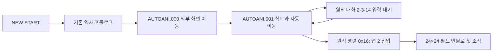
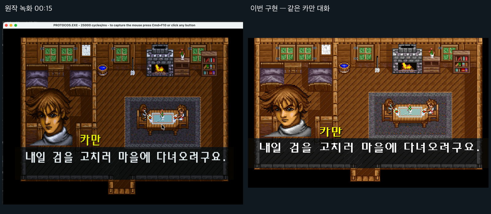
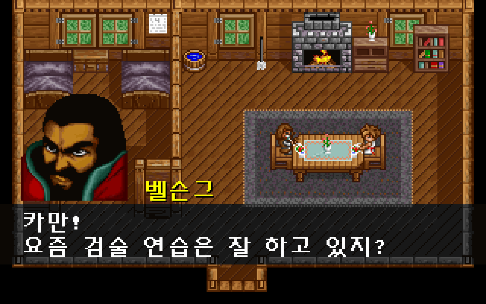
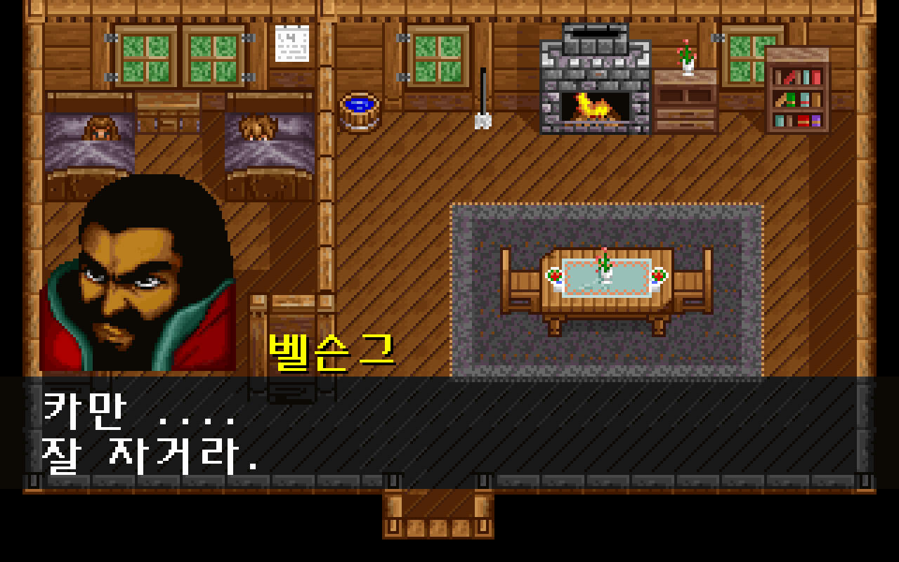

# 원작 오두막 시작 연출과 첫 조작 연결

NEW START의 역사 프롤로그 뒤에 **오두막 외부 화면 이동 → 실내 식탁 대화 → 인물 자동 이동과 반지 대화 → 침대의 마지막 대화 → 맵 2의 첫 조작**을 연결했다. [작업 항목 #9](https://github.com/bnjjong/protocoss-remaster/issues/9)의 첫 복원 범위다. 원작 영상에서 사람이 움직이는 부분을 전부 자유 이동으로 오인하지 않고, `AUTOANI.001`이 끝나는 시점을 조작 시작으로 삼는다.



영상이 끝나면 큰 검술 그림 한 장과 대사 순환 데모로 들어가던 동작을 바꿨다. 전투용 `USER.SPR` 추출 결과와 `kaman_test.png`는 변경하지 않았다. 필드에는 `PEOPLE.SPR`의 24×24 그림을 쓰며 방향·걷기 자세를 연결한다. T/Space로 대사 0~2를 돌리던 데모 호출과 상단 노란 안내는 제거했다.

## 실제 실행 화면과 원작 영상 비교

왼쪽은 사용자가 제공한 원작 녹화 00:15, 오른쪽은 이번 구현의 같은 대화다. 원작 녹화는 DOSBox의 화면 비율과 창 테두리를 포함한다. 이 비교는 장면과 인물 배치의 시각 확인이며 녹화 파일끼리의 픽셀 일치 판정은 아니다.



실제 macOS 그래픽 실행에서 캡처한 첫 대화와 침대 대화다.




## 원본에서 확인한 내용

`decode_opening.py`는 시작 연출 두 개, 호출되는 대화 세 개, 필요한 필드 인물 네 종류·48프레임, 초상화 두 개, 113종 글자를 추출한다. `HANGUL.FNT`의 조합 글꼴과 `ENGLISH.FNT`를 사용한다. 사용하지 않는 글자나 다른 장면의 이벤트까지 복원했다고 간주하지 않는다.

| 원작 함수 | 확인한 역할 |
| --- | --- |
| `0x10A54` | AUTOANI 파일 읽기와 S·L·M·G·C·F·E 명령 실행 |
| `0x10810` | 인물 이동. 방향은 1=위·2=오른쪽·4=아래·8=왼쪽 비트 조합 |
| `0x11328` | 자동 연출의 논리 모션 번호 변경 |
| `0x1186C`, `0x2D11A` | 필드 인물 24×24 그림과 VGA 평면 그리기 |
| `0x20CE8` | 인물의 아래 한 줄과 위쪽 영역을 서로 다른 플래그로 다시 그려 가구에 가림 |
| `0x14108` | 원작 조합형 한글 자모 합성 |
| `0x1F8B0` | 이름·초상화·두 줄 대화, /D에서 마지막 줄을 남기는 동작 |
| `0x25304` | AREA 이벤트 호출과 조건 분기 |

주소는 기존 분석과 같은 LE 코드 객체 기준이다. 실행 파일은 원본 폴더에서 읽고, 저장소에 복사하지 않는다. `opening.json`에는 사용한 원본 파일 해시를 기록한다.

SOC의 첫 2,000바이트 참조 배열은 겹침 그림 번호, 둘째 배열은 불꽃 등의 다음 타일 번호다. 마지막 2,048바이트는 **8×256 팔레트 색 번호 변환표**다. 대화창은 이 표의 4번으로 배경을 어둡게 비춘다. [맵 구조 설명](map-format.md)도 이 근거로 보완했다.

시작 음악 `S0002.MFA`와 맵 2 음악 `S0025.MFA`는 기존 프롤로그의 원작 FM 음악 실행 도구로 한 반복 구간을 합성했다. 각각 약 128.134초와 79.306초다. 시작 연출→맵 진입에서 음악을 교체하며, 새 게임·메인 복귀·종료 때 이전 음악을 해제한다. 앱을 잠시 벗어날 때 음악을 중지하고 복귀 때 재개한다.

저장 좌표는 인물 그림의 왼쪽 위 기준이다. 엔진의 중심 좌표와 12픽셀 차이를 변환해 읽고 저장한다. 연출 종료 때 원작 시작 분기의 이벤트 변수 0·2를 0으로 하고 마지막 호출 인자 14를 보존한다. 사용자 저장은 변환하거나 덮어쓰지 않는다.

## 검사와 판정 범위

- 수정 전 기준 `./gradlew test` 통과.
- Kotlin 단위 검사 36개: 세 대화 호출 시점의 **모든 인물 좌표·종류·자세를 원작 함수 실행 결과와 비교**, 대화 중 시간 경과로 진행되지 않음, /D의 마지막 줄 유지 확인.
- 추출 때 필드 인물 48프레임·27,648픽셀, 두 초상화, 사용되는 한글 글자의 비트맵을 원작 그리기·합성 함수와 비교한다.
- `:desktop:verifyOpening`: 원본 폴더 없이 패키지 자산만으로 새 게임·프롤로그 스킵·외부 연출·세 대화·자동 이동·암전·첫 조작을 실행한다. 대화 중 이동 차단, 음악의 일시 정지·재개와 메인 복귀 해제를 확인한다. 시험 저장은 임시 폴더에 두고 시험 앱의 음악만 음소거한다.
- 세 대화의 첫 페이지에서 원작의 인물·겹침 그리기 함수를 실행해 만든 기준 이미지와 실제 GPU 출력을 비교한다. **190,848픽셀 일치**. 타이머 위상이 다른 불꽃 24×16 영역만 제외하고, 인물·가구 가림·초상화·이름·대화창·글자는 포함한다.
- 기존 `:desktop:verifyPrologue` 27단계, `:desktop:verifyTitleSave` 63단계, `:desktop:verifyFieldBounds` 20개 시나리오 통과. 새 게임은 OPENING을 거치도록 검사 기준을 바꿨다. 메뉴·경계 검사는 시작 연출을 빠르게 진행하며, 시작 연출 자체는 별도 검사에서 확인한다.
- 기존 Python 추출기 검사 26개 통과. 원본 저장 네 개의 해시 보존 확인.

픽셀 비교는 특정 장면의 정지 상태를 확인한다. 게임 전체·모든 시간의 프레임이나 실제 DOSBox 녹화와 일치한다는 뜻이 아니다. 움직임은 원작 호출 시점의 상태와 실행 영상의 순서로 확인한다.

## 남은 범위

- 벽·가구 충돌과 문을 통한 맵 이동, 취침·아침 이후 이벤트 및 마을·상점 진행은 다음 단계다.
- 시작 연출에 필요한 명령과 대화만 연결했다. 전체 AREA 이벤트 실행기는 아니다. 다른 저장 지점의 NPC·파티 상태는 아직 재현하지 않는다.
- 초상화의 좌우 등장과 줄 스크롤의 세부 애니메이션, 말소리·F 효과음, 음악 음량 감소의 세부 타이밍은 아직 원작과 대조하지 않았다. 암전은 70Hz 기준으로 진행하지만 원작의 팔레트 감쇠를 모든 단계에서 픽셀 비교하지 않았다.
- 불꽃의 교체 타일은 원본을 사용하되 타이머 위상은 실제 DOS 실행과 동기화하지 않는다.

## 재현

```bash
python3 -m venv .venv
.venv/bin/pip install Pillow unicorn numpy soundfile
.venv/bin/python tools/extractor/decode_opening.py --game-dir /path/to/Protocoss_Game
.venv/bin/python tools/extractor/render_prologue_audio.py --game-dir /path/to/Protocoss_Game --track 2
.venv/bin/python tools/extractor/render_prologue_audio.py --game-dir /path/to/Protocoss_Game --track 25
./gradlew test :desktop:verifyOpening :desktop:verifyPrologue :desktop:verifyTitleSave :desktop:verifyFieldBounds
./gradlew :desktop:run
```

NEW START에서 역사 프롤로그를 넘기면 외부 연출이 시작된다. 첫 대화부터 Space/Enter로 진행한다. 게임 실행에는 원본 폴더·DOSBox·Python이 필요하지 않으며, 이번 추출 도구의 실행에만 원본을 사용한다. 다른 저장 지점의 배경 로딩에는 기존처럼 원본 MAP 파일이 필요하다.
