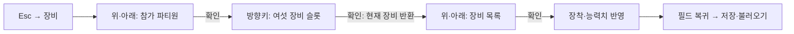
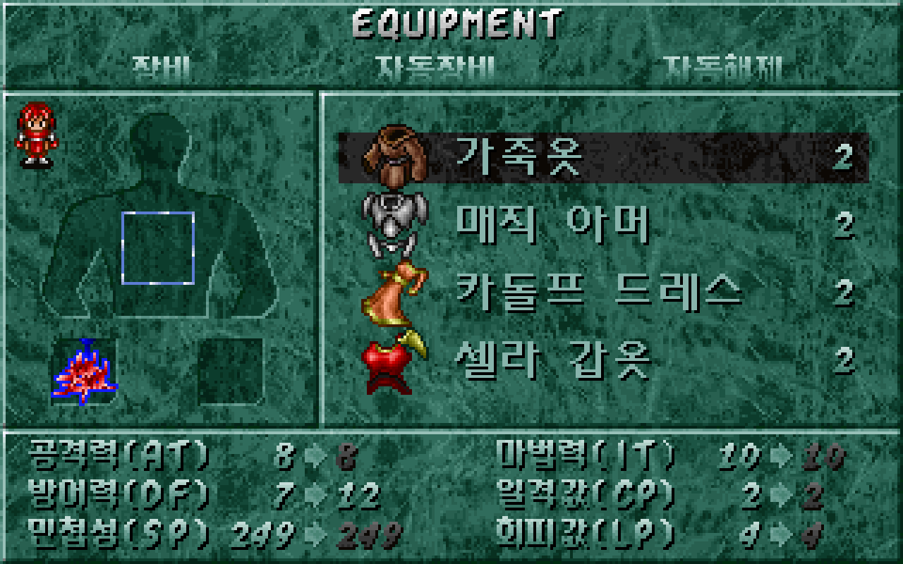
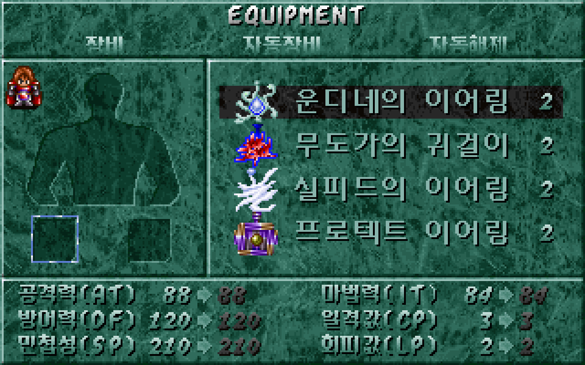
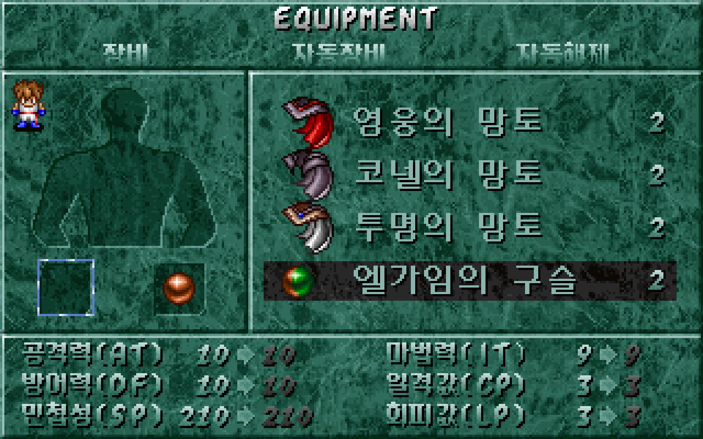
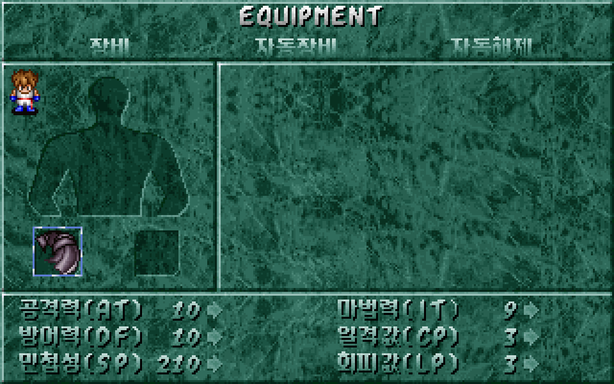

# 파티원별 방어구·장신구 장착

참가 중인 파티원을 고르고 투구·갑옷·무기·방패·두 장신구 슬롯을 수동으로 장착·교체·해제할 수 있다. [이슈 #23](https://github.com/bnjjong/protocoss-remaster/issues/23)에 따라 기존 카만 무기 메뉴를 확장했다. 능력치, 구슬 상태, 이동 속도와 저장 후 복원도 원작 함수에 대조했다.

## 조작

Esc 메뉴의 `장비`를 연다. 처음 화면에서는 위·아래로 현재 참가 중인 파티원을 순서대로 고른다. 비참가자는 건너뛰고 끝에서 처음으로 돌아간다. 확인 키는 Enter·Space다.



슬롯 선택은 투구에서 시작한다. 네 방향 이동은 원작 `0x16388`을 직접 실행해 얻은 24개 전환을 사용한다. 슬롯의 그림 위치를 기준으로 이동하며 단순히 번호를 더하는 방식이 아니다. 목록에서는 위·아래로 선택하고 네 줄을 넘으면 스크롤한다. Esc는 한 단계 돌아간다.

**목록을 여는 순간 해당 슬롯의 현재 장비를 먼저 소지품으로 돌려보낸다. 취소해도 해제 상태를 유지한다.** 이는 앞선 무기 복원과 같은 원작 규칙이다. 같은 장비를 유지하려면 목록에서 다시 선택한다. 다른 슬롯과 파티원은 바꾸지 않는다.

| 엔키드 갑옷 선택 | 다른 파티원 장신구 선택 |
| --- | --- |
|  |  |
| 구슬 제한 | 이동 속도 망토 |
|  |  |

## 원작 장착 조건과 특수 상태

`WEAPON.LST`의 175개 레코드에서 캐릭터 11명의 허용 값과 장비 종류를 읽는다. 소지 수량이 있는 장비만 목록에 넣는다. 투구·갑옷·방패는 해당 종류만, 무기는 한손·양손 무기, 두 장신구 슬롯은 원작이 허용한 장신구·구슬을 표시한다. 특정 장신구 6종을 목록에서 제외하는 원작 규칙도 보존한다.

| 원작 함수 | 확인한 내용 |
| --- | --- |
| `0x15298(slot, character)` | 캐릭터별·슬롯별 장착 가능한 소지품 목록 |
| `0x160D8(slot, partyIndex)` | 장비 반환·해제, 구슬 상태 해제, 취소 결과 |
| `0x15E88(character, slot, id)` | 장착·수량 차감, 양손 무기·방패와 구슬 판정 |
| `0x1A204(character)` | 선택한 파티원의 능력치 재계산 |
| `0x15808(character, slot, id)` | 슬롯별 능력치 미리보기 |

각 파티원은 153바이트 레코드를 사용한다. 장비 여섯 슬롯은 `473 + character × 153`부터, 구슬 상태는 `387 + character × 153`이다. 구슬 ID 163~174를 장착하면 상태를 1~12로 설정하며 해당 구슬을 해제하면 0으로 바꾼다. 능력치는 선택한 인물의 기존 장비·장신구까지 포함해 다시 계산한다.

방패를 장착한 동안 양손 무기를 장착할 수 없고, 양손 무기를 장착한 동안 방패도 장착할 수 없다. 거부하면 수량·슬롯·능력치는 변하지 않고 오류 효과음 13을 재생한다.

두 구슬의 판정에는 **원작의 비대칭**이 있다. 오른쪽 장신구에 구슬이 있으면 왼쪽에 구슬을 넣는 것은 거부한다. 반대 순서는 `0x15FB3`이 현재 오른쪽 슬롯의 상한을 확인하기 때문에 허용된다. 이 경우 두 구슬이 남고 상태는 마지막 구슬 값으로 바뀐다. 구슬 하나를 해제할 때는 다른 구슬이 있어도 상태를 0으로 만든다. 이 실제 결과를 원작 저장 비교와 앱 검사에 포함했다. 임의로 대칭 제한으로 바꾸지 않았다.

`코넬의 망토`(ID 157)는 어느 파티원이 장착해도 원작의 전역 보행 속도를 2로, 해제하면 1로 바꾼다. 원작 `0x2238A`는 70Hz 한 번에 이 값만큼 위치를 옮긴다. 리마스터에서도 기본 보행을 한 번에 2픽셀·1픽셀로 전환한다. 기존 Shift 달리기는 유지한다.

이 속도는 원작 저장 함수가 이벤트 변수 297(저장 오프셋 2936)에 옮기는 값이다. 메뉴에서 바뀐 속도를 맵 전환 중에도 유지하고, 저장할 때 기록하며, 불러올 때 복구한다. 구슬 상태·소지 수량·파티·능력치도 같은 DOS 저장 형식에 남긴다.

## 검사와 비교 근거

[원작 실행 기록](party-equipment-native.json)은 캐릭터 11명 × 슬롯 6개의 **목록 66개**, 장착 **1,201개**, 해제·교체 **20개**, 제한·허용 **13개**를 보존한다. 마지막 13개는 거부 10개와 비대칭 구슬 허용 3개다. 장착 검사는 해당 캐릭터의 원작 목록에 실제로 나타나는 장비를 사용한다.

원작 저장 읽기 함수로 입력을 배치하고, 장착·해제·능력치 기계어를 실행한다. 전체 저장 2,944바이트의 변화를 바이트별로 모아 입력과 변경 목록으로 보관했다. Kotlin 검사에서는 전체 출력을 재구성해 비교한다. 다른 파티원·장비·소지품·진행·좌표가 함께 보존되는지도 확인한다. 미리보기 여섯 값과 전역 보행 속도도 비교한다. 원작 화면·음악 출력과 키 대기는 이 상태 검사에서 대신 처리한다.

인물 11명의 메뉴 그림을 추가한 자산 **310,185픽셀**을 원작 스프라이트 함수와 대조했다. 사용 글자 299개를 추출하고 한글 조합을 원작 글꼴 함수로 확인했다.

[화면 비교 기록](party-equipment-render.json)은 **30장·1,920,000픽셀**이다. 앞선 검 회수·무기·소지품 화면과 인물 11명의 서로 다른 슬롯, 구슬 장착·거부·해제·비대칭 허용, 망토 장착·해제를 포함한다. 같은 저장·선택 상태에서 원작 메뉴 함수의 그리기 명령을 수집하고 원작 스프라이트 출력·글꼴로 조합한 화면과 비교했다. 이 중 장비 소지품 조회 2장은 이전 단계에서 추가한 배치이므로 원작 전체 메뉴 실행 결과와 구분한다.

Kotlin **78개**, Python **31개** 검사를 통과했다. 실제 앱의 `verifyPartyEquipment`는 NEW START부터 검 회수까지 468걸음을 포함한다. 이후 저장 표본으로 참가 인물 11명과 여섯 슬롯, 카만이 없는 파티, 저장·재로딩, 구슬 판정, 망토 장착 전후의 한 틱 이동 거리와 속도 저장을 확인한다. 후반 인물·장비는 저장 표본 검사이며 해당 지역의 스토리·전투를 플레이했다는 뜻은 아니다.

기존 건물 왕복·마을·주민·오두막·오프닝·프롤로그·저장·필드 경계 실행 검사도 모두 통과했다. 사용자 원본 게임·DOS 저장은 읽기만 하고 시험 저장은 임시 폴더에서 정리한다. 시험 앱의 음악·효과음만 음소거한다.

## 범위와 재현

자동 장비·자동 해제, 아이템 사용·버리기, 거래·전투 효과·다음 지역은 제외한다. 자동 탭으로 이동하지 않으며, 메뉴 그림에 들어 있는 문구만 남는다. 메뉴 진입은 현재 앱의 Esc 메뉴를 유지한다. 마우스, 키 반복 속도, 커서 전체 애니메이션·팔레트 전환, DOSBox 전체 녹화의 시점까지 복원한 것은 아니다.

```bash
./gradlew test :desktop:verifyPartyEquipment :desktop:verifyBuildings \
  :desktop:verifyTownTravel :desktop:verifyNpcs :desktop:verifyFieldTravel \
  :desktop:verifyOpening :desktop:verifyPrologue :desktop:verifyTitleSave \
  :desktop:verifyFieldBounds
python3 -m unittest discover -s tools/extractor/tests
```

원작 비교에는 Pillow·Unicorn이 설치된 Python을 사용한다.

```bash
python3 tools/extractor/decode_equipment.py --game-dir /path/to/Protocoss_Game
python3 tools/extractor/party_equipment.py --game-dir /path/to/Protocoss_Game
./gradlew :desktop:verifyPartyEquipment
python3 tools/extractor/verify_equipment_render.py --game-dir /path/to/Protocoss_Game \
  --report-name party-equipment-render.json
```

일반 실행은 `./gradlew :desktop:run`이다. 비교 화면과 상태는 `desktop/build/reports/equipment`에 생성한다. [카만 무기 메뉴 1차 복원 기록](equipment.md)도 보존한다.
