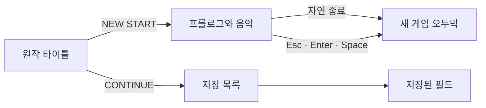
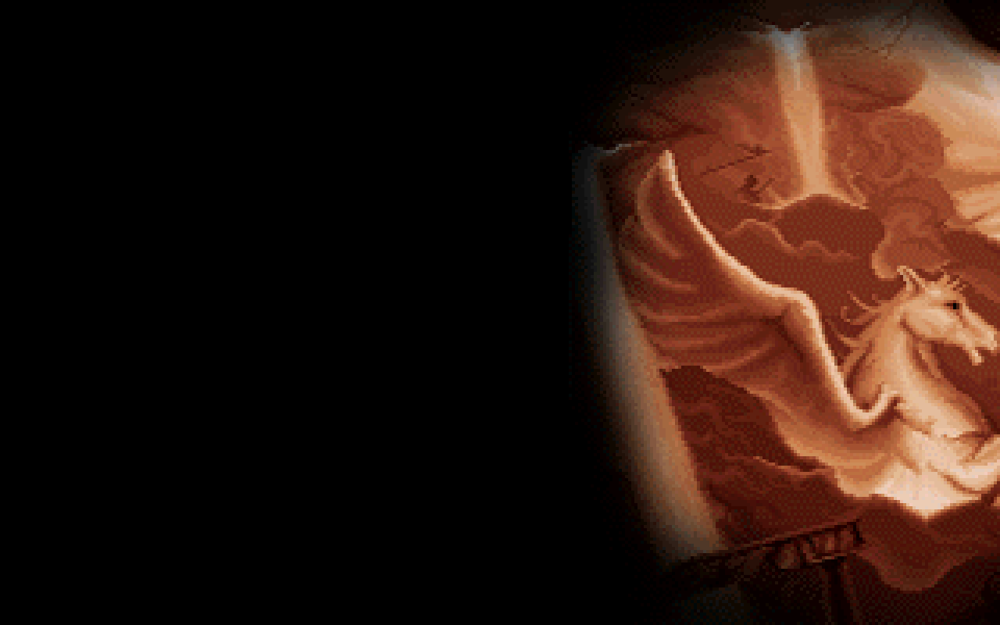
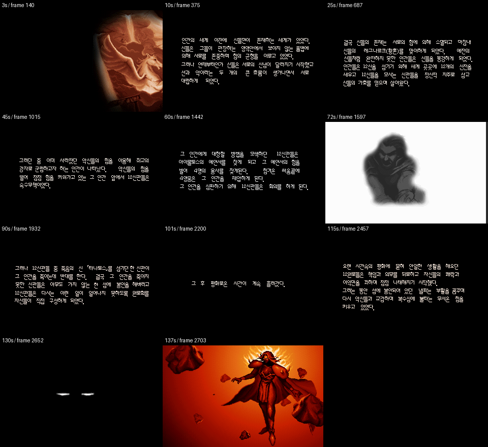
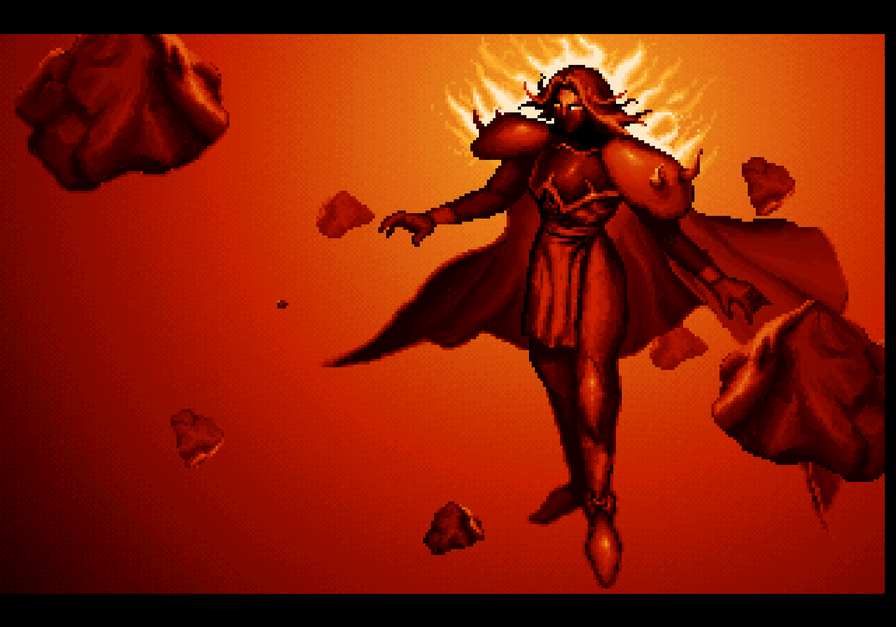

# 새 게임 프롤로그 복원

타이틀에서 `NEW START`를 선택하면 프롤로그와 음악을 재생하고, 끝나면 오두막에서 새 게임을 시작한다. 원작 메인 프로그램의 새 게임 분기가 별도 프롤로그 프로그램을 실행하는 순서를 따른다. `CONTINUE`는 프롤로그를 거치지 않고 저장된 필드로 들어간다.

Esc·Enter·Space로 건너뛸 수 있다. 재생 중에는 필드 이동과 대화를 처리하지 않으며, 건너뛰기 입력도 필드에 전달하지 않는다. 앱의 일시 정지·재개에 영상과 음악을 함께 맞춘다. 종료·건너뛰기·앱 종료 시 음악과 영상 자원을 해제한다.





## 복원한 장면

`PROLOGUE.EXE`의 진입 함수 `0x116D8`은 초기화 뒤 아래 장면 함수를 차례대로 호출한다. 원작 코드를 실행하며 화면 메모리와 팔레트를 기록했다. 기존 VIS 추출기의 잘못된 PNG를 이어 붙이지 않았다.

| 원작 함수 | 입력 데이터 | 내용 |
| --- | --- | --- |
| `0x10560` | `PRO0.DAT`, `TXT.VIS` | 처음 그림과 신들의 역사 설명, 가로 화면 이동 |
| `0x1098C` | `PRO1.VIS` | 인물 그림과 설명, 밝아짐·암전 |
| `0x10D3C` | `PRO2.VIS` | 타나토스에 관한 설명과 장면 변화 |
| `0x10F94` | `PRO3.VIS` | 시간이 흐른 뒤의 설명 |
| `0x110F4` | `PRO4.VIS` | 무인의 칼 그림과 설명 |
| `0x112D4` | `PRO5.VIS` | 과거의 약속에 관한 설명 |
| `0x11434` | `PRO6.VIS` | 어둠 속 눈과 마지막 붉은 인물 |
| `0x1030C` | 음악 음량 조절 | 음악이 잦아들며 종료 |

화면 이동·자막·팔레트 변화·장면 대기를 포함해 **2,769개의 화면 상태, 139.299초**를 기록했다. 음악은 원작 `S&W/S0000.MFA`를 사용한다. `OPEN.VIS`는 이 프롤로그의 장면 목록에 들어 있지 않다.



## 원작 실행과 검증 근거

[기록 도구](../tools/extractor/record_original_prologue.py)는 분석한 `PROLOGUE.EXE`의 SHA-256이 맞을 때만 실행한다. 실행 파일의 두 메모리 객체를 올리고 LE 재배치 1,137개를 적용한다. 원본 EXE를 수정하거나 복사해 저장하지 않는다.

DOS의 파일 읽기·메모리 확보·시간 대기와 VGA 장치를 제공하고, 그림 해석과 장면 진행은 원작 명령을 실행한다. VGA는 당시 DOS 화면 장치이며, 이 게임은 픽셀 열을 네 메모리 평면으로 나눈다. 평면별 쓰기 선택, 읽기 래치, 화면 시작 주소, 가로 미세 이동, 6비트 RGB 팔레트 변경을 반영해 320×200 화면을 얻는다.

시간은 명목 화면 갱신 70Hz와 BIOS 대기 한 단위 `65536/1193182`초를 사용한다. CPU 명령별 실행 시간이나 실제 CRT의 주사 시점까지 재현하는 에뮬레이터는 아니다. 따라서 화면 픽셀·장면 순서와 이 시간 모델로 확인한 재생 시간을 구분한다.

기존 `decode_vis.py`는 VIS의 물리 저장 순서와 실제 재생 순서, 이전 그림을 유지하는 차이 프레임을 잘못 다룬다. 이번 프롤로그는 원작의 VIS 함수 `0x12318`, `0x124BC` 등을 실행해 이 문제를 피했다. 다른 컷씬 PNG의 복원 완료를 뜻하지 않는다.

[manifest.json](../assets/prologue/manifest.json)에 원본 파일 해시, 장면 시작 시각, 기록 파일 해시와 기준 장면을 남겼다. [frame-hashes.json](../assets/prologue/frame-hashes.json)은 모든 화면의 팔레트·색 번호 전체 해시다. Kotlin 디코더의 전체 출력이 이 기록과 같은지 검사한다.

## 음악 복원

[음원 도구](../tools/extractor/render_prologue_audio.py)는 같은 원작 실행 파일의 MFA 음악 루틴을 실행한다. 악기·음표·템포·반복과 마지막 음량 감소를 원작 코드로 처리한다. 타이머 이벤트 1,405회에서 OPL 레지스터 쓰기 12,481개를 얻었다. OPL은 당시 FM 음원 칩에 음색과 음표를 전달하는 장치다.

등록된 값을 [Nuked-OPL3](https://github.com/nukeykt/Nuked-OPL3)의 고정 커밋 `765ec962e473aeb767e4cba74ffdc8f588ffbfe8`으로 합성해 44.1kHz·2채널 PCM을 만들고 Ogg Vorbis로 저장했다. 원작의 FM 재생 방식으로 합성한 것이며, 실제 사운드 카드의 아날로그 출력 녹음은 아니다. 재생 샘플 수·PCM 해시·파형 크기·파일 해시는 [audio.json](../assets/prologue/audio.json)에 기록했다.

Nuked-OPL3 소스와 [LGPL 라이선스](../tools/extractor/vendor/nuked-opl3/LICENSE)는 추출 도구 아래에 보관한다. 게임 실행 모듈에 이 라이브러리를 링크하지 않으며, 게임은 생성한 Ogg를 스트리밍 재생한다.

## 실행 형식과 메모리 사용

기본 LibGDX 실행 환경에 영상 재생 기능이 없어, 원작 256색 화면을 순서대로 읽는 작은 재생기를 추가했다. 실행할 때 원본 게임 폴더나 DOSBox는 필요하지 않다.

`prologue.pvid`는 GZIP으로 압축한 스트림이다. 헤더와 숫자는 빅 엔디언이다.

| 구간 | 형식 |
| --- | --- |
| 헤더 | `PV01` 4바이트, 폭·높이 uint16, 화면 수 uint32 |
| 각 화면 | 대기 시간 float64, 이전 화면과 XOR한 64,768바이트 |
| 복원한 화면 | VGA 팔레트 768바이트 + 색 번호 64,000바이트 |

게임은 현재 색 번호와 차이 데이터, 업로드용 Pixmap·Texture만 유지하며 전체 프롤로그를 메모리에 펼치지 않는다. 큰 시간 간격이 들어오면 필요한 화면을 순서대로 읽은 뒤 마지막 화면만 GPU에 올린다. 창 크기 변경에도 기존 320×200 비율을 유지한다.



## 재현 명령

```bash
./gradlew :desktop:run
./gradlew test
./gradlew :desktop:verifyPrologue :desktop:verifyTitleSave :desktop:verifyFieldBounds
./gradlew :desktop:verifyPrologueRealtime
```

자동 검사는 해당 검사 앱의 음악 음량만 0으로 설정한다. 재생 상태·재생 위치·일시 정지·종료는 실제 음악 장치로 검사하고, 시스템 음량과 다른 앱의 소리는 바꾸지 않는다. 실제 게임 실행은 음악을 재생한다.

추출을 다시 할 때는 Python과 C 컴파일러 clang을 사용한다.

```bash
python3 -m venv .venv
.venv/bin/pip install Pillow unicorn numpy soundfile
.venv/bin/python tools/extractor/record_original_prologue.py \
  --game-dir /path/to/Protocoss_Game
.venv/bin/python tools/extractor/render_prologue_audio.py \
  --game-dir /path/to/Protocoss_Game
```

화면 기록 도구는 영상·해시·장면 모음과 기준 PNG를 생성하고, 음원 도구는 음악과 분석 정보를 생성한다. 원본 파일은 읽기만 한다. 컴파일한 음원 합성 라이브러리는 Git에서 제외된 `tools/extractor/build/`에 둔다.

## 확인 결과

- Kotlin 검사 33개 통과. 전체 2,769개 화면의 원작 기록 해시, 색 번호·RGBA 변환, 화면 대기와 마지막 종료, 큰 시간 간격, 잘린 파일을 검사했다.
- 실제 macOS 그래픽 실행에서 자연 종료·Esc/Space/Enter 건너뛰기·반복 시작·일시 정지·음악 재개·창 크기 변경 27개 단계 통과.
- 기준 장면 11개와 크기 변경 후 1개 화면에서 **768,000픽셀**을 비교해 차이 0개. 문자·캐릭터 영역을 빼지 않고 영상 전체를 비교했다.
- 기존 메뉴·저장 검사 63개 단계와 필드 경계 20개 시나리오도 통과. 불러오기에서 프롤로그가 시작되지 않는 것을 확인했다.
- 무음으로 139.299초 전체를 실제 시간대로 재생해 자연 종료를 확인했다. 이 실행에서 영상과 음악의 최대 시간 차는 약 0.077초였다. 테스트 결과는 `desktop/build/reports/prologue/`에 저장한다.

다른 컷씬, 필드 NPC·이벤트·전투는 이번 변경 범위에 포함하지 않았다. F11 전체화면 전환 자체도 자동 시나리오에는 넣지 않았다.
