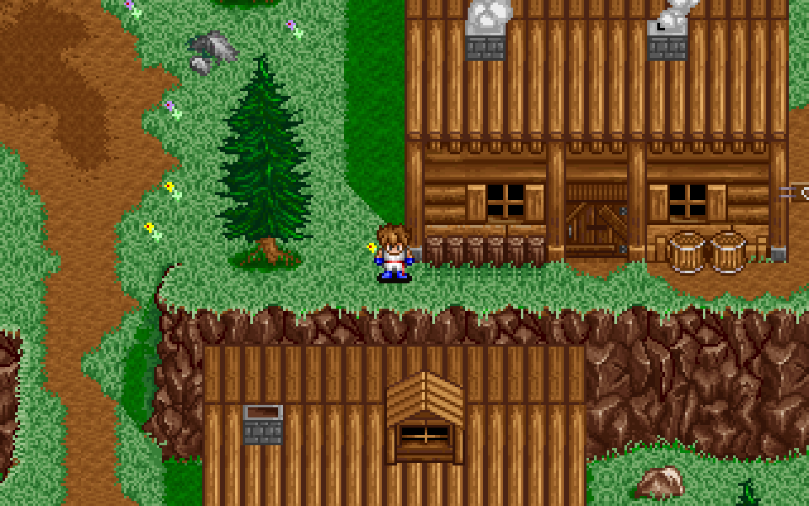
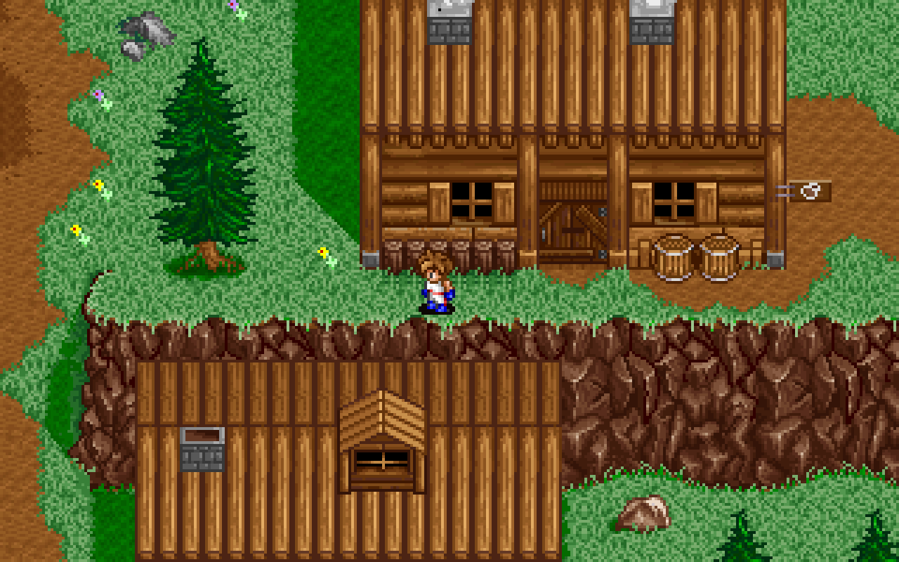
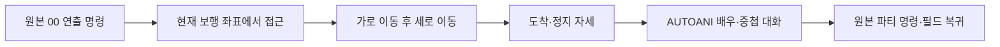

# 연출 시작 위치까지 접근 보행

엔키드 합류 연출에 들어가기 전에 카만이 현재 위치에서 시작 위치까지 걷는다. 도착한 뒤 기존 AUTOANI.005의 배우·대화·합류 명령을 실행한다. [전체 복원 이슈 #39](https://github.com/bnjjong/protocoss-remaster/issues/39)의 공통 이벤트 복원 단계이며, 플레이 범위는 기존 AREA00 맵 0~12다. 첫 전투와 새 지역은 아직 연결하지 않았다.

| 접근 시작 | 가로 이동 뒤 세로 접근 |
| --- | --- |
|  |  |

## 원작에서 확인한 규칙

원작 `0x10A54`는 mode=0일 때 AUTOANI의 첫 `S` 배우 위치와 헤더 스크롤을 `0x11B20`에 전달한다. 접근 속도는 첫 `L`의 속도다. 합류의 속도는 1이며, 달리기 키나 코넬의 망토 속도를 사용하지 않는다.

`0x11B20`은 8픽셀 경계마다 가로를 먼저 비교하고, 가로가 맞으면 세로를 비교한다. `0x23154`의 지형·주민 충돌과 높이 층, `0x1F350`의 자세, `0x21A7C`·`0x22300`·`0x26674`의 화면 안 이동·스크롤을 적용한다. 각 틱은 70Hz다. 도착한 뒤 방향을 0으로 지우고 정지 자세로 한 틱을 그린다. 길 찾기로 장애물을 우회하거나 도착 위치로 순간 이동하지 않는다.

주민 갱신 `0x23DA4`는 화면 안 보행 뒤, 스크롤 보행 전에 실행한다. 원작 그리기 `0x243F0`는 전체 인물을 정렬한 뒤 주민의 화면 좌표가 `-16 < x < 312`, `-16 < y < 192`인 경우만 그린다. 접근 화면에도 같은 순서와 범위를 적용했다.



## 게임 연결과 검증

접근 중에는 이동·달리기·대화·메뉴 입력을 받지 않는다. 기존 주민과 그리기 자원을 유지하며, 음악은 접근 전에 연출 음악으로 바뀐다. 오래된 세션 저장 좌표 대신 실제 보행 좌표에서 출발한다. 도착 좌표·높이·자세를 이벤트 저장에 반영한 뒤 중첩 대화를 시작한다. 접근 중 별도 저장은 열리지 않으며, 합류 후 저장·불러오기를 확인했다.

- [원작 실행 기록](animation-approach-native.json): 55개 표본·6,898틱의 위치·자세·높이·방향·스크롤·주민 상태. 네 속도, 네 방향, 가로→세로 전환, 16개 도착 자세, 화면 안 보행·중심 진입, 막힌 위치를 포함한다. 48개는 도착했고, 7개는 원작처럼 제한한 관찰 시간 동안 막혀 있었다.
- 같은 기록의 `stories`: 접근 함수를 생략하지 않고 원작 이벤트→접근→005→중첩 대화→합류까지 실행한 23개 최종 저장. 이 전체 이벤트 비교에서는 화면·오디오 입출력과 주민 시계를 생략했다. 주민 이동·충돌·시계는 위 틱별 비교에서 실제 원작 함수로 따로 검사한다.
- 같은 기록의 `visibility`: 원작 그리기 루프를 실행한 화면 가장자리 81개 표본.
- 실제 그래픽 출력은 [접근 화면 10장](animation-approach-render.json)·[기존 합류/쪽지·검 수리·오두막 조사 49장](animation-approach-regression-render.json), 합계 59장·3,776,000픽셀이 원작 그리기 함수와 일치했다. 접근 시작·가로 보행·방향 전환·도착 자세와 주민의 가장자리 생략을 포함한다. 화면 비교는 선택한 8픽셀 경계의 표본이며, 모든 중간 프레임의 픽셀·오디오 타이밍 일치를 뜻하지 않는다.
- `./gradlew test :desktop:verifyEventStory`: Kotlin 123개, 실제 앱 접근 23개 출발 상태·135틱·전체 저장 일치, 입력 잠금·기존 주민/자원 유지·저장 재개. 기존 스토리 36개 상태·연출 6회와 새 게임→검 회수 연속 진행도 검사한다.
- `./gradlew :desktop:verifyCabinInteraction`: 오두막 조사 30개 대화·두 맵·세 조작 키·벽난로 반응과 초반 연속 진행 통과.
- Python 추출기 33개 검사 통과. 비교 도구는 EXE·폰트의 지원 판본 해시를 확인하고 압축 해제한 EXE와 메모리를 파일로 남기지 않는다. 원본·사용자 저장도 수정하지 않는다.

원작 기록 재생성에는 Pillow·Unicorn이 필요하다.

```bash
python3 tools/extractor/verify_animation_approach.py --game-dir /path/to/Protocoss_Game
./gradlew test :desktop:verifyEventStory
python3 tools/extractor/verify_npc_render.py --game-dir /path/to/Protocoss_Game \
  --folder desktop/build/reports/animation-approach \
  --report-name restoration/animation-approach-render.json
```

## 남은 범위

현재 게임 연결은 005 합류의 수평·수직 접근이다. 경사에서 방향이 대각선으로 바뀌는 접근은 거부하며, 다른 AUTOANI를 지원한 것으로 계산하지 않는다. 일반 필드는 기존 부드러운 카메라 추적을 유지하고, 접근 시작에 원작의 중심·지도 경계 기준 스크롤로 정렬한다. 일반 필드 카메라와 그리기의 전체 원작 일치는 별도 점검 대상이다.

다음은 기상·벽난로 연출을 공통 이벤트에 연결하고, 조우 영상 명령과 시설 명령을 이어서 복원한다. 현재 기상·조우·벽난로는 기존 전용 경로를 사용한다.
