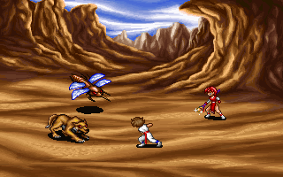
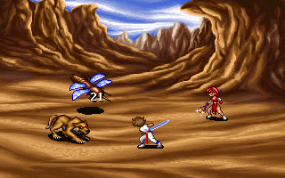

# 첫 기본 공격의 대상·피해·연출

카만·엔키드의 초기 단일 대상 공격을 원작 함수와 대조했다. 대상 선택, 명중·치명타·속성·방어력 계산, 준비 동작·피격 효과·숫자·처치 상태를 복원했다. [파티·행동 게이지·명령 분기](battle-start.md)에 이은 [전체 복원 이슈 #39](https://github.com/bnjjong/protocoss-remaster/issues/39)의 다음 단계다. **일반 플레이의 전투 연결은 아직 없다.** 적의 행동·동시 진행·승패/보상·필드 복귀가 남아 있다.

| 준비 동작 | 명중 효과 | 피해 숫자 |
| --- | --- | --- |
|  |  |  |

위 그림은 원작의 프레임·그리기 위치와 그림/색 변환 출력을 조합한 **공격 시각 요소의 비교 기준**이다. 전체 상태창·원작 전투 화면·실제 시간/음악을 재현했다는 뜻은 아니다.

## 대상 선택

`0x5AA86`이 무기를 확인하고 단일 대상 선택 `0x5A3F7`로 들어간다. 대상 목록은 상태 0·5를 뺀 원래 적 슬롯 순서다. 시작 대상은 `0x5A30A`가 고르는 가장 오른쪽 적이며, 같은 X에서는 앞 슬롯을 유지한다. 위/왼쪽은 이전, 오른쪽/아래는 다음 대상으로 순환한다. Enter·Space로 확정하고 Esc로 취소한다. 명령창에서 Enter/Space를 무시하는 규칙과 구분한다.

선택 표시는 적 좌표와 `MON_PARA.LST` 끝의 두 int16 보정치를 더한 위치다. 선택창을 열기만 하거나 취소하면 피해·공격 난수를 소비하지 않는다. 확인 뒤에는 빗나가도 행동을 완료하며, 상위 명령창의 완료 처리에서 게이지를 소모한다.

## 명중과 피해

난수 함수 `0x5E7B3`는 추첨할 때마다 BIOS 시계 하위 바이트와 32비트 호출 횟수를 더해 `srand`를 호출한다. `rand`는 `(seed × 0x41C64E6D + 0x3039)`의 32비트 결과를 16비트 오른쪽으로 옮긴 뒤 `0x7FFF` 마스크를 적용한다. 범위가 1보다 작으면 0을 반환하고 호출 횟수도 늘리지 않는다. `DosBattleRandom`은 시계 바이트 공급 함수를 받아 같은 계산과 횟수 순환을 한다.

`0x587C2`의 순서는 다음과 같다. 아직 이름을 확정하지 않은 필드는 게임 내 능력 이름으로 추측하지 않는다.

1. 참가자의 `+0x9389` 값을 최대 10으로 제한한다. 이 수정은 빗나가도 남는다.
2. 기본값은 `+0x9375` 수치의 두 배다. 전투 보정 `+0x1C`가 있으면 별도 수치 `+0x9381`와 보정을 더한다.
3. 적 `+0x7C` 값이 0~9 추첨보다 크면 피해 0으로 끝난다.
4. 다음 추첨보다 참가자 보정 값이 크면 두 배로 만들고, 그 외에는 보정 전 기본값을 10으로 나눈 몫에 보정 값을 곱해 더한다.
5. 두 무기의 속성 보정을 순서대로 적용한다. 적의 해당 응답이 1이면 두 배, 2이면 정수 나눗셈으로 1/5이다.
6. 적 `+0x6F` 방어값보다 작으면 피해 0이다. 그 외에는 방어값을 빼고 남은 체력으로 제한한 뒤 체력을 감소시킨다.

정수 나눗셈·비교 순서를 유지하며 최소 피해 1 같은 새 규칙을 넣지 않는다. 첫 기본 공격의 추가 주문 없는 무기도 원작의 발동 확률 추첨은 소비한다. 마지막 적을 처치하면 이 추첨을 건너뛰는 분기도 보존한다.

## 준비·명중·피격·복귀

`0x58F8E`는 참가자를 공격 위치로 옮기고 `LEV_PARA.LST`의 공격 정의와 `USER.ANI`의 그림 묶음을 사용한다. 준비 동작이 끝난 뒤 피해를 계산한다. `EFFECT.ANI`의 명중 또는 빗나감 연출, 원작 흔들림 표, 숫자 이동 표를 이어서 사용한다. `0x2E1FE`는 체력이 0인 일반 적을 색 변환으로 표시한 뒤 상태 0으로 바꾼다. 상위 함수는 참가자의 위치와 자세를 복구한다.

연속 공격에서는 적의 남은 체력·처치 슬롯·난수 호출 횟수를 이어받는다. 직전 공격 준비 동작의 마지막 프레임도 다음 공격의 첫 표시로 남는다. `previousWindupFrame`으로 이 상태를 넘기며, 새 공격 때마다 체력이나 프레임을 초기화하지 않는다. 네 번의 연속 공격도 원작과 비교했다.

`BasicAttack.next`는 원작 화면 콜백에 시계 한 틱을 공급한 비교 기준의 시각 상태를 하나씩 반환한다. 실제 초 단위 속도와 `BattleClock`·적 행동의 동시 갱신은 호출자 연결이 남아 있다. 소리 번호는 기록하지만 이번 변경에서 오디오를 재생하지 않는다. 원작 파일과 사용자 저장을 바꾸지 않으며, 결과는 전투 내 체력·상태·보정 값으로 반환한다.

현재 전체 공격 흐름의 지원 범위는 카만·엔키드의 공격 단계 1, 초기 단일 대상 공격과 추가 주문 없는 무기다. 초기 단검·맨손을 비교했다. 다른 인물/단계·다중 대상·보호막/반사/부활·추가 주문과 장비 효과는 미연결이다. 지원하지 않는 인자 조합은 난수나 주어진 체력을 바꾸기 전에 거부한다. 순수 피해 함수의 보정/속성 경계 검증과 전체 공격 흐름의 지원 범위를 구분한다.

## 검증

- [원작 기록](battle-attack-native.json): 난수 1,029개(시계 바이트 0~255·호출 횟수 순환·범위 경계), 피해 384개, 대상 선택 96개 조합이 Kotlin과 일치했다.
- 실제 공격 11개·496개 콜백 시점에서 위치·자세·프레임·적 체력·그리기 명령·최종 체력/상태·보정 값·난수 횟수가 일치했다. 빗나감·일반 명중·치명타·처치와 네 번 연속 공격을 포함한다.
- 공격 시각 요소 485개·31,040,000픽셀의 실제 GPU(그래픽 장치) 출력이 비교 기준과 일치했다. 대상 선택의 11개 콜백은 이 화면 합성 비교에서 제외하고 위치/키 분기 검사로 확인했다.
- 그림은 원작 VGA 함수 `0x2D11A`, 단색 피격은 `0x2CE74`, 처치 색 변환은 `0x2CF03`과 대조했다. 문자 모양은 기존 원작 폰트 추출 함수를 사용하고 새 공격 함수의 문자 위치·색·문자열을 비교했다. 기존 USER.SPR 자산·디코더는 수정하지 않았다.
- 원작 EXE·재배치 메모리는 RAM에만 둔다. 하위 화면/음향 I/O·전체 상태창 그리기를 생략하고 BIOS 하위 시계 바이트를 고정했다. 매 콜백에는 실제 `0x6155D`를 한 번 호출한다. 이 조건과 전체 게임의 실시간 동작은 다르다.
- Kotlin 150개·Python 36개 검사와 기존 파티/적 편성·재합류·출발 영상·북마겔/마을 왕복·저장 재개 검사를 통과했다. 새 자산·원작 기록 32파일은 격리한 폴더에서 재생성해 바이트 일치를 확인했다.

```bash
python3 tools/extractor/battle_attack.py --game-dir /path/to/Protocoss_Game
./gradlew test :desktop:verifyBattleAttack
python3 -m unittest discover -s tools/extractor/tests
```

다음은 적의 기본 공격·피격 결과를 연결하는 것이다. 이후 나머지 명령·승패/보상·실제 시간/음악·필드 복귀를 연결해야 첫 전투를 실제 플레이할 수 있다.
