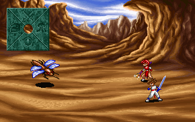
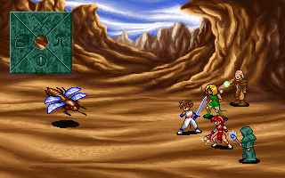

# 첫 전투 파티·행동 게이지·명령 분기

전투 파티의 참가 순서·시작 자세·배치, 행동 게이지와 준비된 인물 선택, 방향키 명령의 중단/복귀를 원작 코드와 맞췄다. [전투 위치·적 편성](first-battle.md)에 이은 [전체 복원 이슈 #39](https://github.com/bnjjong/protocoss-remaster/issues/39)의 다음 단계다. **일반 플레이에는 아직 전투를 연결하지 않았다.** 하위 명령의 실제 화면·공격/기술·피해·승패·필드 복귀가 남아 있다.

| 카만·엔키드 배치와 명령 안내 | 다섯 참가자 배치 |
| --- | --- |
|  |  |

이 그림은 원작 배경·적·파티·명령 안내 레이어의 검증용 합성이다. 상태창·숫자·기술 목록·전환/공격 효과를 포함한 전체 전투 화면은 아니다. 일반 실행에 임시 전투 키나 종료할 수 없는 전투 화면을 추가하지 않았다.

## 파티 초기화와 그리기

원작 `0x5F12F`는 저장 레코드의 참가 바이트를 인물 번호 0~10 순서로 확인하고 처음 다섯 명을 사용한다. 참가자가 없으면 초기화 실패다. `0x5F5A8`은 `USER.ANI`의 행동 레코드를, `0x5F6B7`은 `USER.SPR`을 읽는다. 저장의 153바이트 인물 레코드도 전투 상태에 그대로 복사한다. `BattleParty`는 원본 저장을 바꾸지 않는다.

| 상태 값 | 시작 행동 번호 | 시작 게이지 |
| --- | --- | --- |
| 1·4 | 0 | 14 |
| 2 | 2 | 14 |
| 3 | 1 | 14 |
| 5 | 10 | 1 |

`0x602FA`는 참가 인원별 기준 좌표에서 기본 행동의 첫 그림 크기를 빼고 인물을 배치한다. 상태 5에는 인물별 좌표 보정도 적용한다. 구슬 상태 1~12에 따른 명령 아이콘 번호·효과 번호와 네 개의 시작 수치도 보존한다. 이 번호들을 아직 확인하지 않은 기술 효과로 해석하지 않는다. 참가 상태 0은 원작이 초기화하지 않는 레코드를 만들므로 모델은 거부한다.

그림 순서는 `0x601DA`의 기준 좌표 Y 순서다. 실제 그림의 왼쪽 위 Y나 사망 자세의 보정 Y로 다시 정렬하지 않는다. `USER.ANI`의 첫 프레임 묶음에 여러 그림이 있으면 각 그림의 좌표 보정도 적용한다. `0x64B69→0x63AF4`의 순서·프레임·좌표와 대조했다. 기존 캐릭터 PNG·디코더는 바꾸지 않았다.

여기서 검증한 시작 상태는 로더가 파티를 배치한 직후다. 전체 진입 연출이 끝날 때까지 흐른 실제 시간과 모든 변화까지 검증한 것은 아니다.

## 행동 게이지와 대기열

`BattleClock.tick` 한 번은 원작 타이머 인터럽트에서 호출하는 `0x6155D` 한 번이다. 누적 시간은 항상 증가하고, 전투 시계 허용 플래그가 켜져 있으면 모든 참가자와 적의 개별 대기 시간도 증가한다. 실제 초 단위 재생 간격은 아직 연결하지 않았다.

- 적 선택 `0x647DE`는 상태 0·2·5와 속도 값 0을 건너뛴다. 정수 계산으로 대기 기준을 정하고, 준비 게이지가 28에 도달한 첫 적을 반환한다. 이 호출에서 뒤쪽 적은 아직 검사하지 않는다.
- 파티 선택 `0x6450C`는 여섯 칸 대기열을 먼저 검사한 뒤 전체 인물을 찾는다. 기준 계산에는 원작처럼 32비트 실수 반올림과 엄격한 `>` 비교를 사용한다. 상태 0·2·5는 전체 검색에서 제외한다. 0 체력/마력 상한과 0 속도, 큰 속도 값의 경계도 비교했다.
- 명령을 고르는 동안 호출되는 `0x642EB`는 준비된 다른 파티원을 대기열에 넣는다. 충전 중인 인물은 대기 시간을 소모해도 게이지를 올리지 않는다. 마지막 대기 항목을 읽을 때 전체 검색으로 돌아가는 원작의 분기도 보존했다.
- 기준 계산에 쓰는 인원 수는 파티와 적의 상태별 집계가 서로 다르다. 대기 기준 상수 표를 추측한 새 공식으로 대체하지 않는다.

적은 명령 선택 중에도 준비될 수 있다. 모델의 `nextEnemy`·`nextParty`는 행동 요청의 대상만 반환한다. `finishEnemy`·`finishParty`는 행동 본체가 끝난 뒤 호출자가 복구하는 게이지 0을 나타내며, 피해나 보상을 대신 계산하지 않는다.

## 명령 선택

`BattleCommandMenu`는 선택된 파티원을 유지하며 원작 `0x5F0BD→0x5EF04`처럼 방향키로 하위 명령을 즉시 요청한다. 위·오른쪽·아래·왼쪽은 각각 원작 `0x5AA86·0x551EE·0x559F8·0x5839D`에 대응한다. 이번 단계는 그 분기와 반환 대기까지이며 하위 명령 본체는 아직 연결하지 않았다.

Enter·Space는 이 화면의 명령 확정 키가 아니다. Esc도 창을 닫지 않으며 원작은 소리 5와 안내 효과 `(27,14)`를 요청한다. 하위 명령의 반환값이 0이면 명령창으로 돌아가고, 0이 아니면 호출자가 게이지를 0·선택 인물을 `0xFFFF`·명령 모드를 0으로 복구한다. 새 명령을 대기 중인 요청 위에 덮어쓰거나 이미 닫힌 명령창을 다시 완료하는 호출은 거부한다.

## 검증과 재현

- [원작 기록](battle-start-native.json): 파티 93개 조합의 참가자·전체 인물 레코드·자세·좌표·상태 아이콘·그림 순서가 일치했다. 11명·다섯 자리 제한·상태 1~5·구슬 0~12를 포함한다.
- 원작 시계·선택 3,120개 시점에서 시간·개별 대기 시간·게이지·체력/마력 표시 수치·대기열·선택 결과가 일치했다. 정지·행동 불가·0 상한·0/큰 속도·충전 중·대기열 경로를 포함한다.
- 명령 44개 조합에서 두 파티원의 방향키·무입력 대기·Enter/Space·Esc·여러 입력·하위 명령 취소/완료의 호출 순서와 게이지/선택/모드가 일치했다. 하위 메뉴와 피해 계산은 반환값을 공급했으며 실행하지 않았다.
- 원작 VGA 그리기 함수로 파티/안내 합성 12장·768,000픽셀을 대조하고, `:desktop:verifyBattleStart`에서 실제 GPU(그래픽 장치) 출력도 같은 기준 그림과 비교했다. 기존 적 편성 4장·256,000픽셀 비교도 유지했다.
- Kotlin 144개·Python 36개 검사와 기존 재합류·출발 영상·북마겔/마을 왕복·저장 재개 검사를 통과했다. 새 자산/원작 기록 15파일은 격리한 폴더에서 재생성해 바이트 일치를 확인했다.

```bash
python3 tools/extractor/battle_start.py --game-dir /path/to/Protocoss_Game
./gradlew test :desktop:verifyBattleStart :desktop:verifyBattleEntry
python3 -m unittest discover -s tools/extractor/tests
```

원작 검증은 EXE·재배치 메모리를 RAM에만 두며 원본과 사용자 저장은 쓰지 않는다. 파일·할당·스택 검사·memcpy, 화면·음향·입력 대기는 분석 도구에서 공급하거나 생략한다. 타이머는 수동 틱이다. 전체 게임의 동시 실행과 실제 시간·음악·전투 종료는 아직 검증하지 않았다.

다음은 위쪽 공격 명령의 대상 선택·행동 연출·피해 계산을 원작과 대조하는 것이다. 나머지 하위 명령과 상태창·실제 시계·전투 진입/종료도 연결해야 첫 전투를 플레이할 수 있다.
