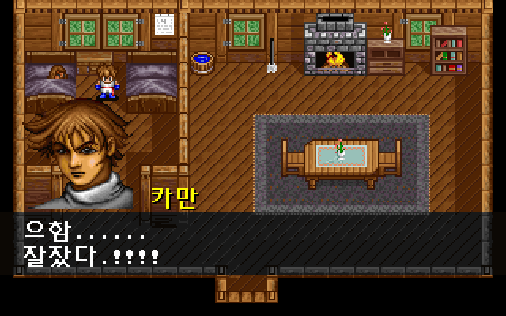
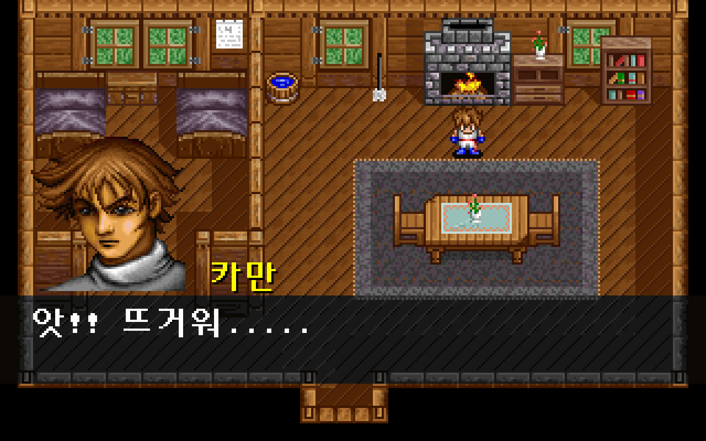
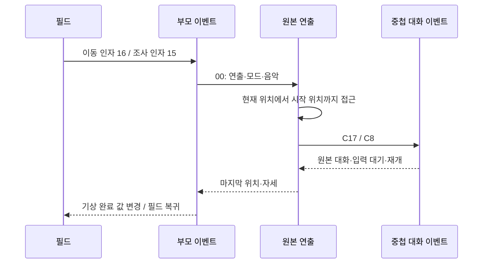

# 기상·벽난로 연출의 원본 이벤트 연결

기상과 벽난로 반응을 원본 이벤트의 접근 보행→AUTOANI→중첩 대화→상태 변경으로 실행한다. 게임이 최종 위치·맵·진행 값을 미리 만들던 전용 처리를 제거했다. [전체 복원 이슈 #39](https://github.com/bnjjong/protocoss-remaster/issues/39)의 공통 이벤트 복원 단계다. 플레이 범위는 기존 AREA00 맵 0~12이며, 첫 전투·새 지역은 아직 연결하지 않았다.

| 기상 대화 | 벽난로 반응 |
| --- | --- |
|  |  |

## 원작에서 확인한 실행 순서

| 진입 | 원본 명령 | 연출의 중첩 호출 | 종료 뒤 처리 |
| --- | --- | --- | --- |
| 그룹 0·인자 16 | 변수 6이 0일 때 `00 / 3 / 0 / 25` | AUTOANI.003의 C17에서 원본 기상 대화 실행 | 연출이 끝난 뒤 부모 이벤트가 변수 6을 1로 변경 |
| 그룹 0·인자 15 | `00 / 2 / 0 / 25` | AUTOANI.002의 C8에서 원본 벽난로 대화 실행 | 변수 6·8 유지, 원작 마지막 배우 위치·자세로 필드 복귀 |

명령·모드·음악 번호는 원본 uint16 인자다. 두 연출 모두 mode=0이며 현재 맵을 유지한다. AUTOANI 헤더의 맵 번호가 1이어도 호출 당시 맵이 2이면 맵 2에서 계속 실행한다. 기존 기상 처리의 강제 맵 1 전환과 화면 페이드를 제거했다. 기상 후 위치는 월드 (56,40), 자세 10이다. 벽난로 반응 후 위치는 (200,48), 자세 8이다.



접근은 [검증한 원작 보행](animation-approach.md)을 사용한다. 기상은 월드 (80,40)에서 (56,40)까지 걷는 25틱, 벽난로 표본은 시작 위치에서 정지하는 1틱이다. 실제 조사 입력은 기존처럼 Space·Enter·E를 지원한다. 접근 중 이동·대화·메뉴 입력은 잠그고, 연출 대화는 원본 G&M 바이트를 해석한다. 기상 값이 이미 0이 아니면 원본 분기에 따라 다시 기상하지 않는다.

## 검증과 재현

- [원작 기록](cabin-story-native.json): 맵 1·2, 인자 15·16, 기상 값 0·1·2·65535, 검 수리 진행 0·2·4의 48개 조합. 원작 `0x25304`→`0x10A54`→`0x11B20`→중첩 `0x25304`를 실제 실행했다. 30회 연출·174개 접근 틱, 중첩 대화·중간/최종 저장 전체를 Kotlin과 비교한다.
- `./gradlew test`: Kotlin 125개 통과. 기상 값의 변경 시점·현재 맵 유지·입력 저장의 불변성도 확인한다.
- `./gradlew :desktop:verifyCabinStory`: 실제 앱 48개 조합의 전체 저장 일치, 접근 174틱의 위치·자세·스크롤 일치, 대화·기상 완료 시점·음악 번호·페이드 없음·그리기 자원 유지·저장 재개·반복 기상 방지 통과.
- `./gradlew :desktop:verifyCabinInteraction`: 두 맵의 일반 조사 30개 대화와 Space·Enter·E의 실제 벽난로 조사, 잘못된 방향·거리 거부·이동 잠금·저장 재개 통과.
- `./gradlew :desktop:verifyTownTravel`: 조우 영상·마을 4/12 진입·복귀·저장 재개와 443,392픽셀 비교 통과.
- `./gradlew :desktop:verifyEventStory`: 기존 합류·쪽지 36개 상태·6회 연출, 합류 접근 23개 상태·135틱과 저장 재개 통과. 모든 실제 앱 검사에는 새 게임→검 회수의 468걸음 연속 진행도 포함한다.
- [기상·벽난로 화면 비교](cabin-story-render.json): 실제 GPU 화면 46장·2,944,000픽셀이 원작 그리기 함수와 일치했다. 접근·기상 자세·화상 반응·물러나는 보행·대화를 포함한다.
- [기존 화면 비교](cabin-story-regression-render.json): 합류 접근·합류/쪽지·검 수리·일반 조사 59장·3,776,000픽셀 일치. 새 표본과 합계 105장·6,720,000픽셀이다.
- Python 추출기 33개·변경한 Python 도구 문법 검사·`git diff --check` 통과. 원작 기록·연출 대응 자산·시작 연출 JSON을 재생성해 바이트가 같은 것도 확인했다.

전체 이벤트의 원작 상태 비교는 화면·오디오 입출력과 NPC 시계를 생략한다. 실제 접근·연출 해석·배우 이동/자세·중첩 이벤트·저장 메모리는 실행한다. 맵 2의 고정형 NPC 한 명은 충돌 판정에 포함하며, 별도 접근 틱 비교에서는 원작 주민 시계도 실행해 정지 상태가 유지되는지 확인했다. 화면은 위 별도 픽셀 비교에서 확인한다. 모든 중간 프레임의 표시 시간·오디오 파형까지 일치한다고 계산하지 않는다.

일반 실행과 Kotlin/실제 앱 검사는 원본 폴더가 필요 없다. 원작 기록 재생성에는 Pillow·Unicorn이 필요하다.

```bash
python3 tools/extractor/verify_cabin_story.py --game-dir /path/to/Protocoss_Game
./gradlew test :desktop:verifyCabinStory :desktop:verifyCabinInteraction :desktop:verifyTownTravel
python3 tools/extractor/verify_npc_render.py --game-dir /path/to/Protocoss_Game \
  --folder desktop/build/reports/cabin-story --report-name restoration/cabin-story-render.json
python3 -m unittest discover -s tools/extractor/tests
```

원본 EXE·폰트의 지원 판본 해시를 확인하고 압축 해제한 EXE와 메모리는 RAM에만 둔다. 원본·사용자 저장은 수정하지 않는다. 시작 연출 전체를 다시 추출해도 기상 연출의 mode=0 표시 값이 유지되도록 `decode_opening.py`를 함께 수정했다. 연출 대응 자산 재생성도 002·003·005·006을 모두 보존한다.

기존 합류/쪽지 원작 기록 36개와 파티 기록 110개도 분리한 임시 폴더에서 다시 생성해 기존 JSON과 바이트가 같은지 확인했다. 같은 실행에서 생성한 네 연출 대응 자산도 현재 패키지와 바이트가 같다.

## 남은 범위

다음은 조우 영상 명령을 원본 이벤트 실행기에 연결하고 시설 명령을 이어서 복원하는 작업이다. 현재 조우는 기존 전용 경로를 사용한다. 공통 연출의 경사 접근·일반 필드 카메라/그리기 전체 원작 대조·나머지 연출과 전투 연결은 남아 있다.

후속 [조우 영상 연결](encounter-event.md)에서 004와 원본 1A 영상 명령을 공통 실행기에 추가했다. 위 비교 기록과 지원 범위는 기상·벽난로 단계를 마쳤을 당시의 근거다.
