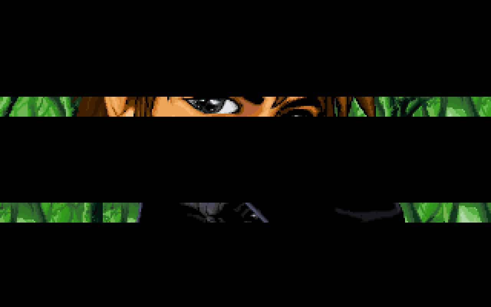
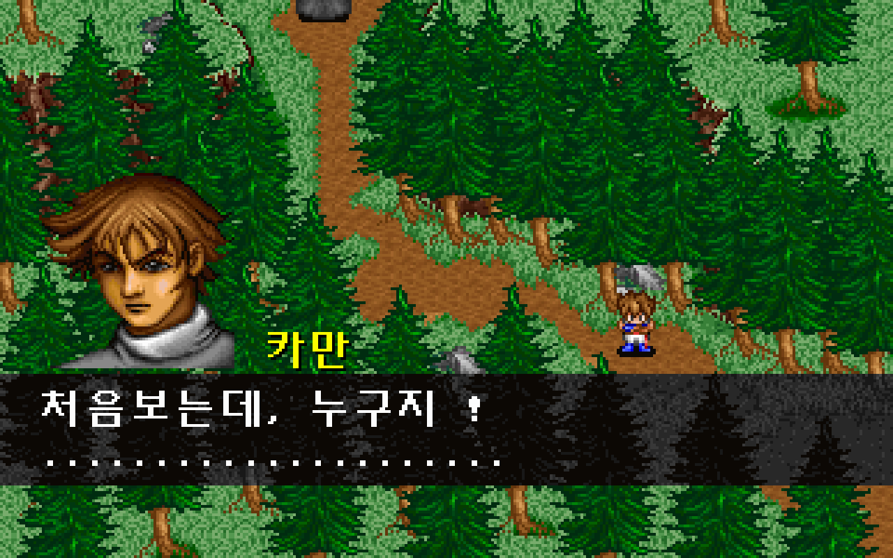
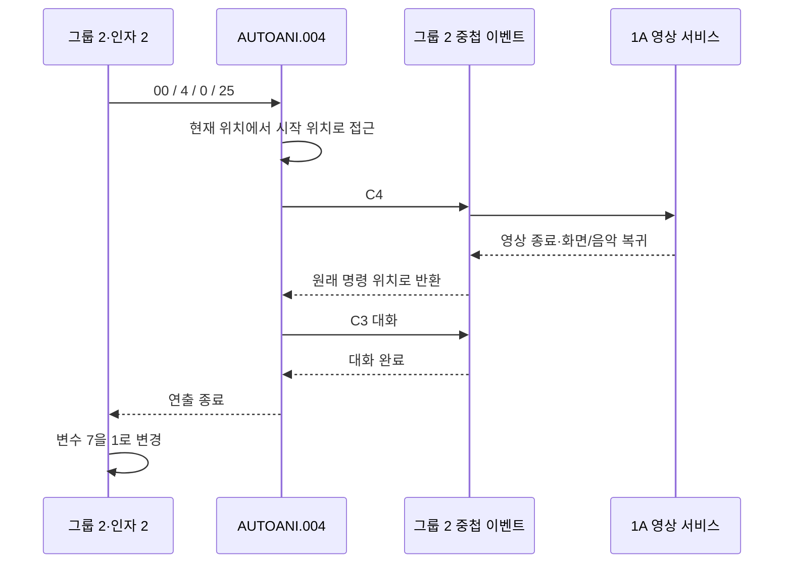

# 조우 영상의 원본 이벤트 명령 연결

검은 망토 조우를 원본 이벤트의 접근→AUTOANI.004→영상 명령 1A→중첩 대화→진행 값 변경으로 실행한다. 임시 영상 명령 `V`와 최종 저장을 미리 만들던 게임 전용 경로를 제거했다. [전체 복원 이슈 #39](https://github.com/bnjjong/protocoss-remaster/issues/39)의 공통 이벤트 복원 단계다. 플레이 범위는 기존 AREA00 맵 0~12이며 첫 전투·새 지역은 아직 연결하지 않았다.

| 영상 | 영상 뒤 원본 대화 |
| --- | --- |
|  |  |

## 원작 명령과 복귀

1A의 원작 해석 함수 `0x261F4`는 NUL로 끝나는 파일명 뒤의 uint16 세 개를 읽어 `0x134B8`에 전달한다. 세 값은 변수 참조가 아닌 부호 없는 리터럴이다. 조우에서는 `#0.vis / 3 / 27 / 1`이다.

| 인자 | 원작에서 확인한 용도 |
| --- | --- |
| `#0.vis` | GRP의 영상 파일 |
| 3 | 프레임마다 기다리는 BIOS 시계 틱 수. 1틱은 65536/1193182초 |
| 27 | 영상 중 재생할 음악 |
| 1 | 영상 뒤 필드 화면과 원래 음악으로 복귀 |

원작은 영상 중에도 저장 변수 4를 원래 음악 번호 25로 유지한다. 영상 음악 27을 임시로 재생한 뒤 그 변수의 음악 25를 다시 읽어 복귀한다. `0x134B8`의 실제 음악 파일 선택 결과는 `s0027.MFA`→`s0025.MFA`이며, 재생 전후 저장 메모리는 같다.



AUTOANI.004도 mode=0으로 현재 맵·그리기 자원을 유지한다. 임시로 `V`로 바꿨던 오프셋 164를 원본 C4로 복원했다. 영상 중에는 부모 연출·중첩 이벤트·이동·메뉴 입력이 진행되지 않는다. 화면·음악 복귀가 끝나야 1A를 완료하고 다음 원본 명령으로 간다. 조우 완료 값은 전체 연출 뒤 부모 이벤트가 변경한다.

음악은 필드 감쇠→영상 음악→영상 끝 감쇠→원래 음악의 음량 복귀 순서로 처리한다. 실제 재생은 겹치지 않으며 기존 음량을 보존한다. 영상 프레임 간격과 마지막 65단계 팔레트 감쇠는 기존 검증 자산을 사용한다.

## 지원 범위와 검증

파일명과 세 리터럴의 해석은 공통 실행기에 추가했다. 게임 연결은 [videos.json](../../assets/data/events/videos.json)의 `#0.vis / 3 / 27 / 1`, 지역 0·복귀 음악 25 조합이다. 다른 파일·간격·음악·복귀 모드는 사전 검사에서 거부한다. 영상은 현재 연출의 중첩 이벤트 안에서만 연결하며, 필드 최상위 영상 호출은 지원하지 않는다. 미지원 요청을 조용히 건너뛰지 않는다.

- [원작 상태 기록](encounter-event-native.json): 출발 Y=32/40/48, 조우 값 0/1/2/65535, 검 수리 진행 0/2/4의 36개 조합. 실제 VM·접근·AUTOANI·중첩 이벤트·영상 함수의 분기/음악 선택·복귀·저장 메모리를 실행했다. 9회 연출, 81개 접근 틱과 중간·최종 저장을 Kotlin/실제 앱과 비교했다.
- 같은 기록의 파서 4개 표본: 원본 `0x261F4`의 파일명·세 리터럴·다음 주소를 비교한다. 빈 이름·한글 이름·상위 비트가 켜진 값도 원본 바이트로 보존한다. 대기 중 재호출·한 번의 완료 처리·반복 완료 거부·미지원 조합의 상태 불변성도 검사한다.
- `./gradlew test`: Kotlin 128개 통과.
- `:desktop:verifyEncounterEvent`: 실제 앱 36개 상태·9회 영상·81개 접근 틱·225개 영상 프레임 상태 해시 일치. 입력/연출 잠금·진행 값 변경 시점·임시 음악·음량 감쇠/복귀·일시정지/재개 때 음악 겹침 없음·저장 재개·반복 조우 방지 통과.
- `:desktop:verifyTownTravel`: 실제 조우 진입·25프레임 영상·마을 4/12 왕복·저장과 443,392픽셀 비교 통과.
- `:desktop:verifyCabinStory`, `:desktop:verifyEventStory`: 기존 기상·벽난로 48개 상태·30회 연출, 합류/쪽지 36개 상태·6회 연출, 합류 접근 23개 상태·135틱과 저장 재개 통과. 실제 앱 검사마다 새 게임→검 회수 468걸음도 진행했다.
- [영상 전후 필드](encounter-event-render.json) 6장·384,000픽셀과 [영상 표본](encounter-event-video-render.json) 9장·576,000픽셀이 원작 출력과 일치했다. 영상 표본은 세 출발 위치에서 프레임 0/12/24를 비교한 것이다.
- [기존 화면 비교](encounter-event-regression-render.json) 71장·4,544,000픽셀도 일치했다. 기상·벽난로·합류 접근·합류/쪽지·검 수리 화면이며, 새 표본과 합계 86장·5,504,000픽셀이다.
- Python 추출기 33개·문법 검사·`git diff --check` 통과. 원작 기록과 연출 대응/시작 연출 자산을 재생성해 바이트가 같은지 확인했다. 기존 VIS 추출기도 원작 디코더의 25프레임·1,600,000픽셀과 비교하고, 현재 영상 자산·기준 이미지·명세가 재생성 결과와 같은지 확인했다.

원작 전체 이벤트 비교에서는 영상 디코딩·화면/오디오 출력·IRQ 시간 대기와 NPC 시계를 생략한다. 영상 함수의 실제 분기·프레임 반복 수·음악 선택·원래 화면/음악 복귀 경로·저장 상태는 실행한다. 영상 디코딩·프레임 상태·선택한 GPU 화면은 위 별도 비교로 확인한다. 모든 전환 프레임의 표시 시간과 원작 오디오 파형 일치까지 검증한 것은 아니다.

일반 실행과 Kotlin/실제 앱 검사에는 원본 폴더가 필요 없다. 원작 기록 재생성에는 Pillow·Unicorn이 필요하다. 압축 해제한 EXE와 메모리는 RAM에만 두며 원본·사용자 저장을 수정하지 않는다.

```bash
python3 tools/extractor/verify_encounter_event.py --game-dir /path/to/Protocoss_Game
./gradlew test :desktop:verifyEncounterEvent :desktop:verifyTownTravel \
  :desktop:verifyCabinStory :desktop:verifyEventStory
python3 tools/extractor/verify_npc_render.py --game-dir /path/to/Protocoss_Game \
  --folder desktop/build/reports/encounter-event --report-name restoration/encounter-event-render.json
python3 -m unittest discover -s tools/extractor/tests
```

다음은 상점·시설 명령을 원본 실행기에 연결하는 작업이다. 공통 연출은 002~006을 연결했으며 나머지 영상·경사 접근·일반 필드 카메라/그리기의 전체 원작 대조·다른 지역과 전투는 남아 있다.
