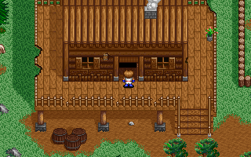
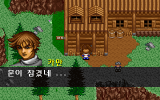
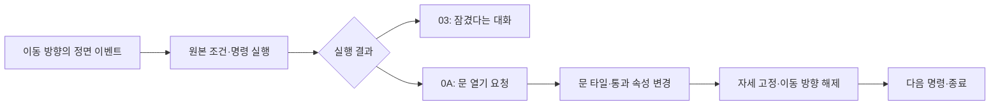

# 원본 문 열기 명령 연결

오두막 마당과 엘가임의 문 열기를 원본 G&M의 `0A` 명령으로 실행한다. 맵·이벤트 번호별로 문을 열던 게임 조건문을 제거했다. [전체 복원 이슈 #39](https://github.com/bnjjong/protocoss-remaster/issues/39)의 공통 이벤트 실행기 연결 단계다.

플레이 범위는 기존 AREA00 맵 0~12다. 다른 지역과 첫 전투를 추가한 단계는 아니다. 다음은 보상·연출·동료·시설 명령을 연결하는 작업이다.

| 오두막 문 열기 | 진행 전 잠긴 문 |
| --- | --- |
|  |  |

## 실행 흐름



원작 `0x25E58`은 uint16 인자 하나를 읽고 명령 위치를 2바이트 넘긴 뒤 `0x11CDC`를 호출한다. 인자의 상위 비트로 변수를 참조하지 않는다. 현재 등록 문에는 모두 값 0을 사용한다. 0 이외 값의 타일·통과 효과는 이번 게임 연결 범위에 포함하지 않는다.

`EventMachine.Stop.Door`에서 실행을 멈추고, 게임이 처리를 끝낸 뒤에만 재개한다. 사전 확인에서는 현재 맵·좌표·방향·높이에 등록된 닫힌 문인지 확인하며 타일·소리·저장 상태를 바꾸지 않는다. 한 이벤트에서 여러 문을 열거나 문 열기와 맵 이동을 함께 실행하는 조합은 아직 허용하지 않는다. 미지원 조합을 일부만 적용하지 않는다.

타일·통과 변경은 기존에 원작 함수로 추출해 검증한 자료를 사용한다. 마당의 문도 같은 자료 형식으로 보존했다. 열림 기록은 같은 문에 재적용하지 않게 하며, 맵 재진입에서는 원래 타일·속성·충돌을 복구한다. 마당에서 사용하는 기존 `doorOpen` 이동 판정도 함께 갱신한다.

원작 함수가 문 앞 자세를 고정하고 이동 방향을 0으로 바꾸는 규칙을 게임과 저장 상태에 반영한다. 문을 여는 입력과 같은 틱에 보행을 시작하지 않는다. 뒤의 입력부터 열린 문을 통과할 수 있다. 효과음은 기존 문 소리를 사용한다.

## 원작과 실제 앱 검사

[원작 기록](event-doors-native.json)은 문 11곳 × 진행 상태 4개(0·2·3·65535) × 스크롤 2개, 총 **88개 조합**이다. 84개는 문을 열고, 나머지 4개는 진행 전 잠긴 문 대화를 실행한다.

- 원작 이벤트 함수 `0x25304`와 문 함수 `0x11CDC`를 실행해 요청 인자·대기 위치·명령 수·변수 해시를 대조했다.
- 문을 여는 84개에서 각 문 주변 9개 셀의 타일·속성 변경이 일치한다. 기존 이동 판정 전체 해시·여러 문을 함께 연 결과 검사도 유지한다.
- 모든 조합에서 저장 메모리 2,944바이트 전체와 문 앞 정면 이벤트의 해제/유지를 비교했다. 시작 방향 1·자세 2에서 문 열기 후 방향 0·자세 0이 되는 변경도 확인했다.
- 별도로 인자 0·1·255·32768·65535를 원작 인자 해석 함수에 넣었다. 모두 같은 uint16 값으로 전달되고 2바이트를 소비했다. 이 검사는 0 이외 값의 문 효과를 실행한 검사는 아니다.
- 실제 앱에 동일한 88개 상태를 불러오고 W 입력을 넣어 저장 전체·충돌·중복 방지·잠김 대화·재진입을 검사했다. 원본 명령을 검사 중에만 종료 명령으로 바꾸면 문이 열리지 않고, 복구하면 열리는 것도 확인했다. 게임 파일 자체는 바꾸지 않는다.
- [화면 비교 기록](event-doors-render.json)의 닫힘·열림·잠김 **22장, 1,408,000픽셀**이 원작 VGA 출력과 일치했다.

원작의 화면 그리기·버퍼 복사와 키/음악 대기는 생략하고 실제 타일·속성·자세·방향 변경을 실행한다. 저장 파일 쓰기 함수가 아니라 기존 원작 로더가 읽은 저장 메모리 구간을 비교한다. 화면 검사는 같은 상태의 정지 화면 비교이며 모든 프레임의 처리 시간이나 오디오 파형을 동일하게 재현했다는 뜻은 아니다.

88개 앱 검사는 문 앞 상태를 직접 불러오는 검사다. 새 게임부터 모든 조합을 연속으로 걸어간 검사가 아니다. 별도의 기존 검사로 오두막 출입·마을 건물 11회 왕복·검 수리·합류·쪽지·조사·저장 재개를 확인한다. 사용자 원본·저장은 수정하지 않는다.

문 연결 후 Kotlin 112개·Python 33개 검사를 통과했다. 자동 경로 검사는 문을 여는 틱까지 보행 8틱에 포함하던 가정을 제거했다. 추가로 최대 8틱 동안 이미 시작한 보행만 완료하고, 끝내 완료하지 않으면 실패한다. 쪽지 연출·저장·완료 상태의 기존 검사는 유지한다.

## 재현

일반 앱과 Kotlin 검사에는 원본 폴더가 필요 없다.

```bash
./gradlew test :desktop:verifyEventDoors :desktop:verifyFieldTravel \
  :desktop:verifyBuildings :desktop:verifyTownTravel :desktop:verifyNpcs \
  :desktop:verifyIndoor :desktop:verifyCabinInteraction :desktop:verifyActorDepth
python3 -m unittest discover -s tools/extractor/tests
```

원작 기록 갱신에는 Pillow·Unicorn과 지원 판본의 원본이 필요하다. 실행 파일은 메모리에서만 압축 해제한다.

```bash
python3 tools/extractor/verify_event_doors.py --game-dir /path/to/Protocoss_Game
python3 tools/extractor/verify_npc_render.py --game-dir /path/to/Protocoss_Game \
  --folder desktop/build/reports/event-doors \
  --report-name restoration/event-doors-render.json
```
