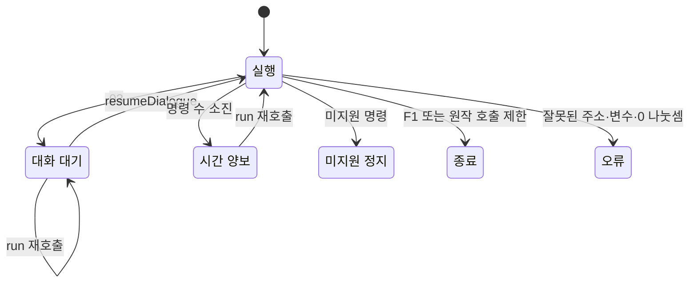

# 공통 이벤트 명령 실행과 대화 대기

전 지역 G&M의 변수·계산·분기·공통 구간 호출을 하나의 실행기로 처리한다. 대화 명령에서는 원본 바이트와 변수·복귀 주소를 유지한 채 멈추고, 명시적으로 재개하면 다음 명령부터 실행한다. [전체 복원 이슈 #39](https://github.com/bnjjong/protocoss-remaster/issues/39)의 공통 이벤트 실행기 단계다.

이번 단계는 순수한 이벤트 상태 변경과 대화 대기까지다. 맵 전환·전투·아이템·음악 등 외부 동작은 아직 `ProtocossGame`에 연결하지 않았다. 현재 플레이 범위는 AREA00 초반 그대로다.

## 원작에서 확인한 명령

원작 실행 함수 `0x25304`와 각 명령 함수를 메모리에서 실행했다. 변수는 DOS 저장과 같은 300개의 uint16 값이다. 실행을 시작할 때 변수 0의 그룹을 선택하고 변수 1에 인자를 넣는다. 그룹의 첫 명령부터 실행하므로 진입 분기 역시 같은 실행기를 통과한다.

| 명령 | 의미 | 원작 처리 |
| --- | --- | --- |
| F0 | 지정 변수와 16비트 상수가 같으면 절대 주소로 이동 | `0x25A34` |
| F1 | 공통 구간에서 복귀. 복귀할 주소가 없으면 실행 종료 | `0x255BD` |
| F2 | 변수 대입 | `0x25844` |
| F3·F4 | 나머지·나눗셈 | `0x25150` |
| F5·F6·F7 | 곱셈·뺄셈·덧셈 | `0x25150` |
| F8 | 복귀 주소를 보관하고 공통 구간 호출 | `0x2554D` |
| F9 | 두 값을 비교하고 참이면 다음 3바이트를 건너뜀 | `0x258F0` |
| FA | 절대 주소로 이동 | `0x2550F` |
| 03 | NUL로 끝나는 원본 대화 바이트를 전달하고 대기 | `0x25DD4` |

F2·계산의 목적지 번호는 하위 15비트다. 값으로 쓰는 피연산자는 상위 비트가 1이면 하위 15비트 번호의 변수를 읽고, 0이면 상수다. F0의 변수 번호에는 이 간접 읽기 규칙을 적용하지 않는다. 계산 결과는 하위 16비트만 저장한다. 나눗셈·나머지는 0~65535 범위의 값으로 계산한다.

F9 비교 번호 0~5는 순서대로 `<`, `<=`, `>`, `>=`, `!=`, `==`다. 원작은 부호 없는 16비트 비교를 사용한다. 예를 들어 65535를 음수 -1처럼 비교하지 않는다. 참일 때 3바이트를 건너뛰는 동작을 일반적인 조건 분기로 추측해 바꾸지 않았다.

F8은 다음 명령의 주소를 보관한다. 호출 깊이가 G&M 헤더의 그룹 수와 같아지면 목적지 인자를 읽기 전에 호출 전체를 끝내고 깊이를 0으로 만든다. 이 원작 동작도 대조했다. 원작 복귀 주소 영역 `0x7E4F8` 뒤 10개 슬롯을 넘으면 다음 필드 `0x7E50C`를 침범하므로, 분석 범위를 벗어나는 호출은 `Fault`로 보고한다. 메모리 침범 자체를 복제하지 않는다.

## 실행 중단과 재개

[EventMachine](../../core/src/main/kotlin/com/protocoss/script/EventMachine.kt)은 한 번의 `run`에 실행할 명령 수를 지정한다. 무한 점프도 정해진 명령 수 뒤에 멈추고, 다음 `run`에서 같은 상태로 이어간다.



대화 대기 중 `run`을 다시 호출해도 같은 요청을 반환한다. `resumeDialogue`는 대기 중인 대화에만 사용할 수 있으며, 인자를 다시 설정하거나 진입 분기를 다시 실행하지 않는다. 대화의 원본 CP1361 바이트는 복사해 전달한다. 페이지·글꼴·입력 대기는 이후 화면 연결 단계에서 처리한다.

외부 처리가 필요한 미지원 명령에서는 번호와 주소를 반환하고 그 명령을 소비하지 않는다. 대화 재개 함수를 호출해도 이를 건너뛸 수 없다. 잘못된 변수·주소·비교 번호·0 나눗셈은 해당 명령의 주소와 번호를 담은 `Fault`로 보고한다. 오류 명령을 읽다가 변수나 복귀 목록을 일부 바꾸지 않는다.

## 검증한 범위

[원작 실행 기록](event-machine-native.json)은 Kotlin 실행기를 사용하지 않고 원작 기계어로 만든다. 원작의 대화 함수 호출만 반환해 다음 명령으로 진행하고, 아직 지원하지 않는 외부 명령은 실행 직전에 멈춘다.

| 표본 | 수 | 확인한 것 |
| --- | ---: | --- |
| 원본 진입점·인자·초기 변수 조합 | 7,596 | 6개 지역, 모든 진입점과 기본 분기, 초기 변수 0·1·3·65535 |
| 원작 경계·대기 프로그램 | 782 | 부호 경계·계산 넘침·변수/상수·목적지 별칭·6개 비교·호출·대화·무한 점프 |
| 분석 범위 보호 프로그램 | 1 | 원작 복귀 주소 저장소를 넘기 직전에 분석을 멈추고 새 실행기도 오류로 보고 |

원본 조합의 결과는 종료 3,569개와 외부 명령 대기 4,027개다. 없는 인자의 기본 분기도 포함되므로 이 수를 완료한 퀘스트 수로 계산하지 않는다. 각 대화 대기와 최종 지점의 **변수 600바이트 해시·복귀 주소·명령 수·위치·원문**을 대조한다. 기록한 대화는 원본 조합 2,896회와 경계 프로그램 3회, 서로 다른 문자열 841개다.

0 나눗셈 42개는 원작 CPU가 예외로 멈추는 것을 확인했다. 기록의 `offset`은 오류 명령 위치, `native_offset`은 원작이 인자를 읽은 뒤의 위치다. 새 실행기는 오류 명령 위치를 유지해 원인을 보고한다. 각 원작 표본은 CPU 실행 상태를 초기화해 이전 예외의 영향을 받지 않는다.

Kotlin 104개와 Python 33개 검사를 통과했다. 명령을 한 개씩 실행하는 경우에도 대화·변수·복귀 주소가 같으며, 대화 중 외부에서 바꾼 변수를 재개 후 읽는 것도 원작과 대조했다. 손상된 인자와 미지원 명령이 뒤의 상태 변경을 실행하지 않는 것도 확인했다. 수정 전 기준 검사 100개도 통과했다.

이 기록은 순수 명령과 대화 대기의 검증이다. 맵 전환·전투 등에서 바뀌는 상태와 화면은 다음 연결 단계에서 검증한다. 분석 보호 프로그램 1개는 원작의 메모리 침범 결과와 일치한다고 주장하지 않는다.

## 재현과 다음 연결

일반 검사는 원본 폴더 없이 패키지 이벤트 파일과 원작 기록으로 실행한다.

```bash
./gradlew test
python3 -m unittest discover -s tools/extractor/tests
```

원작 기록을 다시 만들 때는 Pillow·Unicorn이 필요하다. 실행 파일은 지원 판본의 해시를 확인하고 메모리에서만 압축 해제한다.

```bash
python3 tools/extractor/verify_event_machine.py --game-dir /path/to/Protocoss_Game
./gradlew test
```

다음은 원작의 외부 명령 인자와 결과를 확인하고, **대화·맵 전환부터 실제 게임 화면에 연결**하는 단계다. 기존 오두막·엘가임 진행과 저장을 공통 실행기로 재현한 뒤 다음 지역을 연결한다.
