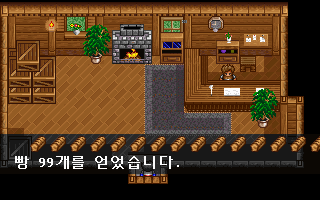
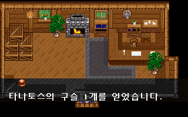
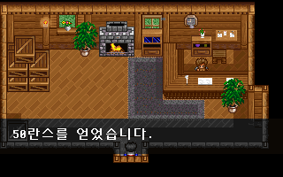
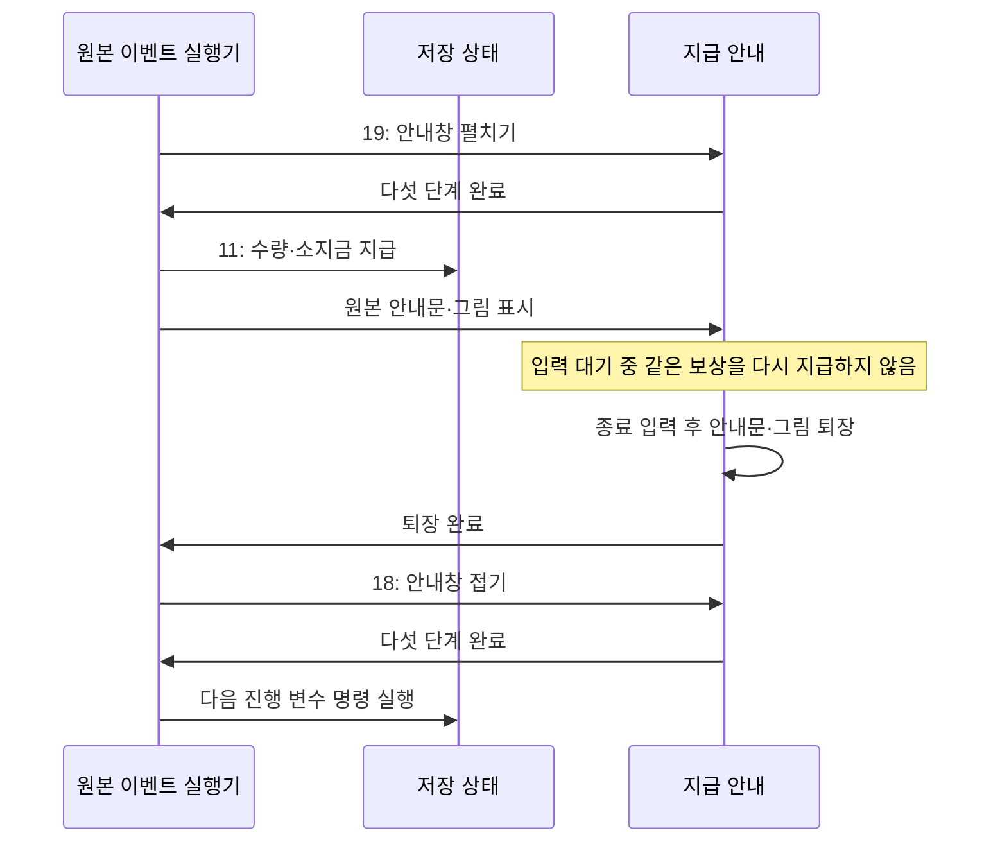

# 원본 보상 명령과 지급 안내 연결

검 수리의 단검 회수와 론도의 여비 지급을 원본 G&M 명령으로 실행한다. 대화가 끝났다는 이유로 별도 조건문에서 수량·진행 상태를 바꾸던 경로를 공통 실행기로 옮겼다. [전체 복원 이슈 #39](https://github.com/bnjjong/protocoss-remaster/issues/39)의 보상 연결 단계다.

아이템 39종·장비 175종·소지금의 지급 명령을 지원한다. 실제 스토리에서 새로 얻는 품목이나 지역을 추가한 단계는 아니다. 플레이 범위는 기존 AREA00 맵 0~12이며, 첫 전투는 아직 연결하지 않았다. 상점·숙박 등 미지원 시설은 기존 전용 경로를 유지한다. 다음은 연출·동료·시설 명령을 순서대로 연결한다.

| 아이템 반복 표시 | 장비 보상 | 소지금 보상 |
| --- | --- | --- |
|  |  |  |

이 세 화면은 명령의 품목·개수·표시를 확인하는 검사 상태다. 현재 스토리에서 이 장소가 빵 99개나 구슬을 지급하도록 바꾸지 않았다.

## 원본 명령과 지급 규칙

명령 번호는 16진수다.

| 명령 | 원작 함수 | 처리 |
| --- | --- | --- |
| 11 | 인자 해석 `0x25F84`, 지급 `0x12924` | uint16 품목 번호·개수·종류를 읽는다. 종류 0은 아이템, 1은 장비, 2는 소지금이다. 인자의 상위 비트로 변수를 참조하지 않는다. |
| 19 | `0x133E0` | 지급 안내창을 펼치는 다섯 사각형을 표시한 뒤 재개한다. |
| 18 | `0x132A4` | 지급 안내창을 접는 다섯 사각형을 표시한 뒤 재개한다. |

아이템·장비는 기존 수량과 개수의 합을 먼저 8비트로 줄인 뒤 99개 상한을 적용한다. 예를 들어 기존 수량 255에 한 개를 더하면 0이 된다. 소지금은 signed int32 덧셈을 먼저 수행한 뒤 999,999 상한을 적용한다. 원작의 덧셈 넘침을 임의로 다른 상한 처리로 바꾸지 않는다. 지원 범위 밖 품목·종류는 사전 확인에서 거부하며 저장을 일부만 바꾸지 않는다.



안내창의 화면 사각형은 `(0,154,320,1)`에서 `(0,134,320,40)`까지 펼치고 반대 순서로 접는다. 안내문은 원작 실행 파일의 `%s %d개를 얻었습니다.`와 `%d란스를 얻었습니다.` 형식을 사용한다. 아이콘은 원본 COMMON 그림과 팔레트를 보존한 기존 장비 자료를 재사용한다. 부족한 숫자 세 글자만 원본 글꼴에서 추가했다.

안내문은 화면 X=318에서 16픽셀씩 이동해 X=14에 도착한다. 종료 입력이 오면 원작처럼 X=14에서 퇴장하며, 이동 중 입력해도 퇴장을 시작할 수 있다. 아이템과 장비의 입장/퇴장 글·아이콘 Y좌표 차이도 보존했다. 여러 개의 아이콘은 원작처럼 20픽셀 간격으로 반복한다. 화면에 나타나지 않는 아이콘은 그리기만 생략하며 지급 수량은 원작 규칙으로 계산한다.

`FieldScript`는 저장·변수 사본으로 지원 가능 여부를 먼저 확인한다. 게임에 적용할 때는 대기 중인 같은 보상 요청에 한 번만 지급한다. 보상 안내와 펼치기·접기 대기가 끝나기 전에 다음 명령으로 넘어가지 않는다. 다음 명령이 기록하는 검 수리 진행·여비 수령 표시는 원작 명령 위치에서 변경한다. 보상·안내창 중에는 필드 이동과 메뉴 입력을 전달하지 않는다. 일반 저장 불러오기·맵 재진입은 대기 중인 실행기와 안내창을 제거한다.

## 원작과 실제 앱 비교

[원작 기록](event-rewards-native.json)의 604개 조합은 다음과 같다.

- 기존 실내 대화 224개와 검 수리 18개 상태: 실제 원본 이벤트 파일을 실행한다.
- 아이템 39종·장비 175종 각각의 지급 214개.
- 두 종류의 첫/마지막 품목에서 개수 0·1·99·100·255·256·65535와 기존 수량 0·98·99·255를 조합한 112개.
- 개수 0·1·50·65535와 음수·상한·signed int32 경계의 소지금 9개를 조합한 36개.

현재 지원하는 570개 조합에서 저장 메모리 2,944바이트 전체가 일치한다. 나머지 34개는 상점·숙박 명령 직전에 멈추며 사전 확인에서 거부한다. 이 거부를 시설 복원 완료로 계산하지 않는다. 총 지급 369회·안내창 요청 738회·대화 231회의 인자·명령 위치·명령 수·변수 해시를 비교했다. 지급 직후의 저장과 안내문도 원작 함수의 실제 결과와 대조했다.

별도로 원작 인자 해석 함수에 상위 비트가 있는 값을 넣어 uint16 인자 세 개와 소비한 6바이트를 대조했다. 이 검사는 범위 밖 품목·종류의 지급 효과를 실행한 검사가 아니다.

실제 앱에서는 별도의 검사 명령으로 362개 지급 조합을 불러와 수량·소지금·중복 방지·후속 변수 변경 시점·입력 잠금·자동 퇴장·접기 완료를 확인했다. 이 검사에는 기존 맵 위에서 검사 전용 이벤트를 메모리에 주입한 상태가 포함된다. 원본 파일과 실제 스토리 보상은 변경하지 않는다. 검 수리·론도 여비는 별도로 실제 대화 입력과 저장 재개까지 확인했다.

[화면 비교 기록](event-rewards-render.json)의 안내창·지급 안내·아이콘 반복·퇴장 80장, **5,120,000픽셀**이 같은 상태의 원작 VGA 출력과 일치했다. Kotlin 116개·Python 33개와 기존 장비·자동 장비·아이템·텐트·193거래·실내 224분기·오두막 조사 검사를 통과했다.

그래픽 검사는 처음 모니터 중앙 위치를 읽는 과정에서 중단됐다. 검사창의 위치를 `(0,0)`으로 명시한 뒤 통과했다. 게임의 일반 창 설정은 바꾸지 않았다. 자동 입력은 지급 안내의 퇴장·접기가 끝나야 다음 대화를 확인하며, 정한 틱 수 안에 끝나지 않으면 실패한다.

## 검증의 한계와 재현

원작의 보상 수량·소지금 변경, 문자열 포맷과 안내창 사각형 계산은 실제 함수를 실행한다. 대화·지급 안내의 입력/그리기는 원작 상태 비교 도구에서 생략하며, 화면은 실제 앱 캡처를 별도의 원작 VGA 출력과 비교한다. 저장 파일 쓰기 함수가 아닌 원작 로더의 저장 메모리 구간을 비교한다. 원작 전체 프레임의 시간 간격이나 모든 입출력 동작이 같다는 검증은 아니다.

일반 게임·Kotlin·앱 검사에는 원본 폴더가 필요 없다. 사용자 원본·저장을 수정하지 않고 임시 저장으로 실행한다.

```bash
./gradlew test :desktop:verifyEventRewards :desktop:verifyIndoor :desktop:verifyCabinInteraction
python3 -m unittest discover -s tools/extractor/tests
```

원작 기록을 갱신할 때는 Pillow·Unicorn과 지원 판본이 필요하다. 압축 해제한 실행 파일과 메모리는 파일로 남기지 않는다.

```bash
python3 tools/extractor/verify_event_rewards.py --game-dir /path/to/Protocoss_Game
python3 tools/extractor/verify_npc_render.py --game-dir /path/to/Protocoss_Game \
  --folder desktop/build/reports/event-rewards \
  --report-name restoration/event-rewards-render.json
```
