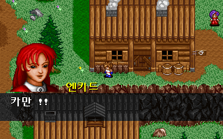
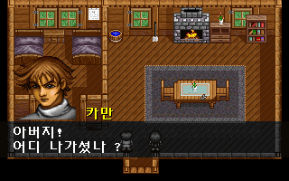
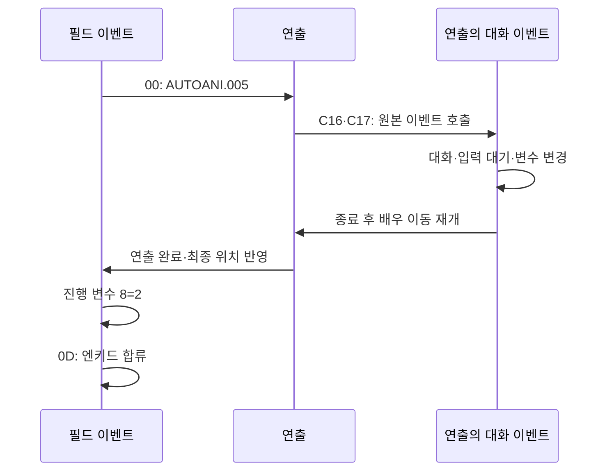

# 합류·쪽지 연출의 원본 명령 연결

엔키드 합류와 오두막 쪽지 확인을 원본 이벤트의 연출·대화 호출·파티 명령으로 실행한다. 맵·진행 번호별로 최종 저장을 미리 만들던 게임 조건문을 제거했다. 연출이 대화를 호출할 때 실제 G&M 실행기로 들어가고, 끝나면 원래 명령 위치로 돌아간다. [전체 복원 이슈 #39](https://github.com/bnjjong/protocoss-remaster/issues/39)의 다음 단계다.

플레이 범위는 기존 AREA00 맵 0~12다. 첫 전투와 새 지역을 추가한 단계는 아니다. AUTOANI.005 합류·006 쪽지를 연결했으며, 기상·조우·벽난로 연출과 시설의 전용 경로는 후속 작업으로 남긴다.

| 합류 연출의 원본 대화 | 쪽지 연출의 원본 대화 |
| --- | --- |
|  |  |

## 명령과 실행 순서

명령 번호는 16진수다.

| 명령 | 원작 함수 | 연결 |
| --- | --- | --- |
| 00 | 인자 해석 `0x25C18`, 연출 `0x10A54` | uint16 연출 번호·모드·음악을 그대로 읽고, 연출이 끝날 때까지 대기한다. 현재 005/0/24와 006/1/27만 허용한다. |
| 0D | 인자 해석 `0x25F04`, 합류 `0x1255C` | 파티 참가·정상 상태·체력/마력·현재 변신 기력을 갱신한다. |
| 13 | 인자 해석 `0x26034`, 이탈 `0x12F4C` | 참가를 해제하고 장신구 두 슬롯의 구슬을 소지품으로 반환한다. |

인자는 상위 비트로 변수를 참조하지 않는다. 연출 번호와 기존 표시 자산의 대응·헤더·대화 호출 번호는 원본 AUTOANI에서 추출해 [story.json](../../assets/data/events/story.json)에 보존했다. 실제 대사와 진행 조건은 미리 선택한 대화 표가 아니라 원본 G&M에서 읽는다.



원작 연출 인자 해석 함수는 연출 호출 전에 다음 명령 위치를 보관하고, 연출 중 대화 호출이 바꾼 명령 위치를 복구한다. 새 실행기도 같은 위치에서 재개하며, 변수 300개와 저장 상태는 대화 이벤트에서 바꾼 값을 공유한다. 합류의 마지막 인자 17, 쪽지의 빈 호출 C7이 남기는 인자 7도 직접 실행한 결과다. 이 값을 호출자가 미리 넣지 않는다.

합류 연출 뒤에 원본 명령이 진행 8을 2로 바꾸고 엔키드를 참가시킨다. 쪽지는 C4·C5·C6의 대화와 빈 C7을 실행한 뒤, 원본 02 명령으로 오두막에 이동하고 진행 8을 3으로 바꾼 후 엔키드를 이탈시킨다. 연출·맵 전환 대기 중에는 다음 파티 명령으로 넘어가지 않는다.

mode=0인 합류는 열린 문·주민·배경 상태와 렌더러를 유지한다. 최종 스크롤 14·7, 화면 좌표 160·104, 자세 8을 반영한다. mode=1인 쪽지는 헤더의 맵·스크롤로 시작하며, 이후 필드 위치는 뒤따르는 원본 이동 명령이 결정한다. 음악도 00 명령의 24·27과 뒤의 이동 명령에서 가져온다.

## 11명 파티의 변경 규칙

합류는 원작처럼 참가 표시가 정확히 1인 사람이 5명 미만이고, 대상이 이미 표시 1로 참가 중이지 않을 때 허용한다. 대상의 참가·정상 상태를 설정하고 현재 HP/MP를 각각 최대값으로 복구한다. 현재 변신이 있으면 그 변신의 기력을 최대값으로 복구한다. 다른 인물과 장비·수치·변수는 보존한다.

이탈은 주인공 이외의 참가 중인 인물에게 허용한다. 두 장신구 슬롯에서 구슬 번호 163~174만 반환하고 해당 슬롯과 변신 상태를 해제한다. 일반 장신구는 그대로 둔다. 반환은 8비트 덧셈이며 보상 명령처럼 99개 상한을 적용하지 않는다. 같은 구슬이 두 슬롯에 있고 소지량이 255면 두 번 더해 1이 된다.

원본 자료 밖 인물·변신 번호와 소지품 범위 밖 반환 장비는 거부한다. 전체 이벤트를 저장 사본으로 먼저 실행해, 연출 뒤 합류 조건에서 막히더라도 실제 연출·저장·소리를 일부만 적용하지 않는다. 중첩 호출과 부모가 같은 변수·저장을 공유하지만, 복귀 주소가 쌓인 상태에서 다시 연출을 부르는 조합은 아직 허용하지 않는다. 현재 연결한 연출 안에서는 대화·파티·순수 명령만 허용한다.

## 원작과 앱 검증

[원작 실행 기록](event-story-native.json)은 다음을 대조한다.

- 스토리 36개 상태: 마을 인자 15와 마당 인자 1, 진행 0~5, 소지품·변신·장비 상태 3종을 원본 G&M으로 실행했다.
- 원본 연출 해석·배우 이동·자세 함수와 중첩 G&M 호출을 실행했다. 합류 연출 3회·쪽지 연출 3회, 중첩 이벤트 18회와 뒤의 실제 파티·이동 변경을 확인했다.
- 부모·중첩 이벤트의 인자·명령 위치·명령 수·변수 해시와 저장 메모리 2,944바이트 전체가 일치한다. 중첩 호출에서 돌아온 뒤 부모 명령 위치가 유지되는 것도 비교한다.
- 파티 110개 조합: 11명 × 합류/이탈 × 5개 상태를 실행했다. 73개는 회복·변신 기력·구슬 반환·수량 넘침을 포함해 저장 전체가 일치한다. 37개는 원작에서 파티 제한·중복 참가·주인공/미참가 이탈 조건으로 오류가 나며 사전 확인에서 거부한다.
- 별도 인자 해석 함수에 65535·32768 등을 넣어 연출의 세 uint16과 파티의 한 uint16이 그대로 전달되는 것을 확인했다. 범위 밖 인물 번호로 실제 파티 메모리를 바꾸는 검사는 아니다.

실제 앱은 원본 이벤트가 선택한 연출과 대기 중인 공통 실행기를 확인한다. 36개 상태·연출 6회를 불러와 대화·파티 변경 시점·맵 복귀·저장 재개를 검사했다. 새 게임부터 검 맡기기→합류→쪽지→검 회수를 실제 입력으로 진행하는 기존 검사도 유지한다.

[화면 기록](event-story-render.json)의 새 비교 화면 5장·검 수리 회귀 화면 10장, 총 **15장·960,000픽셀**이 같은 상태의 원작 VGA 출력과 일치했다. Kotlin 121개·Python 33개, 기존 실내 224분기·장비·아이템·텐트·193거래·보상 362개 조합·오두막 조사를 통과했다.

## 남은 차이와 재현

연출은 기존에 검증한 배우 이동·그리기 타임라인을 사용한다. **mode=0 연출의 시작 위치까지 접근하는 보행은 이번에 새로 복원하지 않았다.** 원작 상태 비교 도구도 이 접근 구간을 생략하고 목표 위치에 둔다. 방향 0인 카메라 갱신·NPC 시계·화면/음악 I/O·맵 자산 로드는 생략한다. 현재 두 연출에는 카메라 이동이 없으며, 해당 조합만 사전 확인에서 허용한다. 접근 보행, 남은 연출과 시설은 다음 복원 항목으로 추적한다.

원작 저장 파일 쓰기 함수가 아닌 로더가 배치한 저장 메모리를 비교한다. 지정한 화면과 상태를 검증하며, DOS 실행 전체의 프레임 간격·팔레트/음량 전환·접근 보행까지 동일하다는 뜻은 아니다. 일반 게임과 앱 검사에는 원본 폴더가 필요 없다. 원본·사용자 저장·다른 앱의 오디오는 수정하지 않는다.

```bash
./gradlew test :desktop:verifyEventStory :desktop:verifyCabinInteraction \
  :desktop:verifyIndoor :desktop:verifyEventRewards
python3 -m unittest discover -s tools/extractor/tests
```

원작 자료를 갱신할 때는 Pillow·Unicorn과 지원 판본의 원본이 필요하다. 실행 파일은 메모리에서만 압축 해제한다.

```bash
python3 tools/extractor/verify_event_story.py --game-dir /path/to/Protocoss_Game
python3 tools/extractor/verify_npc_render.py --game-dir /path/to/Protocoss_Game \
  --folder desktop/build/reports/event-story --report-name restoration/event-story-render.json
```

위 화면 재현 명령은 새 비교 화면 5장을 갱신한다. 회귀 화면 10장은 `desktop/build/reports/sword`에서 같은 도구로 별도 비교해 통합 기록에 포함했다.
