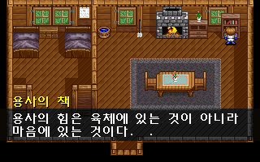
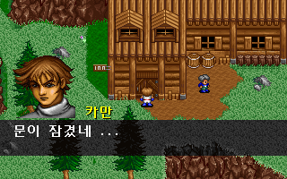
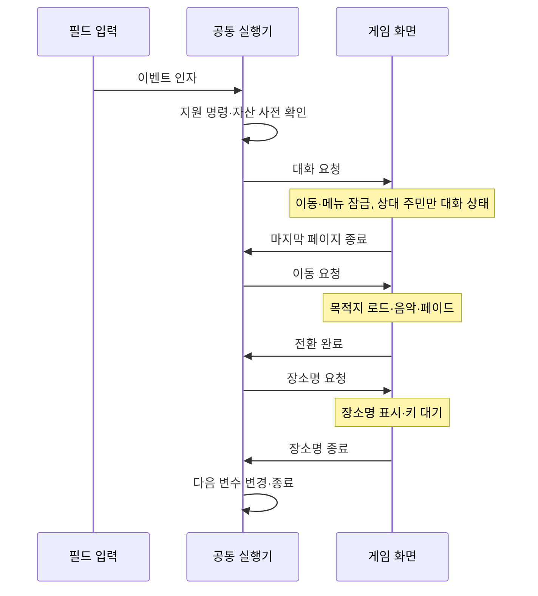

# 원본 이벤트의 대화·맵 전환 연결

오두막 일반 조사·엘가임 주민과 일부 실내 대화, 일반 출입구를 실제 G&M 명령으로 실행한다. 대화의 조건·원문·종료 뒤 변수 변경과 이동의 목적지·좌표·자세·음악·장소명을 이벤트 파일에서 읽는다. [전체 복원 이슈 #39](https://github.com/bnjjong/protocoss-remaster/issues/39)의 공통 이벤트 실행기 연결 단계다.

플레이 범위는 기존 AREA00 맵 0~12다. 기상·합류·쪽지·벽난로 연출, 상점·보상·숙박·문 타일 변경 등 아직 외부 명령을 연결하지 않은 흐름은 기존 처리 경로를 유지한다. 기존 기능을 버리고 미지원 명령을 건너뛰지 않는다.

| 원본 책 조사 | 원본 잠긴 문 대화 |
| --- | --- |
|  |  |

## 이번에 연결한 동작

| 원작 명령 | 실행 규칙 | 게임 연결 |
| --- | --- | --- |
| 02 | uint16 8개: 맵·스크롤 X/Y·화면 X/Y·자세·높이·음악 | 필드 로드, 좌표·자세·음악 변경 후 페이드 동안 대기 |
| 03 | NUL로 끝나는 CP1361 대화 | 화자·초상화·줄바꿈·페이지를 표시하고 종료 입력 후 재개 |
| 15 | uint16 효과음 번호 | 현재 연결한 문 효과음 0을 한 번 재생 |
| 17 | NUL로 끝나는 장소명 | 저장의 장소명을 바꾸고 장소명 표시·키 대기가 끝난 뒤 재개 |

명령 번호는 16진수다. 이동 인자는 변수 참조가 아닌 원본 uint16 값이다. 원작 `0x25CF0`은 8개 인자를 읽고 `0x1EE50`을 호출한다. 그 함수가 음악 변수 4를 먼저 변경하고, 맵·좌표·스크롤을 적용한다. 효과음은 `0x2609C`, 장소명은 `0x261B4`가 처리한다.

대화와 장소명의 명령 포인터 처리도 구분한다. 대화 함수는 화면 처리가 끝난 뒤 문자열을 넘긴다. 장소명 함수는 문자열을 넘긴 뒤 화면 함수를 호출한다. 새 실행기의 대기 위치와 재개 위치는 이 규칙을 따른다.



이 그림은 가능한 요청 순서의 예시이며, 실제 명령 순서는 G&M이 결정한다.

## 사전 확인과 중단·재개

[FieldScript](../../core/src/main/kotlin/com/protocoss/field/FieldScript.kt)는 변수·저장 사본으로 이벤트가 끝까지 지원되는지 먼저 확인한다. 현재 연결한 맵·음악·글꼴·초상화·효과음과 한 번의 맵 전환만 허용한다. 미지원 명령이나 자산이 있으면 사본을 버리며, 검사 도중 대화·소리·저장 상태를 게임에 적용하지 않는다.

확인을 통과하면 원본 명령을 처음부터 실행한다. 캐시된 변형 대화나 출입구 표가 실행 결과를 결정하지 않는다. 기존 대화 표는 마이그레이션 대상 선택·글꼴과 아직 남은 전용 기능에 사용한다. `BuildingTravel`·`TownTravel`의 기존 표/조건은 검사 기준으로 남았으며 일반 출입구의 실제 실행에는 사용하지 않는다. 쪽지 연출의 기존 목적지 처리는 연출 명령 연결 전까지 유지한다.

실행 중 대화 요청은 `FieldDialogue`에 연결한다. 여러 03 명령은 같은 대화의 페이지 번호를 이어가고, 각각의 원문·페이지 유지 규칙을 보존한다. 마지막 페이지를 닫으면 다음 명령을 실행하고, 스크립트 전체가 끝났을 때 상대 주민을 원래 방향·동작으로 복구한다. 다른 주민은 기존 규칙대로 계속 움직인다.

이동 요청에서는 같은 실행기 객체를 유지하며 목적지 필드를 로드한다. 페이드가 끝나기 전에 뒤의 명령을 실행하지 않는다. 장소명도 표시·입력 대기가 끝나기 전에는 다음 변수 변경으로 넘어가지 않는다. 일반 저장 불러오기와 맵 재진입에서는 진행 중인 실행기를 제거한다.

## 원작 비교와 검사

[원작 외부 명령 기록](field-services-native.json)은 AREA00의 11개 그룹에서 408개 이벤트·진행·기상/조우 상태 조합을 실행했다. 요청 454개에는 대화 180회·이동 174회·문 소리 80회·장소명 20회가 있다.

- 현재 지원하는 356개 조합은 원작과 **저장 2,944바이트 전체가 일치**한다. 입력 인자와 대기 위치·명령 수·변수 600바이트 해시도 비교한다.
- 나머지 52개는 연출·보상·시설 등 미지원 명령 직전에 멈춘다. 사전 확인이 이 조합을 거부하고 입력 저장을 바꾸지 않는 것을 검사한다. 거부된 명령을 실행한 검증으로 계산하지 않는다.
- 원작 이동 함수의 음악 변수·위치·자세·스크롤 변경과 장소명 저장을 실행했다. 맵 파일 읽기·타일/인물 자산 로드와 화면·음악 I/O는 생략했다. 맵 로더는 맵 번호를 기록한 직후 되돌리고, 장소명 함수는 문자열을 저장한 직후 표시·키 대기를 끝낸다.
- Kotlin 108개·Python 33개 검사 통과. 대화 원문은 기존 추출기의 페이지 결과와도 대조했다. 기존 변수·분기·호출·복귀 검사는 필드 명령을 끈 모드로 유지한다.

실제 앱 검사는 주민 대화와 건물 이동이 새 실행기에 연결됐는지도 확인한다. 검사 경로 탐색은 게임의 삭제된 내부 필드를 읽지 않고 기존 원작 기준 자료를 따로 읽는다. 움직이는 주민이 길을 막으면 제한된 횟수 안에서 기다린 뒤 다시 접근하며, 끝내 접근하지 못하면 실패한다.

UI 검사는 패키지 자산·임시 저장을 사용한다. 고정 화면의 픽셀 비교와 완료 상태를 검증하며, DOS 전체의 모든 프레임 타이밍을 동일하게 재현했다는 뜻은 아니다. 사용자 원본·저장은 변경하지 않는다.

최종 실행 검사는 위 범위와 기존 장비·소지품·텐트·거래·검 수리·합류·시작 화면·프롤로그·겹침·필드 경계를 모두 통과했다. [화면 비교 기록](field-services-render.json)의 주민 10장·건물 12장·실내 63장·검 수리 10장·오두막 34장·겹침 89장, 총 **218장·13,952,000픽셀**이 원작 출력과 일치했다. 기존 전용 경로로 남은 화면도 회귀 검사에 포함한다.

## 재현과 다음 작업

```bash
./gradlew test :desktop:verifyFieldTravel :desktop:verifyNpcs :desktop:verifyBuildings \
  :desktop:verifyIndoor :desktop:verifyTownTravel :desktop:verifyCabinInteraction \
  :desktop:verifyOpening :desktop:verifyPrologue :desktop:verifyTitleSave \
  :desktop:verifyActorDepth :desktop:verifyFieldBounds
python3 -m unittest discover -s tools/extractor/tests
```

원작 기록을 다시 만들려면 Pillow·Unicorn을 설치한다. 실행 파일은 메모리에서만 압축 해제한다.

```bash
python3 tools/extractor/verify_field_services.py --game-dir /path/to/Protocoss_Game
./gradlew test
```

다음은 남은 외부 명령인 **연출·아이템/소지금·파티·시설·문 처리**를 같은 방식으로 연결하는 단계다. 기존 초반 예외 처리를 줄인 뒤 다음 지역과 첫 전투 진행을 연결한다.
