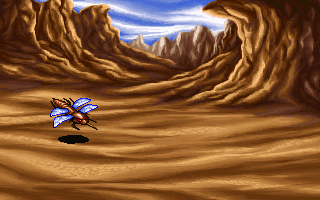
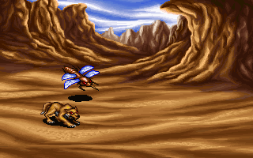

# 북마겔 첫 전투의 조건·편성

북마겔의 전투 위치·진입 요청·적 편성·초기 매개변수와 그림을 원작 함수에 맞췄다. **일반 플레이에서 전투를 시작하는 연결은 아직 하지 않았다.** 명령·턴·승패·필드 복귀가 없는 상태로 플레이를 막지 않기 위해서다. [전체 복원 이슈 #39](https://github.com/bnjjong/protocoss-remaster/issues/39)의 전투 복원 첫 단계이며, 첫 전투 플레이 완료로 계산하지 않는다.

| 편성 50: SUPER FLY 1마리 | 편성 52: SUPER FLY·WOLF |
| --- | --- |
|  |  |

위 그림은 **배경·적 위치 확인용**이다. 파티·명령창·전투 진입 효과를 담은 전체 게임 화면은 아니다.

## 원작의 전투 위치 검사

맵 13의 `BAT013.MAP`은 80×50개의 uint16이다. `0xFFFF`는 빈 칸이고 나머지는 `MON_GRP.LST`의 0부터 시작하는 편성 번호다. 무작위로 적을 뽑는 표가 아니다. 4,000칸 중 34칸에 전투가 배치돼 있다.

| 편성 | 전투 위치 수 | 적 구성 | 배경 번호 |
| --- | --- | --- | --- |
| 50 | 5 | SUPER FLY 1마리 | 23 |
| 51 | 15 | SUPER FLY 2마리 | 23 |
| 52 | 9 | SUPER FLY·WOLF | 23 |
| 53 | 5 | SUPER FLY 3마리 | 23 |

원작 `0x13148`은 상태 워드 `0x7E512`가 0이고 전투 허용 워드 `0x71574`가 0이 아닐 때 `0x124B4`를 호출한다. 이 함수는 별도 상태 워드 `0x7E042`가 0이 아니면 종료한다. 아직 의미를 확정하지 않은 상태를 다른 이름의 게임 규칙으로 추측하지 않는다.

검사 셀은 다음과 같다. `screenX/Y`는 원작의 16픽셀 여백을 포함하며 `scrollX/Y`는 8픽셀 셀 단위다. 월드 좌표는 여백을 뺀 왼쪽 위 기준이다.

```text
column = (screenX >> 3) + scrollX - 1 = floor(worldX / 8) + 1
row    = (screenY >> 3) + scrollY     = floor(worldY / 8) + 2
```

해당 셀이 비어 있지 않으면 원작은 먼저 `0xFFFF`를 쓴다. 그 뒤 `0x1217C`의 화면 전환, `0x122B0(편성, 모드 0)`의 전투를 호출한다. 따라서 같은 맵 메모리에서 같은 칸을 다시 검사해도 전투 요청은 한 번이다. Kotlin 모델도 조건 거부 때는 아무 셀도 바꾸지 않으며, 성공 때만 그 셀을 소모한다.

맵 로더 `0x1E1BC`의 전투 허용 바이트는 맵 헤더 +36이다. 허용 맵에서는 저장 변수 3과 현재 맵 번호가 다를 때 `0x1E100`이 `BAT{지역}{맵:02}.MAP`을 읽는다. 비허용 맵에서는 변수 3을 `0xFFFF`로 바꾸고 전투 메모리를 해제한다. **이 수명과 저장 재개의 연결은 후속 작업이다.** `freshField`는 BAT를 새로 읽은 상태만 만들며, 맵을 바꿀 때마다 무조건 호출하는 게임 규칙이 아니다.

## 적 편성과 초기화

`0x122B0→0x62A5A→0x61ACA`가 전투 준비로 이어진다. 편성 로더 `0x5F96B`는 `MON_GRP.LST`의 32바이트 레코드를 읽는다.

| 바이트 | 해석 |
| --- | --- |
| 0~9 | 적 최대 5개의 X 좌표, int16 |
| 10~19 | 적 최대 5개의 Y 좌표, int16 |
| 20~29 | 적 번호 5개, int16. 첫 0에서 종료. 1을 빼서 몬스터 번호로 사용 |
| 30 | BACK.DAT 배경 번호 |
| 31 | 이번 단계에서 의미를 확정하지 않음 |

적 하나마다 141바이트 상태를 할당하고 좌표에는 작업 여백 16을 더한다. 같은 종류의 적이 여러 번 들어 있어도 별개 인물로 보존한다. `0x5FB3F`는 각 적의 `MONSTER.SPR` 프레임을 읽고, `0x5FC84`는 `MON_PARA.LST`의 89바이트 레코드를 상태 +52에 복사한다. 매개변수 +67의 int32에는 최대 400 제한을 적용하며 이 값을 초기 카운터에도 복사한다. 아직 이 필드를 체력·속도 등의 이름으로 붙이지 않았다. `0x605F9`는 지정 배경의 64,000바이트를 읽는다.

## 구현·검증 범위

- [추출·검증기](../../tools/extractor/first_battle.py)는 압축 해제 EXE와 재배치한 메모리를 RAM에만 보관한다. 원본·사용자 저장을 쓰지 않는다.
- [원작 기록](first-battle-native.json): 전투 위치 4,000칸, 조건·스크롤·셀 내부 7픽셀 이동·반복 진입 408개, 적 편성 340개가 일치했다. 전투 본체는 실행하지 않고 편성·모드 요청을 기록한다. 파일·할당·스택 검사·memcpy를 공급해 실제 로더를 실행한다. 화면 전환과 전투 본체를 생략한 범위를 기록에 명시했다.
- `MONSTER.SPR` 123장·674,417픽셀의 색 번호·투명도·RGBA를 실제 원작 VGA 그리기 함수 `0x2D11A`와 대조했다. 기존 USER.SPR 디코더를 재사용하며 캐릭터 자산은 바꾸지 않았다. 패키지에는 첫 전투에서 쓰는 몬스터 2장만 추가했다.
- 배경 23의 기존 PNG가 원작 배경 로더의 데이터·팔레트와 일치한다. 네 적 편성의 배경 합성을 원작 VGA 출력과 대조했고, `:desktop:verifyBattleEntry`에서 같은 4장·256,000픽셀을 실제 GPU(그래픽 장치) 출력과 다시 대조했다. 이는 전체 전투 화면이나 모든 진입 프레임의 검증이 아니다.
- [BattleEntry](../../core/src/main/kotlin/com/protocoss/battle/BattleEntry.kt)는 패키지 데이터만으로 전투 요청·한 번 소모·편성을 만든다. 다른 지역·맵을 추측해서 매핑하지 않는다. [BattleFormationRenderer](../../core/src/main/kotlin/com/protocoss/battle/BattleFormationRenderer.kt)는 검증한 배경과 적 레이어를 그린다. 일반 게임에는 아직 연결하지 않았다.
- Kotlin 141개·Python 36개 검사를 통과했다. 자산·원작 기록 8파일은 격리한 폴더에서 재생성해 바이트 일치를 확인했다. 기존 `:desktop:verifyTownDeparture`의 새 게임→검 회수→재합류→출발→북마겔/마을 왕복·저장 재개도 확인했다.

```bash
python3 tools/extractor/first_battle.py --game-dir /path/to/Protocoss_Game
python3 -m unittest discover -s tools/extractor/tests
./gradlew test :desktop:verifyBattleEntry
```

다음은 참가 파티 배치·전투 시작 상태·명령 선택·행동 순서를 복원하는 것이다. 공격·아이템/기술·피해·연출·보상·도주/패배·필드 복귀와 저장 상태를 연결해야 첫 전투를 실제 플레이할 수 있다. 음악과 맵 이동/저장 재개에서의 전투 위치 유지도 그 과정에서 원작과 비교한다.
