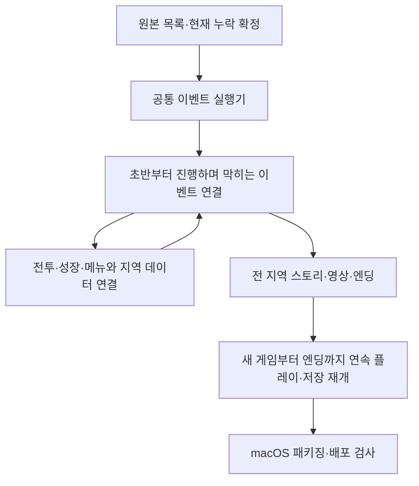

# 원작 전체 복원 계획과 현재 상태

목표는 **새 게임부터 엔딩까지 원작의 진행·전투·상호작용을 연결하고, 저장 후 어느 진행 지점에서도 이어서 플레이하는 것**이다. 전체 작업은 [이슈 #39](https://github.com/bnjjong/protocoss-remaster/issues/39)에서 추적한다. 개별 PR의 완료를 전체 게임 완료로 보고하지 않는다.

이 목록은 2026-11-12의 [기준 코드](https://github.com/bnjjong/protocoss-remaster/commit/f5a69d5db434d63c64c2fca849774ec49ef6341a), 원본 파일, 기존 원작 비교 기록을 대조한 결과다. 예전 노트의 ‘1·2단계 완료’, USER.SPR 588프레임, PEOPLE.SPR 366명 등의 수치를 현재 완료 근거로 사용하지 않는다.

## 현재 플레이 범위

타이틀 → 프롤로그 → 오두막 → 엘가임의 초반 대화·건물·검 수리·엔키드 합류·쪽지·단검 회수까지 연결했다. 장비·소지품·거래·텐트와 DOS 저장 재개도 지정한 표본에서 검증했다. 조사키와 인물 앞뒤 표시는 후속 수정까지 포함한다.

현재 패키지는 AREA00의 맵 0~12와 연출 7개를 담고 있다. 런타임의 보행·주민·이벤트 연결 역시 이 초반 범위에 한정된다. **다른 지역의 스토리·전투·엔딩은 아직 플레이할 수 없다.** 맵 데이터가 담겨 있다는 사실은 그 맵의 모든 조사·퀘스트를 연결했다는 뜻이 아니다.

## 전수 목록

[재현 가능한 원본 목록](source-inventory.json)은 MAP·DATA·GRP·S&W, 공용 글꼴·암호 배경, 실행 참조 파일과 동봉 참고 자료 등 483개 파일의 이름·크기·SHA-256을 기록한다. 사용자 저장·설정·설치 도구·압축 배포본은 제외한다. 실행 파일 자체는 산출물로 복제하지 않는다. 해시와 구조 검사는 파일의 범위를 확인하는 검사이며, 화면·동작이 복원됐다는 뜻이 아니다.

| 지역 | 맵 레코드 | 타일셋 블록 | 이벤트 그룹 | 진입 분기 |
| --- | ---: | ---: | ---: | ---: |
| AREA00 | 59 | 19 | 47 | 344 |
| AREA01 | 63 | 21 | 11 | 336 |
| AREA02 | 51 | 14 | 7 | 234 |
| AREA03 | 62 | 15 | 4 | 243 |
| AREA04 | 99 | 37 | 14 | 425 |
| AREA05 | 30 | 7 | 3 | 145 |
| 합계 | 364 | 113 | 86 | 1,727 |

364개 맵의 크기·셀·애니메이션·54바이트 인물·이벤트 사각형 레코드의 범위를 검사했다. 전체에는 인물 레코드 573개와 이벤트 사각형 1,394개가 있다. 같은 인물이나 장소의 변형이 반복될 수 있으므로 이를 인물 수·퀘스트 수·전체 복원율로 환산하지 않는다. 실제로 도달하는 맵과 이벤트는 원작 실행 흐름으로 추가 확인한다.

| 분류 | 원본에서 확인한 범위 | 현재 근거와 남은 작업 |
| --- | --- | --- |
| 필드 | 맵 364개·타일셋 113블록 | 전체 구조 검사. 현재 플레이 연결은 AREA00 초반 일부. 나머지 배경·충돌·이동·높이·시간 변화의 원작 대조 필요 |
| 이벤트 | 6개 G&M·86그룹·진입 분기 1,727개 | [순수 명령·대화 대기](event-machine.md)에 이어 [초반 대화·맵 전환 연결](field-services.md)과 [문 명령 연결](event-doors.md), [보상·안내창 연결](event-rewards.md), [합류·쪽지 연출과 파티](event-story.md). 나머지 연출·접근 보행·시설 연결 필요 |
| 필드 인물 | PEOPLE.SDA 412블록·4,944프레임 | 전체 오프셋 범위 검사. 현재 사용하는 일부 인물만 픽셀·이동·대화 대조 완료 |
| 전투 인물 | USER.SPR 11명·599프레임 | [전체 프레임 원작 대조](../sprite-format.md) 완료. 전투에서 행동별 재생은 미연결 |
| 전투 | BAT MAP 110파일·몬스터 123프레임·전투 메뉴 219프레임·이펙트 396프레임 | 파일·일부 컨테이너 범위 확인. 전투 루프·배치·계산·입력·연출·결과 연결 필요 |
| 연출 | AUTOANI 134파일 | 현재 해석기로 131파일 문법 해석. 048·120·130은 종료 뒤 데이터가 남아 분석 대기. 모든 명령의 동작 검증은 미완료 |
| 영상 | VIS 90파일·END.MOV | 시작·프롤로그·조우 일부 검증. 나머지 VIS와 엔딩의 원작 디코딩·재생 필요 |
| 메뉴 | IMG 6파일·암호 배경 | 장비·소지품·상점 등 일부 검증. 일시정지·저장 목록은 임시 UI. 상태·마법/신법과 원작 시스템 메뉴 누락 점검 필요. PRESS.IMG·TIMETL.IMG는 현재 IMG 파서 미지원 |
| 수치 DB | 아이템 39·마법 87·몬스터 123·장비 175레코드 | 지정 레코드 폭과 일치. 일부 아이템·장비 동작만 대조. 전투 수치와 LEV_PARA·MON_GRP·SB_PARA 의미 복원 필요 |
| 소리 | MFA 37곡·EFF 34파일 | 전체 메타데이터/산출물 존재와 게임 연결을 구분. 현재 시작·마을·오두막·조우·텐트 일부 재생. 나머지 곡·효과음·전환·반복 검증 필요 |
| 저장 | 원작 DOS 저장 2,944바이트 | 초반·파티·소지품·장비·거래·휴식 재개 검사. 저장 허용 조건·전 지역 진행·전투 전후·엔딩 상태의 보존 검사 필요 |

추가로 동작 표 `*.ANI`, 시설·아이템 관련 보조 표 `*.GUP`, 성장·적 편성·신법의 나머지 LST는 의미 분석이 남아 있다. BACK.FXP·PRO0.DAT는 목록의 미분류 자료로 남겼다. 모르는 파일을 임의로 복원 완료에 포함하지 않는다.

동봉 `메뉴얼.txt`는 작성자의 추측과 편집 플레이가 포함된 공략이다. **진행 후보를 찾는 참고 자료로만 사용한다.** 구슬 성장·파손·재장착, 소환수와 선택 동료, 낚시·오락실, 배·기차·변장, 필드 전용 아이템·스위치·워프 같은 항목도 누락 점검 대상에 넣는다. 실제 존재·조건·결과는 원작 스크립트와 실행으로 확인한 뒤 복원한다.

## 진행 순서와 완료 조건



1. **원본 목록과 진입 형식:** [PR #40](https://github.com/bnjjong/protocoss-remaster/pull/40)에서 완료했다. 아래 재현 명령, 해시, 원작 진입 주소 대조로 확인한다. 게임 진행 범위를 늘린 단계로 계산하지 않는다.
2. **공통 이벤트 실행기:** 원작 `0x25304`의 명령 읽기·분기·변수 변경부터 복원한다. 이어서 맵 전환·대화·아이템/소지금·파티·연출·음악 등 원작 명령을 실행한다. 각 명령은 같은 초기 상태에서 원작의 호출·변수·저장 결과와 비교한다. 모르는 명령을 건너뛰거나 임의의 기본값으로 처리하지 않는다.
3. **실제 게임에 연결:** 기존 초반 조건문을 검증된 공통 실행기로 순차 교체한다. 이미 복원한 기상·검 수리·합류·조사·상점 흐름을 유지한다. 다음 지역을 열기 전에 초기화·복귀·대화 중단·진행 분기·저장 재개를 확인한다.
4. **진행에 필요한 시스템 복원:** 원작을 진행하며 처음 막히는 순서에 따라 전투·성장·상태·마법/신법·퀘스트 아이템·상자·시설 등을 구현한다. 전투는 시작·행동 순서·명령·수치·연출·보상·도주·패배·필드 복귀까지 확인한다. 기존 DB의 필드를 임의로 추측하지 않는다.
5. **전 지역과 엔딩:** 원작에서 실제로 쓰는 지역·맵·진행 분기·동료·조사·선택·영상·소리를 연결한다. 미사용 자료와 진행 상태별 변형은 조사 결과를 남긴다.
6. **전체 완료 판정:** 새 게임부터 엔딩까지 연속 플레이하고, 각 주요 진행 지점의 저장으로 재개한다. 필수 진행뿐 아니라 선택 대화·상자·아이템·시설·메뉴도 별도 목록으로 확인한다. 남은 미지원 명령과 데이터는 사용 여부·처리 근거를 설명할 수 있어야 한다. 원작과 다른 편의 기능은 별도 범위로 다룬다.
7. **배포:** 원본 게임 폴더 없이 패키지 자산으로 실행하고, macOS의 창·전체화면·입력·음량·저장 위치와 독립형 앱 실행을 검사한다.

2번의 명령 읽기·분기·변수 변경과 중단/재개는 [공통 이벤트 실행 기록](event-machine.md), 초반 대화·맵 전환의 실제 연결은 [필드 명령 기록](field-services.md)에 정리했다. [문 명령](event-doors.md), [보상·안내창](event-rewards.md), [합류·쪽지 연출과 파티](event-story.md), [합류 시작 위치 접근 보행](animation-approach.md), [기상·벽난로 연출](cabin-story.md), [조우 영상 명령](encounter-event.md), [잡화점 명령](shop-event.md), [엘가임 사물 조사·상자](town-objects.md)까지 이어서 적용했다. 다음 구현은 **마을 남쪽 출구의 재합류·영상과 북마겔 진입을 연결**하는 것이다. 지역마다 예외 조건을 계속 추가하는 방식으로 전체 복원을 진행하지 않는다.

## 이번에 만든 이벤트 기반

G&M은 6바이트 헤더, 그룹별 uint16 주소 목록, `XOR 0x7F`로 저장된 명령 본문으로 구성된다. 첫 uint32는 전체 파일에서 6바이트 헤더를 뺀 길이다. 각 그룹의 진입 분기는 `F0 / 변수 1 / 인자 / 이동 주소` 7바이트의 연속이며, 일치하지 않을 때는 `FA / 이동 주소`로 진행한다. 주소는 복호화한 본문의 시작 기준이다.

원작 `0x25304`는 변수 1에 인자를 넣고 그룹 주소에서 명령을 읽는다. `0x25A34`는 변수와 인자를 비교하고 일치하면 절대 주소로 이동한다. [원작 대조 기록](event-entry-native.json)은 모든 진입 분기와 각 그룹의 없는 인자·65535를 포함한 **1,899개 주소**를 실행해 확인한 결과다. 원작이 처음 본문 명령을 읽기 직전에 멈추므로, 이 검사는 **이벤트 본문의 효과나 진행 분기를 실행한 검사가 아니다.**

[EventArchive](../../core/src/main/kotlin/com/protocoss/script/EventArchive.kt)는 원본 6개 파일을 그대로 보존해 읽는다. 잘린 길이·잘못된 주소·미지원 진입 형식을 거부하고, 실제 그룹·인자를 본문 주소로 변환한다. 본문의 순수 명령과 초반 대화·이동·문 실행은 후속 단계에서 `ProtocossGame`에 연결했다. 자산을 JSON 대화 문자열로만 바꿔 바이너리 명령을 잃던 기존 방식과 구분한다.

## 재현과 갱신

목록·진입 기반 단계는 Kotlin 100개·Python 33개 검사와 원작 진입 주소 1,899개 대조를 통과했다. 목록과 이벤트 자산 8파일을 다시 생성해 바이트가 같은 것도 확인했다. 수정 전 기준 검사 98개도 통과했다. 순수 명령 단계의 추가 검사와 한계는 [실행 기록](event-machine.md)에 구분했다.

일반 게임과 Kotlin 검사에는 원본 폴더가 필요 없다. 테스트는 패키지에 보존한 이벤트 파일과 원작 비교 기록을 사용한다.

```bash
./gradlew test
python3 -m unittest discover -s tools/extractor/tests
```

목록과 원작 대조 자료를 갱신할 때는 Pillow·Unicorn을 설치하고 원본 경로를 지정한다.

```bash
python3 tools/extractor/catalogue_game.py --game-dir /path/to/Protocoss_Game
python3 tools/extractor/verify_event_entry.py --game-dir /path/to/Protocoss_Game
./gradlew test
```

원작 비교 도구는 지원 판본의 AMOS.EXE·PROTOCOS.FNT 해시를 확인하며, 압축 해제한 실행 파일과 메모리를 파일로 남기지 않는다. 패키지의 G&M 원본 사본은 원본 파일과 해시가 같고, 사용자 원본·저장 파일은 수정하지 않는다.

후속 PR은 이 목록의 해당 항목과 근거를 갱신하고 이슈 #39에 연결한다. 전체 완료 조건을 충족할 때까지 이슈를 닫지 않는다. 머지 후에는 이 순서의 다음 항목을 이어서 진행한다.

사용자의 후속 지시에 따라 AI가 검증·PR 작성·머지까지 진행하고 PR 링크로 보고한다.
