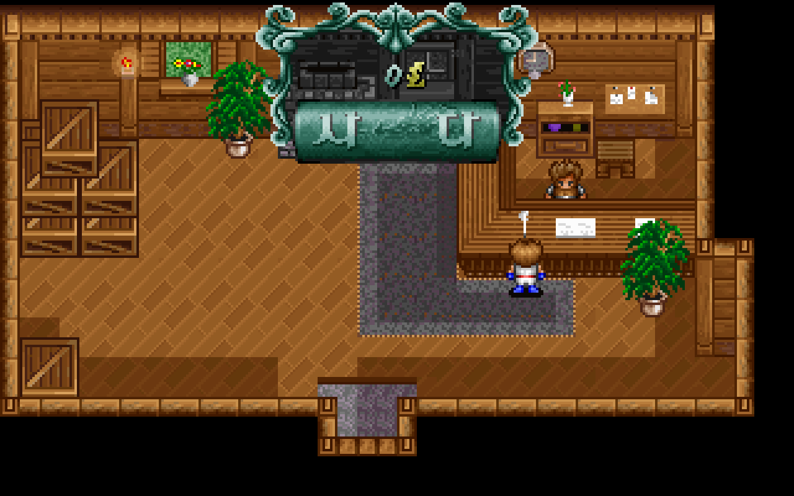
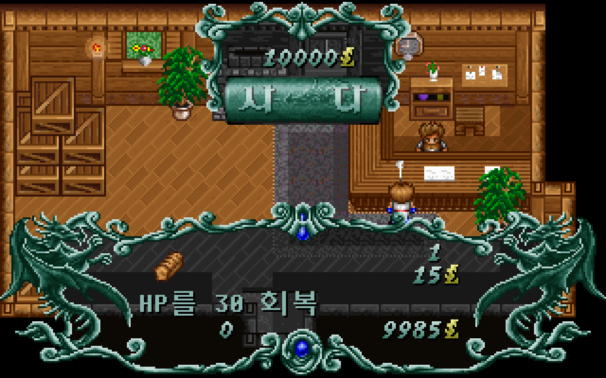
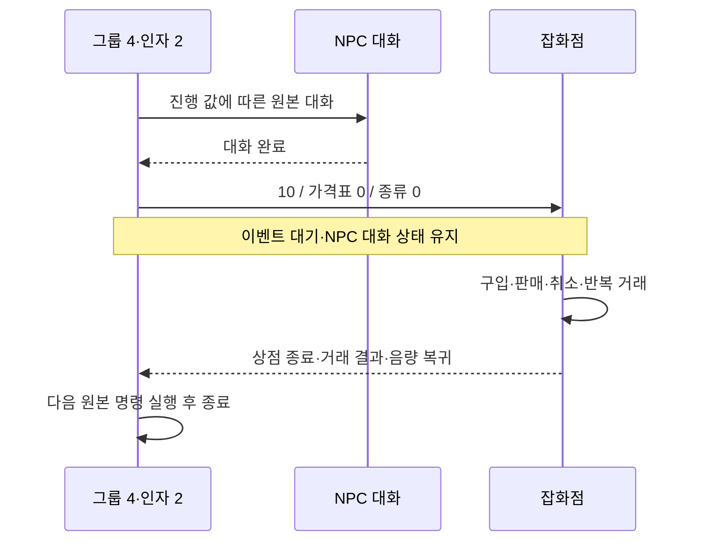

# 잡화점의 원본 이벤트 명령 연결

엘가임 잡화점의 대화→거래→이벤트 복귀를 원본 명령 `10`으로 실행한다. 검 수리 진행 값으로 거래 화면을 따로 열던 게임 분기를 제거했다. [전체 복원 이슈 #39](https://github.com/bnjjong/protocoss-remaster/issues/39)의 공통 이벤트 복원 단계다. 플레이 범위는 기존 AREA00 맵 0~12이며 새 지역과 첫 전투는 아직 연결하지 않았다.

| 상점 진입 | 수량 선택 |
| --- | --- |
|  |  |

## 원작 명령과 복귀

원작 해석 함수 `0x25FE8`은 uint16 두 개를 읽어 `0x29A1C`에 전달한다. 첫 값은 가격표 번호, 두 번째는 물품 종류다. 두 값 모두 변수 참조가 아닌 부호 없는 리터럴이다. 종류 0은 `ITEM_P.GUP`, 1은 `WEAPON_P.GUP`을 선택한다. 가격표 로더 `0x2897C`는 파일의 `번호 × 8` 위치에서 오프셋·길이를 읽는다. 현재 잡화점은 번호 0·종류 0이며 가격표는 39품목의 구입·판매 가격 156바이트다.

해석 함수는 명령 바이트 뒤의 인자 4바이트를 소비한다. 거래 화면이 끝나 `0x2602B`로 돌아오면 다음 이벤트 명령을 실행한다. 화면을 여는 것만으로 이벤트를 완료하지 않는다.



진행 변수 8이 0이면 검을 맡기고 1로 바뀐다. 1·2에서는 기다리라는 대화만 한다. 3이면 검을 돌려받고 4로 바뀌며, 그 대화에서 곧바로 상점을 열지는 않는다. 4 이상에서 다시 말을 걸면 인사 뒤 원본 `10 / 0 / 0`을 실행한다. 이 분기와 변경 시점은 원본 G&M으로 처리한다.

`EventMachine.Stop.Shop`에서 실행을 멈추고 같은 요청을 유지한다. 실제 거래는 기존 `ShopMenu`·`ShopRenderer`가 처리한다. 화면을 닫으면 `FieldScript.resumeShop`이 소지금·잡화 수량을 받아 다음 명령으로 돌아간다. 거래 중 필드·이벤트 변수·장비·인물 상태가 바뀐 저장 결과와 중복 완료 요청은 거부한다. NPC 대화 종료는 부모 이벤트가 끝날 때 처리한다.

## 지원 범위와 검증

가격표·종류 해석은 공통 실행기에 추가했다. 게임 연결은 AREA00의 가격표 0·종류 0이다. 다른 가격표·장비 상점·연출 안의 상점은 사전 검사에서 거부한다. 사전 검사는 저장 사본으로 전체 이벤트를 실행하며 화면·음량·실제 소지품을 바꾸지 않는다. 일반 NPC 대화도 원본 이벤트를 먼저 검사하고, 아직 연결하지 않은 시설은 기존 처리 범위를 유지한다.

- [원작 기록](shop-event-native.json): 진행 0/1/2/3/4/5/65535의 7개 상태, 기존 원작 거래 193개를 실제 대화·상점 명령으로 감싼 상태, 거래 뒤 변수 변경을 확인하는 합성 이벤트까지 **201개 상태**의 중간·최종 저장 전체를 Kotlin과 대조했다. 원작 명령 위치·실행 수·300개 변수 해시도 일치했다.
- 같은 기록의 인자 4개 표본은 32768·65535를 포함한다. 원작 `0x25FE8`의 두 인자와 다음 주소가 일치한다. 대기 유지·완료 한 번만 허용·미지원 가격표/종류·거래 외 상태 변경 거부도 검사한다.
- `./gradlew test`: Kotlin 131개 통과. 이전 보상·필드 기록이 상점 인자를 읽기 직전에 멈춘 사실을 유지하면서, 이번에 추가한 명령 읽기 단계와 구분해 비교한다.
- `:desktop:verifyShop`: 실제 앱에서 새 게임→검 맡기기→합류→쪽지→검 회수→재방문을 진행했다. 모든 상점 대화의 공통 실행기 사용, 거래 대기 요청·NPC 상태 유지, 종료 뒤 실행기 해제, 193개 거래·구입 7종·판매 39종·수량/소지금 경계·취소·거래 중 중복 입력 방지·필드 정지·음량 복귀·일시정지·저장 재개·구입품 사용을 확인했다. 기존 장비·파티·자동 장비·아이템·텐트 검사도 통과했다.
- `:desktop:verifyIndoor -PindoorOnly`: 실내 주민 8명·224개 분기, 여비 지급→구입 후 35→저장 재개·반복 무지급·대화 중 필드 잠금 통과. NPC 진입 순서 변경의 영향을 확인한다.
- [상점 화면 기록](../shop-render.json): 새 실행 결과 528장·33,792,000픽셀이 원작 상점 그리기 함수와 일치했다. 배경은 앱에서 상점을 열 때 정지한 필드다.
- [실내 화면 기록](shop-event-indoor-render.json) 63장·4,032,000픽셀과 [검 수리 화면 기록](shop-event-sword-render.json) 10장·640,000픽셀도 원작 필드·인물·대화 출력과 비교했다. 위 상점 표본과 합계 601장·38,464,000픽셀이다.
- Python 추출기 33개·문법 검사·`git diff --check` 통과. 원작 상점 이벤트 기록을 다시 생성해 바이트 일치도 확인했다.

원작 이벤트 비교는 VM·명령 인자 읽기·대화 분기·보상과 상점 뒤 명령을 실행한다. `0x29A1C`의 전체 화면 루프는 생략한다. 거래 193개는 별도 CPU에서 원작 수량 함수 `0x27EE4`/`0x28CF8`을 실행하고, 저장 결과만 대기 중인 VM의 저장 구간에 복사한 뒤 원래 호출 스택으로 돌아간다. 따라서 원작 전체 상점 화면 루프를 끊김 없이 실행한 증거로 해석하면 안 된다. 실제 거래 입력·음량·그리기는 기존 원작 함수 기록과 위 앱 검사로 따로 비교한다. 원작 오디오 파형과 모든 전환 프레임의 시간은 이번 검증 범위에 포함하지 않는다.

일반 게임·Kotlin/앱 검사에는 원본 폴더가 필요 없다. 원작 기록을 재생성할 때는 Pillow·Unicorn을 설치한다. 압축 해제 EXE·메모리는 RAM에만 두며 원본·사용자 저장을 수정하지 않는다.

```bash
python3 tools/extractor/verify_shop_event.py --game-dir /path/to/Protocoss_Game
./gradlew test :desktop:verifyShop :desktop:verifyIndoor -PindoorOnly
python3 tools/extractor/verify_shop_render.py --game-dir /path/to/Protocoss_Game
python3 -m unittest discover -s tools/extractor/tests
```

다음은 장비 상점·나머지 시설과 진행을 막는 명령의 연결이다. 가격표 전체·시설 선택/비용/효과·나머지 연출·다른 지역·전투는 남아 있다.
