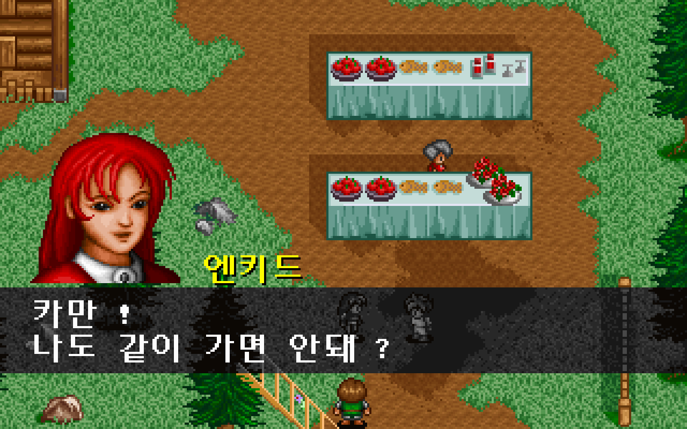
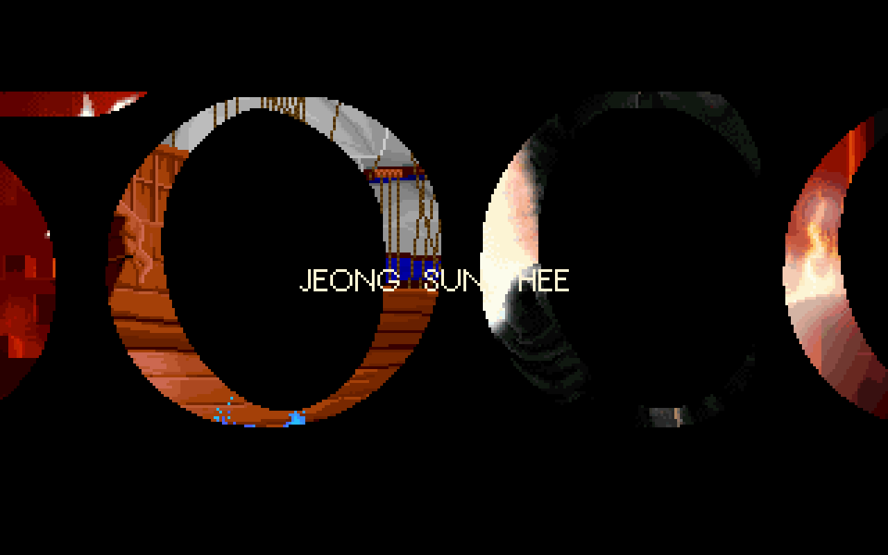
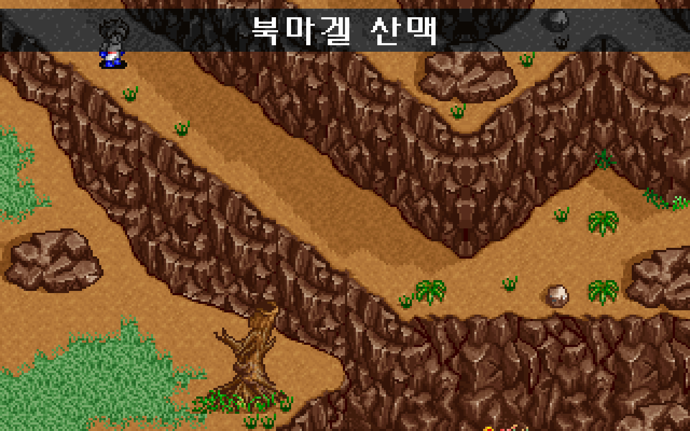
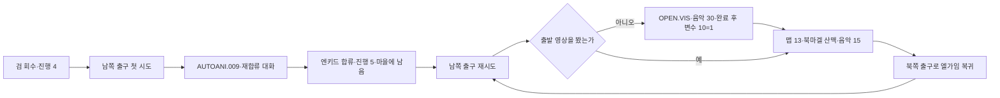

# 마을 재합류·출발 영상·북마겔 진입

검 회수 뒤 마을 남쪽 출구에서 엔키드가 다시 합류하고, 다음 출구 시도에서 출발 영상을 거쳐 북마겔 산맥 첫 맵으로 들어간다. 마을 왕복과 중간 저장 재개도 연결했다. [전체 복원 이슈 #39](https://github.com/bnjjong/protocoss-remaster/issues/39)의 다음 진행 단계다. **현재 전투는 미지원이다.** 패키지 범위는 AREA00 맵 0~13이며 맵 13의 이동·마을 왕복·저장까지 확인했다.

| 엔키드 재합류 | 출발 영상 | 북마겔 첫 맵 |
| --- | --- | --- |
|  |  |  |

## 원작의 진행 순서

그룹 3·인자 22는 검 수리 진행 변수 8과 대화/영상 변수를 확인한다. 원본 이벤트를 그대로 실행하며 한 번의 출구 시도로 모든 단계를 끝내지 않는다.

| 원작 조건 | 실행 결과 |
| --- | --- |
| 진행 0~2 | 변수 9에 따른 출발 전 대화 뒤 마을에 남음 |
| 진행 3 | 변수 9에 따른 검 회수 전 대화 뒤 마을에 남음 |
| 진행 4 | `AUTOANI.009 / mode 0 / 음악 24`→엔키드 합류→진행 5. 마을 안에서 조작을 돌려줌 |
| 진행 5 이상 | 변수 54에 따른 대화, 변수 10이 0이면 `open.vis / 2 / 30 / 0`, 이후 맵 13 이동 |



재합류 연출은 현재 필드·NPC·렌더러를 유지한다. 중첩 C16·C23 대화를 마친 뒤 부모 이벤트가 파티와 진행 값을 바꾼다. 원작의 연출 종료 위치는 세계 좌표 824,536·자세 8이다. 재합류 직후 자동으로 다음 맵으로 이동하지 않는다.

출발 영상의 마지막 인자 0은 원래 필드 음악을 복구하지 않는 모드다. 영상 중 저장 변수 4는 24를 유지하며 실제 음악은 `S0030.MFA`다. 종료 뒤 같은 이벤트에서 맵 13·스크롤 0,0·화면 좌표 56,24·자세 4·층 0·음악 15로 이동한다. 장소명 `북마겔 산맥`의 키 대기까지 끝나면 이벤트 그룹은 11이 된다. 영상이 끝나야 변수 10을 바꾼다.

맵 13 북쪽 출구의 그룹 11·인자 0은 맵 12·스크롤 80,50·화면 좌표 200,184·자세 0·음악 24로 복귀한다. 진행과 영상 완료 값을 유지하므로 다시 출발해도 재합류·영상은 반복하지 않는다.

## 구현과 검증

- 공통 영상 요청에 최상위 필드 호출과 복구 모드 0을 연결했다. 검증한 조합은 지역 0·필드 음악 24의 `open.vis / 2 / 30 / 0`이다. 기존 조우 `#0.vis / 3 / 27 / 1`은 연출 안에서만 실행한다. 파일명·인자·호출 위치가 다른 조합은 사전 검사에서 거부한다.
- 영상 전 감쇠는 현재 플레이어 위치의 필드를 사용한다. 이전 연출의 마지막 화면을 재사용하지 않는다. 영상 음악을 정리한 뒤 새 지역 음악으로 전환하며, 임시로 마을 음악을 다시 재생하지 않는다. 기존 음량을 보존하고 일시정지/재개 때 두 음악이 겹치지 않음을 검사했다.
- [원작 이벤트 기록](town-departure-native.json): 진행 0/1/2/3/4/5/65535, 대화/영상 분기와 두 인물 상태의 42개 조합. 실제 원작 이벤트 실행기·접근·AUTOANI·중첩 대화·파티·영상 함수·맵 이동·장소명을 실행했다. 중간/최종 저장 전체, 명령 위치·실행 수·300개 변수 해시가 Kotlin과 일치했다. 기록에는 연출 6회·출발 영상 4회·맵 이동 12회가 있다.
- [영상 명세](../../assets/departure/manifest.json): `OPEN.VIS`의 464프레임·29,696,000픽셀이 원작 로더/디코더와 일치한다. 원작 DOS의 기본 타이머인 BIOS 시계의 2틱 간격과 마지막 65단계 팔레트 감쇠를 구분한다. 첫 화면·중간·마지막 기준 이미지도 함께 담았다.
- 맵 13은 80×50셀이다. 원작 `0x23154`의 48,000개 방향/높이 판정을 패키지에 넣고, 배경·겹침·대화 색·인물을 추출했다. 공통 맵 추출기를 분리한 뒤 기존 맵 12 메타데이터와 그림 8파일이 재생성 결과와 같은 것도 확인했다.
- `./gradlew test`: Kotlin 137개 통과. 영상 대기/완료 한 번만 허용, 호출 위치 거부·미지원 조합의 무변경, 진행 분기·파티 복구·맵 이동·저장과 이동 표를 검사했다.
- `:desktop:verifyTownDeparture`: 실제 앱의 42개 상태가 원작 최종 저장 전체와 일치했다. 새 게임→검 회수→재합류→출발 영상→맵 13→마을 복귀→영상 없는 재출발도 실제 이동으로 진행했다. 합계 재합류 7회·영상 5회·2,320개 영상 프레임 상태를 확인했고 입력 잠금·변수 변경 시점·음량·저장 재개를 검사했다.
- [출발 필드 화면](town-departure-render.json) 61장·3,904,000픽셀과 [출발 영상 화면](town-departure-video-render.json) 9장·576,000픽셀이 원작 출력과 일치했다. 합계 70장·4,480,000픽셀이다. 영상 GPU(그래픽 장치) 화면 비교는 프레임 0/232/463의 표본이며, 스트림 상태는 위 464프레임 전체를 검사했다.
- [기존 화면 비교](town-departure-regression-render.json) 703장·44,992,000픽셀도 일치했다. 조우/사물/주민/검 수리 필드 166장·상점 528장·기존 조우 영상 9장이다. 상점 배경은 앱의 정지 화면이며 그 위 원작 메뉴 출력을 비교한다. 신규 표본과 합계 773장·49,472,000픽셀이다.
- `:desktop:verifyEncounterEvent`, `:desktop:verifyTownObjects`, `:desktop:verifyShop`, `:desktop:verifyIndoor -PindoorOnly`로 기존 조우 36상태·225개 사물 상태·193개 거래·224개 실내 분기와 장비/아이템/텐트·초반 연속 진행을 확인했다.
- Python 추출기 33개·문법·문서 링크·`git diff --check` 통과. 출발 자산/원작 기록 21파일을 격리한 폴더에 재생성해 바이트 일치를 확인했다. 원본 목록도 현재 패키지 맵 14개·연출 10개로 갱신했다.
- 음악 [15번](../../assets/opening/music-15/audio.json)과 [30번](../../assets/opening/music-30/audio.json)은 기존 원작 FM 음원 칩(OPL)의 재생 코드로 합성했다. 각각 첫 반복 구간의 원작 이벤트 916/1,173개와 압축 전 오디오(PCM)의 해시를 기록했다. 원작 기기의 아날로그 출력 파형과 비교한 것은 아니다.

원작 이벤트 비교에서는 영상 디코딩·화면/오디오 I/O·입력/IRQ 대기와 접근 중 NPC 시계의 BIOS 공급을 생략한다. 영상 함수의 실제 분기·프레임 반복·음악 선택·복귀와 저장은 실행한다. 영상 디코딩·선택 GPU 화면·실제 입력은 위 별도 검사로 대조했다. 일반 필드 카메라와 모든 전환 프레임의 시간·오디오 파형 전체까지 동일하다고 주장하지 않는다.

일반 실행과 Kotlin/앱 검사에는 원본 폴더가 필요 없다. 원작 검증·자산 재생성에는 Pillow·Unicorn, 음악 합성에는 NumPy·SoundFile·clang이 필요하다. 압축 해제 EXE·메모리는 RAM에만 두고 원본·사용자 저장은 수정하지 않는다.

```bash
python3 tools/extractor/town_departure.py --game-dir /path/to/Protocoss_Game
python3 tools/extractor/render_prologue_audio.py --game-dir /path/to/Protocoss_Game --track 15
python3 tools/extractor/render_prologue_audio.py --game-dir /path/to/Protocoss_Game --track 30
./gradlew test :desktop:verifyTownDeparture :desktop:verifyEncounterEvent
python3 tools/extractor/verify_npc_render.py --game-dir /path/to/Protocoss_Game --folder desktop/build/reports/town-departure --report-name restoration/town-departure-render.json
python3 -m unittest discover -s tools/extractor/tests
```

**남은 핵심 작업은 첫 전투다.** 맵 13의 전투 발생 조건·적 편성·전투 화면/입력/수치/연출·승패와 보상·필드 복귀를 연결해야 한다. 다른 출구·시설·지역도 아직 미지원 범위가 있다. 새 맵의 배경과 이동이 보인다는 사실을 전투나 해당 지역 전체 복원 완료로 계산하지 않는다.
