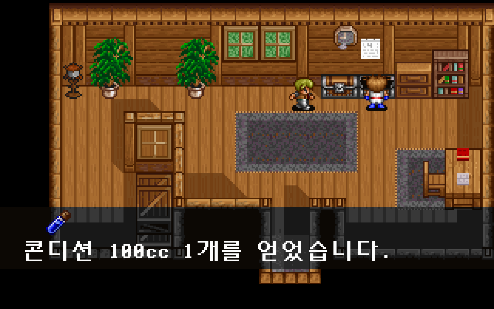
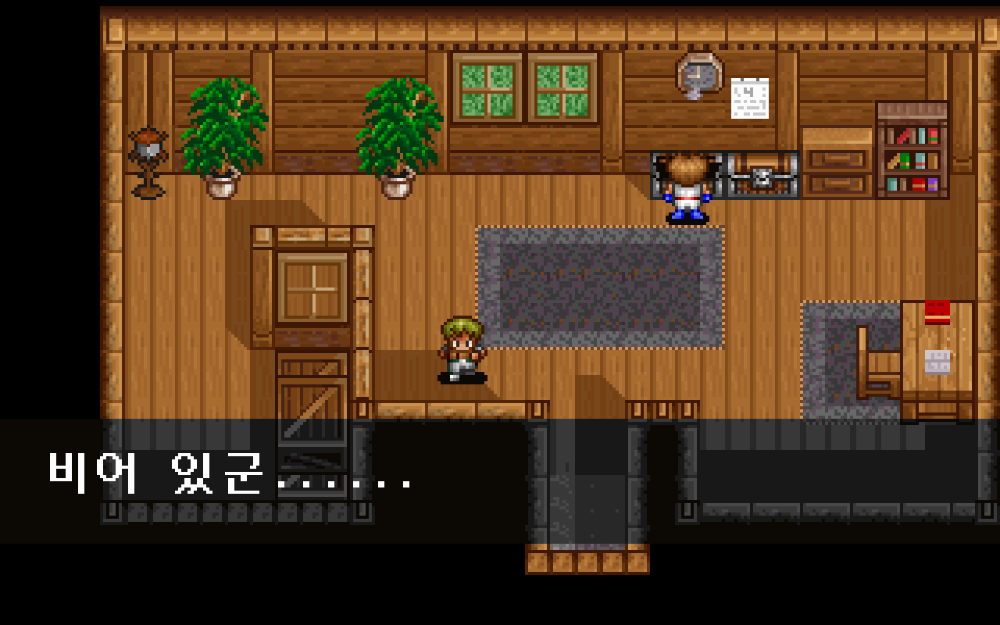
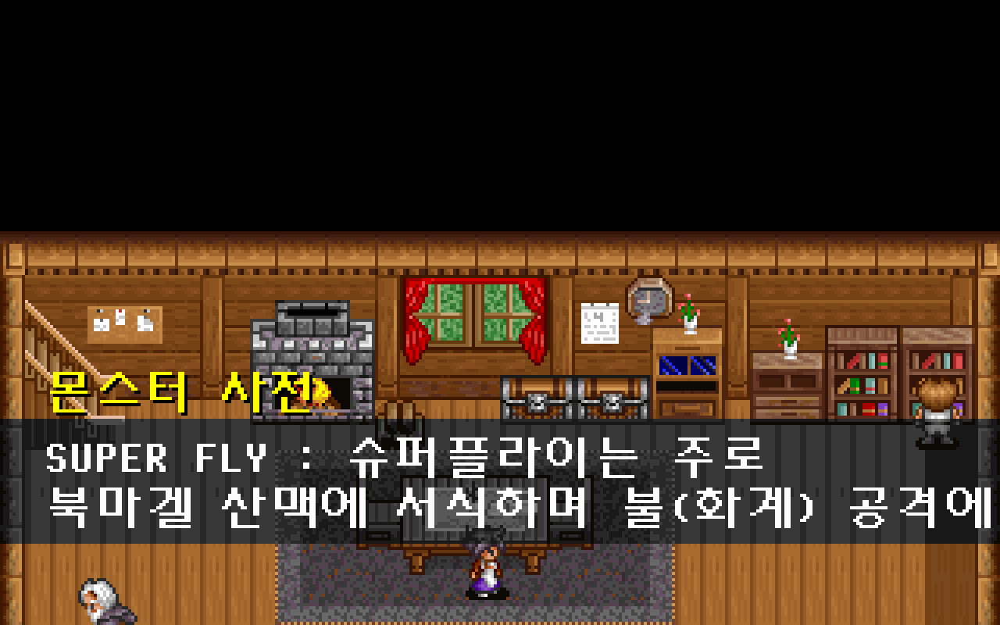
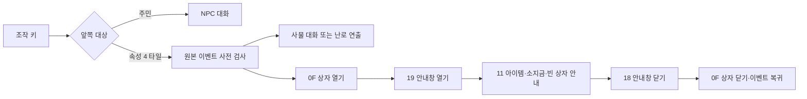

# 엘가임 사물 조사와 상자 복원

엘가임의 우물·책장·장작·상자 등 조사 구역 25곳을 원본 이벤트에 연결했다. 상자 열기/닫기 `0F`, 빈 상자 안내, 잡화점·론도 집의 난로 연출 `AUTOANI.007/008`도 실행한다. [전체 복원 이슈 #39](https://github.com/bnjjong/protocoss-remaster/issues/39)의 현재 지역 누락 복원이다. 플레이 범위는 AREA00 맵 0~12이며 첫 전투와 다음 지역은 아직 포함하지 않는다.

| 아이템 상자 | 빈 상자 | 책장 |
| --- | --- | --- |
|  |  |  |

## 원작 동작과 연결

조작 키의 대상은 이동 이벤트와 별개인 타일 속성 4로 찾는다. 원작 `0x1204C`와 같은 앞쪽 타일·사각형 판정을 사용하고 NPC 대화가 우선한다. 기존 오두막 전용 진입을 공통 조사 진입으로 바꿨다. Space·Enter·E로 조사를 시작하며 연출의 대화는 기존 Space·Enter로 넘긴다.



`0F`는 인자 없는 명령이다. 원작 `0x12720`은 인물의 현재 타일을 시작점으로 가로 3·세로 2칸을 SOC의 다음 타일 표로 치환한다. 타일 번호의 상위 4비트와 셀 속성을 보존한다. 방향과 자세는 0으로 고정한다. 코드가 두 번 호출하면 열기와 닫기를 순서대로 실행하며, 임의의 영구 개방 상태를 추가하지 않는다. 효과음은 원작 `0x7F1B0` 배열의 인덱스 1, `E0001.EFF`다.

게임은 대기 요청을 받은 뒤 현재 필드의 타일에 이 변경을 적용한다. 맵 경계를 넘는 3×2 영역과 이동 이후의 상자 호출은 사전 검사에서 거부한다. 완료한 요청을 다시 완료할 수도 없다. 실제 물품·소지금·획득 여부는 원본 이벤트의 보상·변수 명령이 처리한다.

원작 `0x12924`는 종류 0/1/2를 아이템/장비/소지금으로 처리하고, 그 밖의 부호 없는 종류 값은 `0x12A90`의 빈 안내 분기로 간다. 이번 실제 상자에는 종류 4가 쓰인다. 소지품을 바꾸지 않고 원본 문자열 `비어 있군......`을 표시한다. 아이콘 없는 문구의 위치와 진입·퇴장도 기존 보상 안내 동작에 연결했다.

두 난로는 기존 필드·NPC·렌더러를 유지하는 mode=0 연출이다. 접근→AUTOANI→중첩 조사 대화→필드 복귀를 공통 실행기로 처리한다. 필요한 조합형 글꼴은 원본 폰트 함수와 대조해 별도 자산으로 추가했다.

## 검증과 범위

- [원작 기록](town-objects-native.json): 현재 패키지 맵 0·4~12의 속성 4 조사 구역 25곳. 진행 0/3/4와 관련 변수 0/1/65535, 빈 소지품·98/255 수량·소지금 상한 부근을 조합한 225개 상태다. 상자 명령 90회·난로 연출 18회의 중간/최종 저장 전체, 명령 위치·실행 수·300개 변수 해시를 Kotlin과 대조했다. 조작 위치·네 방향의 원작 호출 100개도 비교했다.
- `./gradlew test`: Kotlin 134개 통과. 3×2 타일 변경·상위 플래그/속성 유지·범위 거부·중복 완료 거부·대화/보상/연출 복귀를 검사했다. 기존 보상 파서의 상위 비트 종류도 원작의 빈 안내 의미로 처리한다.
- `:desktop:verifyTownObjects`: 실제 앱 25구역·225상태·18회 연출에서 원작 최종 저장 전체 일치. 세 조작 키·방향/거리 거부·입력 잠금·아이템/소지금 보상·빈 상자·반복 상태·저장 재개 통과. 새 게임→검 회수 468걸음도 진행했다. 지도상 각 조사 좌표에서 시작하는 표본 검사이며 모든 위치를 출입구부터 걸어간 검사는 아니다.
- [사물 화면 기록](town-objects-render.json): 87장·5,568,000픽셀이 같은 상태의 원작 필드·인물·글꼴·대화 출력과 일치했다. 캡처의 타일 변경은 별도로 위 실제 원작 상자 함수와 대조했다.
- [기존 화면 비교](town-objects-regression-render.json) 107장·6,848,000픽셀도 일치했다. 오두막 조사·주민 대화·검 수리 화면이며 사물 표본과 합계 194장·12,416,000픽셀이다.
- `:desktop:verifyShop`, `:desktop:verifyCabinInteraction`, `:desktop:verifyIndoor -PindoorOnly`: 기존 거래 193개, 오두막 30개 조사·화상 연출, 주민 224분기·여비 지급·저장 재개와 장비·아이템·텐트 검사 통과.
- Python 추출기 33개 통과. 사물 자산/원작 기록 5파일을 격리한 폴더에 재생성해 바이트 일치를 확인했다. 공통 보상 추출기 변경 뒤 기존 604개 원작 보상 기록도 재생성하여 바이트 일치를 확인했다.

원작 이벤트 비교는 실제 VM·보상·상자 타일 함수 또는 AUTOANI·접근·중첩 대화·복귀·저장 메모리를 실행한다. 화면·오디오 I/O와 입력/IRQ 대기는 생략한다. 연출 접근 중 NPC 시계의 BIOS 공급도 생략한다. 실제 키 입력과 선택한 화면은 앱 검사로 따로 확인했다. 원작 오디오 파형과 모든 전환 프레임의 표시 시간은 비교하지 않았다. 압축 해제 EXE·메모리는 RAM에만 두며 원본·사용자 저장을 수정하지 않는다.

일반 게임과 Kotlin/앱 검사에는 원본 폴더가 필요 없다. 원작 기록 재생성에는 Pillow·Unicorn이 필요하다. 아래 사물 추출기는 현재 패키지의 필드/시작 연출/공통 연출 자료를 기반으로 추가 자산을 만든다.

```bash
python3 tools/extractor/verify_event_rewards.py --game-dir /path/to/Protocoss_Game
python3 tools/extractor/town_objects.py --game-dir /path/to/Protocoss_Game
./gradlew test :desktop:verifyTownObjects :desktop:verifyCabinInteraction
python3 tools/extractor/verify_npc_render.py --game-dir /path/to/Protocoss_Game --folder desktop/build/reports/town-objects --report-name restoration/town-objects-render.json
python3 -m unittest discover -s tools/extractor/tests
```

다음은 마을 남쪽 출구의 그룹 3·인자 22다. 원본에는 `AUTOANI.009`·엔키드 재합류·진행 5 변경, 조건부 `open.vis / 2 / 30 / 0`과 맵 13 진입이 있다. 장비 상점은 현재 초반 구간 밖에 있으며, 시설 전체·다음 지역·전투는 계속 복원해야 한다.
