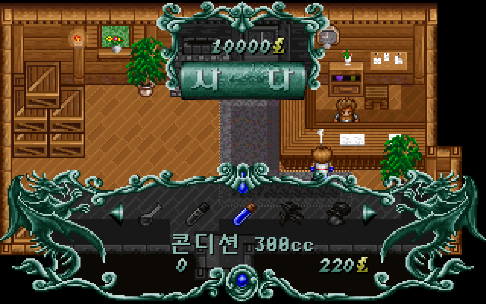
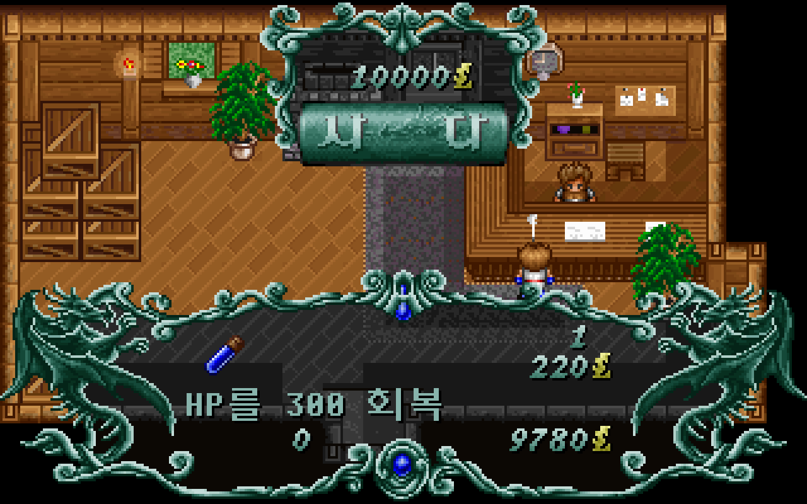

# 엘가임 잡화점 구입·판매

검 회수 후 잡화점 주인에게 다시 말을 걸면 구입·판매·종료를 선택할 수 있다. [이슈 #31](https://github.com/bnjjong/protocoss-remaster/issues/31)에 따라 원작 0번 잡화점의 상품·가격·수량·소지금 처리와 거래 화면을 연결했다. 구입한 물건은 기존 소지품 메뉴에서 사용하고 DOS 저장 형식으로 이어갈 수 있다.

## 진입과 조작

검을 받는 대화에서는 단검만 지급한다. 회수 뒤 다시 대화했을 때 원작 이벤트가 호출하는 `shop(0,0)`으로 들어간다. 거래 동안 주인은 대화 자세를 유지하고 플레이어·주민은 멈춘다. 종료하면 주인의 방향과 필드 조작을 복구한다.

| 화면 | 조작 |
| --- | --- |
| 구입·판매·종료 | 위·아래로 순환, Enter·Space 확인, Esc 종료 |
| 상품 | 좌·우 선택, Enter 수량 선택, Esc 첫 화면 |
| 수량 | 좌·우 −1/+1, 아래·위 −10/+10, Enter 거래, Esc 취소 |

상품·수량 화면에서 Space는 확인하지 않는다. 수량 0을 확인하면 거래 없이 상품으로 돌아간다. 상품 양끝에서는 순환하지 않으며, 판매한 물건이 없어지면 목록을 다시 만들고 선택 위치를 보정한다. 팔 물건이 없으면 첫 화면을 유지한다.

상점에서 필드 음악을 새로 틀지 않는다. 원작 `0x28700`의 음량 계산에 따라 최대 음량 127을 101로 줄이고, `0x28618`의 종료 처리처럼 원래 음량으로 복구한다. 앱 일시정지·재개 중에도 음악을 겹쳐 재생하지 않는다.

## 상품과 거래 규칙

`DATA/ITEM_P.GUP`의 첫 묶음은 일반 아이템 39종의 구입·판매가를 각각 uint16으로 저장한다. 구입가가 0보다 큰 일곱 품목만 번호순으로 진열한다. 이름·그림·설명은 `ITEM.LST`, `COMMON.IMG`에서 읽는다.

| 상품 | 구입가 | 판매가 |
| --- | ---: | ---: |
| 빵 | 15 | 8 |
| 약수 | 100 | 50 |
| 콘디션 100cc | 60 | 30 |
| 콘디션 300cc | 220 | 110 |
| 독초 | 20 | 10 |
| 생명의 가루약 | 450 | 230 |
| 텐트 | 500 | 150 |

판매 목록은 소지 수량이 있는 일반 아이템 전부다. 판매가가 0인 퀘스트 물건도 원작처럼 0원에 판매할 수 있다. 장비는 이 잡화점의 거래 대상에 포함되지 않는다. 구입 수량은 기존 수량과 합쳐 최대 99개이며, 판매는 저장에 기록된 1바이트 수량 전체(최대 255개)를 다룬다.

**원작의 경계 오류도 보존했다.** 구입 수량을 위 키로 늘릴 때 기존 수량과 선택 수량의 합이 90~98이면 원작은 잔액을 확인하지 않고 99개까지 채운다. 따라서 돈이 없어도 이 경로로 구입하면 잔액이 음수가 된다. 그 외 구입 경로는 원작의 잔액 판정을 따르며, 수량·소지금 연산은 원작의 8비트·부호 있는 32비트 넘침을 유지한다. 음수 기호 그림은 원작 숫자 함수가 초기화하지 않아 결과가 불확정이므로 앱에서는 같은 원작 글꼴의 `-`로 표시한다. 음수 상태 변경은 검증하지만 이 기호를 원작 화면과 일치한다고 주장하지 않는다.

소지금은 저장 오프셋 119의 int32, 일반 소지품 수량은 123~161이다. 거래는 이 두 영역만 바꾸며 파티·장비·진행·좌표를 보존한다. 동전 연출이 끝난 뒤 한 번만 반영하므로 연출 중 확인·취소 키가 중복 거래를 만들지 않는다.

## 원작 실행과 화면 비교

[원작 상태 기록](shop-native.json)은 원작 EXE의 거래 함수를 직접 실행한 **193개 표본**이다. 구입 7종의 돈 부족·정확한 금액·취소·수량 0·99·255·원작 음수 잔액, 판매 39종의 수량 1·99·255, 전량 판매·소지금 넘침·Space 무소비를 포함한다. Kotlin 검사에서 저장 전체 2,944바이트와 효과음을 대조한다. 빈 목록·전체 목록·일부 소지품 목록과 첫 화면의 방향·Enter·Space·Esc도 원작과 비교한다.

| 원작 함수 | 검증한 내용 |
| --- | --- |
| `0x29A1C` | 상점 번호·일반 아이템 종류, 구입·판매·종료 호출 |
| `0x28C18`·`0x28A68` | 첫 화면 선택·순환·확인·취소·그리기 |
| `0x2834C`·`0x28408` | 구입·판매 후보와 가격 |
| `0x27EE4`·`0x28CF8` | 수량 입력·금액 판정·취소·거래 |
| `0x29BB4`·`0x28F0C`·`0x29590` | 상품·수량·소지금·동전 그림 |
| `0x28700`·`0x28618` | 진입 101·종료 127 음량 |

그림 **94,022픽셀**은 원작 스프라이트 함수의 출력과 비교해 추출했다. [화면 기록](shop-render.json)은 실제 앱의 **528장·33,792,000픽셀**을 원작 상점 그리기 함수와 비교한다. 필드 바탕은 앱이 진입 순간 정지한 화면을 사용하고, 그 위의 배경색 변환·메뉴 그림·글자·숫자·화살표·동전은 같은 저장·선택 상태에서 원작 함수를 실행해 조합한다. 이 비교를 DOSBox 전체 화면 녹화의 프레임별 비교로 보지는 않는다.

첫 화면의 세 선택, 구입 7종·판매 39종, 설명·수량·금액·목록 스크롤·깜빡이는 화살표와 동전 연출의 표시 프레임을 포함한다. 화살표는 원작의 4틱 간격, 동전은 원작의 12개 프레임·대기 배열과 효과음 7을 사용한다. 첫 화면 선택판 회전과 상품 간 미끄러짐의 중간 프레임, 키 누름 반복 속도는 이번 단계에서 복원하지 않았다.

실제 앱 `verifyShop`는 새 게임→검 수리·회수, 수동·자동 장비, 19종 대상 아이템, 텐트 검사에 이어 193개 거래를 실제 입력으로 실행한다. 소지금·수량 저장 재개, 구입한 빵 사용, 빈 판매 목록, 필드·주민 정지, 대화 자세 유지, 일시정지·음악 음량 복귀를 검사한다. 원본 폴더 없이 패키지 자산만 사용하며 임시 저장 폴더와 음소거를 적용한다.

Kotlin **89개**, Python **31개** 검사와 기존 건물·마을·주민·필드 이동·오프닝·프롤로그·저장·경계 실행 검사를 통과했다.

다른 지역 상점·장비점·여관·전투는 이번 범위에 없다. 새 게임의 소지금이나 소지품을 시험 목적으로 지급하지 않는다. 아래 화면은 소지금 10,000 등 거래 검사용 표본이다.

| 구입 상품 | 수량 선택 |
| --- | --- |
|  |  |

## 재현

```bash
./gradlew test :desktop:verifyShop :desktop:verifyBuildings \
  :desktop:verifyTownTravel :desktop:verifyNpcs :desktop:verifyFieldTravel \
  :desktop:verifyOpening :desktop:verifyPrologue :desktop:verifyTitleSave \
  :desktop:verifyFieldBounds
PYTHONPATH=tools/extractor python3 -m unittest discover -s tools/extractor/tests
```

원작 자료 추출·비교에는 Pillow·Unicorn을 사용한다. EXE의 압축 해제 결과와 재배치한 메모리는 파일에 저장하지 않는다. 화면 비교는 앱 실행 검사가 끝난 뒤 실행한다.

```bash
python3 tools/extractor/shop_trading.py --game-dir /path/to/Protocoss_Game
python3 tools/extractor/verify_shop_render.py --game-dir /path/to/Protocoss_Game
```
