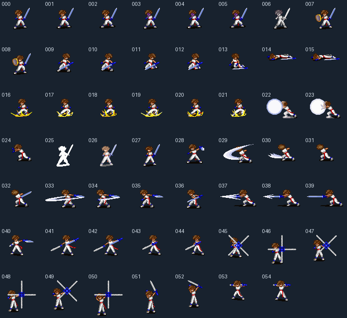

# 1-1. 카만 원본 프레임 추출

`USER.SPR`의 캐릭터 0에 있는 **55프레임을 PNG로 추출하고, 원작 그리기 함수의 출력과 102,307픽셀의 색·투명도가 모두 일치함을 확인했다.** 현재 데모가 읽는 `assets/sprites/kaman_test.png`도 원작 첫 프레임으로 교체했다.

이번 완료 범위는 프레임 추출과 첫 프레임의 표시다. 전투 자세·효과가 섞인 원본 프레임의 용도, 방향별 애니메이션 연결, 다른 캐릭터·NPC·UI와 컷씬 복원은 다음 작업이다. 1단계 전체나 필드 캐릭터 동작을 완료했다고 판정하지 않는다.



## 원본 컨테이너

`GRP/USER.SPR`의 첫 uint32 값 44는 이미지 개수가 아니라 첫 캐릭터 블록의 시작 위치다. 앞의 44바이트에는 캐릭터 블록 11개의 절대 오프셋이 들어 있다.

각 캐릭터 블록은 다음 순서다. 정수는 모두 리틀 엔디언이다.

| 블록 안의 시작 위치 | 크기 | 의미 |
| --- | ---: | --- |
| 0 | 4 | 프레임 개수 `n` |
| 4 | `n×4` | 그래픽 버퍼 기준 프레임 상대 오프셋 |
| `4+n×4` | 4 | 그래픽 버퍼의 바이트 길이 |
| `8+n×4` | 가변 | 각 프레임의 헤더·압축 픽셀 |

캐릭터 0은 55프레임이다. 첫 프레임은 파일 위치 272부터 897바이트이며, 헤더의 폭·높이는 34×44다. 파일 전체에는 11개 캐릭터, 599프레임이 있다. 이번 제품 추출 명령은 캐릭터 0만 출력한다.

## 프레임과 투명도

프레임 앞의 4바이트는 uint16 폭과 높이다. 이후 픽셀은 VGA의 네 메모리 평면으로 나뉘어 있다. 각 평면은 열 개수 1바이트, 각 열은 구간 개수 1바이트와 다음 구간들을 가진다.

```text
skip 1바이트 → count 1바이트 → 색상 인덱스 count바이트
```

픽셀을 쓰는 X좌표는 `평면 번호 + 열 번호×4`다. Y좌표는 각 열의 0에서 시작하며, `skip`만큼 아래로 이동한 뒤 `count`개 픽셀을 세로로 쓴다.

- `count=0`은 그 구간에서 픽셀을 쓰지 않는다는 뜻이다. 새 줄이나 새 열로 이동하는 명령이 아니다.
- 건너뛴 위치는 투명하다. 기록된 팔레트 번호 0과 255도 불투명한 픽셀이므로 색상 번호만으로 투명도를 정하지 않는다.
- 팔레트는 `DATA/PROTOCOS.PAL`의 RGB 채널을 각각 4배로 변환한다. 이번 카만 프레임이 실제로 쓰는 번호는 1~224이며, 이 구간은 첫 오두막의 팔레트와 같다.
- 이전의 가로줄 단위 압축이라는 설명은 이 프레임 형식과 맞지 않는다.

## 산출물과 재현

| 경로 | 내용 |
| --- | --- |
| `tools/extractor/decode_user_sprite.py` | 원본 범위를 검사하고 캐릭터 0을 추출 |
| `assets/sprites/user/character_00/frame_000.png` ~ `frame_054.png` | 원본 크기·투명도를 보존한 55장 |
| `assets/sprites/user/character_00/manifest.json` | 원본·팔레트 SHA-256, 각 프레임의 원본 위치·크기·파일명 |
| `assets/sprites/kaman_test.png` | 현재 데모 호환 경로. `frame_000.png`와 같은 파일 |
| `tools/extractor/verify_original_user_sprite.py` | 독립적으로 읽은 프레임과 원작 x86 함수로 PNG·목록·데모 사본 검사 |

저장소 루트에서 실행한다. 이미지 추출에는 Pillow, 원작 명령 실행 검증에는 Unicorn을 사용한다. 출력은 기본적으로 이 스크립트가 속한 저장소이며, `--output-root`로 분리할 수 있다.

```bash
python3 -m venv .venv
.venv/bin/pip install Pillow unicorn
GAME_DIR=/Users/df/Downloads/Protocoss/Protocoss_Game

.venv/bin/python tools/extractor/decode_user_sprite.py \
  --game-dir "$GAME_DIR" --preview docs/images/kaman-frames.png
.venv/bin/python -m unittest discover -s tools/extractor/tests -v
.venv/bin/python tools/extractor/verify_original_user_sprite.py \
  --game-dir "$GAME_DIR"
./gradlew test
./gradlew :desktop:run
```

현재 `extract_all.py`에는 이 명령을 연결하지 않았다. 기존 일괄 스크립트의 다른 변환기와 컷씬은 아직 재검증·수정 대상이므로, 이번에는 이 명령만 독립적으로 사용한다.

## 원작 검증 근거

맵 검증 도구의 압축 해제 함수를 재사용해 `PROTOCOS.FNT` 안의 게임 실행 코드를 메모리에서 얻는다. AMOS·압축 데이터의 SHA-256을 확인한 판본만 실행하며, 원본 파일은 수정하지 않고 압축 해제한 실행 파일도 저장하지 않는다.

스프라이트 비교는 원작 코드 주소 **`0x2D11A..0x2D19D`**를 실행한다. 이 함수는 VGA 포트 `0x3C5`로 평면을 선택하고, 구간을 읽어 화면에 세로 픽셀을 쓴다. 검증 도구는 포트 선택과 화면 메모리 쓰기를 받아 팔레트 인덱스·알파를 만든다. 제품 디코더의 `decode_frame`을 기대 이미지 생성에 사용하지 않는다.

- 카만 55프레임의 PNG·크기·원본 오프셋·데모 첫 프레임: **원작과 RGBA 전체 일치**, 102,307픽셀.
- Python 검사 20개: 기존 맵 7개와 스프라이트 13개 통과. 평면·열 순서, 투명 구간, `count=0`, 색상 0·255, 잘린 데이터와 잘못된 오프셋, 실패 시 기존 데모 파일 보존을 검사.
- `./gradlew test`: Kotlin 15개 통과.
- 실제 `ProtocossGame`를 실행해 캡처한 첫 화면에서, 상단 안내 문구를 제외한 54,400픽셀을 원본 배경·스프라이트의 합성과 비교했다. 차이는 0개다. 임시 검사 런처로 입력을 고정해 검사했으며 제품 코드는 바꾸지 않았다.

실행 화면은 [오두막 캡처](images/belson-cabin-desktop.png)에 남겼다. 대화창의 초상화도 기존 코드가 같은 데모 PNG를 참조하므로 함께 바뀐다. 화자별 원작 초상화, 원작 폰트, 카메라 경계와 캐릭터 모션은 이번 검증 범위에 포함하지 않는다.
