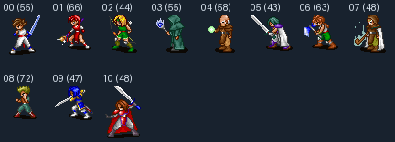

# USER.SPR 원본 프레임 추출

`USER.SPR`의 **11개 캐릭터·599프레임을 추출하고, 원작 그리기 함수가 쓴 1,019,826픽셀의 색 번호·투명도를 모두 확인했다.** 원본 공용 팔레트로 만든 RGBA 이미지도 전부 일치했다. 1-1의 카만 55프레임에 이어 1-2의 나머지 544프레임까지 검증한 상태다.

이번 완료 범위는 이미지 데이터 추출·비교다. 모션과 캐릭터 이름 연결, 전투·필드에서의 프레임 용도, 장면별 팔레트 적용, NPC·UI·컷씬은 후속 작업이다. 1단계 전체나 필드 캐릭터 동작을 완료했다고 판정하지 않는다.



| 원본 캐릭터 번호 | 프레임 수 | 비교한 픽셀 수 | 전체 프레임 |
| --- | ---: | ---: | --- |
| 00 — 카만 | 55 | 102,307 | [보기](images/user-frames/character_00.png) |
| 01 | 66 | 101,054 | [보기](images/user-frames/character_01.png) |
| 02 | 44 | 73,790 | [보기](images/user-frames/character_02.png) |
| 03 | 55 | 90,584 | [보기](images/user-frames/character_03.png) |
| 04 | 58 | 83,057 | [보기](images/user-frames/character_04.png) |
| 05 | 43 | 83,661 | [보기](images/user-frames/character_05.png) |
| 06 | 63 | 106,402 | [보기](images/user-frames/character_06.png) |
| 07 | 48 | 79,994 | [보기](images/user-frames/character_07.png) |
| 08 | 72 | 106,568 | [보기](images/user-frames/character_08.png) |
| 09 | 47 | 85,687 | [보기](images/user-frames/character_09.png) |
| 10 | 48 | 106,722 | [보기](images/user-frames/character_10.png) |
| 합계 | **599** | **1,019,826** | |

원본 번호를 그대로 사용한다. 카만 외의 캐릭터 이름은 이번 작업에서 추정해 붙이지 않았다.

## 원본 컨테이너

`GRP/USER.SPR`의 첫 uint32 값 44는 이미지 개수가 아니라 첫 캐릭터 블록의 시작 위치다. 앞의 44바이트에는 캐릭터 블록 11개의 절대 오프셋이 들어 있다.

각 캐릭터 블록은 다음 순서다. 정수는 모두 리틀 엔디언이다.

| 블록 안의 시작 위치 | 크기 | 의미 |
| --- | ---: | --- |
| 0 | 4 | 프레임 개수 `n` |
| 4 | `n×4` | 그래픽 버퍼 기준 프레임 상대 오프셋 |
| `4+n×4` | 4 | 그래픽 버퍼의 바이트 길이 |
| `8+n×4` | 가변 | 각 프레임의 헤더·압축 픽셀 |

캐릭터 0은 55프레임이다. 첫 프레임은 파일 위치 272부터 897바이트이며, 헤더의 폭·높이는 34×44다. 이전 노트의 총 588프레임과 달리 실제 프레임 목록에는 599개가 있고, 이번에는 그 모두를 원작 함수로 확인했다.

## 프레임과 투명도

프레임 앞의 4바이트는 uint16 폭과 높이다. 이후 픽셀은 VGA의 네 메모리 평면으로 나뉘어 있다. 각 평면은 열 개수 1바이트, 각 열은 구간 개수 1바이트와 다음 구간들을 가진다.

```text
skip 1바이트 → count 1바이트 → 색상 인덱스 count바이트
```

픽셀을 쓰는 X좌표는 `평면 번호 + 열 번호×4`다. Y좌표는 각 열의 0에서 시작하며, `skip`만큼 아래로 이동한 뒤 `count`개 픽셀을 세로로 쓴다.

- `count=0`은 그 구간에서 픽셀을 쓰지 않는다는 뜻이다. 새 줄이나 새 열로 이동하는 명령이 아니다.
- 건너뛴 위치는 투명하다. 기록된 팔레트 번호 0과 255도 불투명한 픽셀이므로 색상 번호만으로 투명도를 정하지 않는다.
- 기본 PNG는 `DATA/PROTOCOS.PAL`의 RGB 채널을 각각 4배로 변환한다.
- 이전의 가로줄 단위 압축이라는 설명은 이 프레임 형식과 맞지 않는다.

## 팔레트 번호 보존

캐릭터 07의 일부 프레임에는 색 번호 235가 기록된 픽셀 37개가 있다. 이 번호는 공용 팔레트에서 흰색이지만, 첫 오두막 팔레트에서는 파란색이다. 따라서 공용 팔레트로 만든 RGBA만으로 모든 장면의 색을 재현할 수는 없다.

모든 프레임에 `indices/frame_NNN.png`를 함께 저장한다. 이 파일은 **LA 모드**이며 L 채널은 밝기 대신 원본 8비트 색 번호, A 채널은 투명도를 담는다. `(0, 0)`은 빈 픽셀, `(0, 255)`는 실제로 기록된 0번 색이다. 같은 RGB를 가진 색 번호도 구별해 남기므로, 장면의 팔레트를 나중에 적용할 수 있다. 이번에는 장면별 팔레트 전환을 엔진에 연결하지 않았다.

## 산출물과 재현

| 경로 | 내용 |
| --- | --- |
| `tools/extractor/decode_user_sprite.py` | 전체 또는 선택한 캐릭터를 추출 |
| `assets/sprites/user/character_00` ~ `character_10` | 캐릭터별 원본 크기의 RGBA PNG, 합계 599장 |
| 각 폴더의 `indices/frame_NNN.png` | 원본 색 번호·투명도 LA PNG, 합계 599장 |
| 각 폴더의 `manifest.json` | 원본·팔레트 SHA-256, 캐릭터·프레임 번호, 원본 위치·크기·두 PNG 경로 |
| `assets/sprites/kaman_test.png` | 현재 데모 호환 경로. 캐릭터 0의 `frame_000.png` 사본 |
| `tools/extractor/verify_original_user_sprite.py` | 독립적으로 읽은 프레임과 원작 함수로 모든 산출물 검사 |

저장소 루트에서 실행한다. 이미지 추출에는 Pillow, 원작 명령 실행 검증에는 Unicorn을 사용한다. 출력은 기본적으로 이 스크립트가 속한 저장소이며, `--output-root`로 분리할 수 있다.

```bash
python3 -m venv .venv
.venv/bin/pip install Pillow unicorn
GAME_DIR=/Users/df/Downloads/Protocoss/Protocoss_Game

# USER.SPR 전체 추출과 미리보기
.venv/bin/python tools/extractor/decode_user_sprite.py \
  --game-dir "$GAME_DIR" --all-characters \
  --preview docs/images/user-characters.png --preview-dir docs/images/user-frames
.venv/bin/python tools/extractor/verify_original_user_sprite.py \
  --game-dir "$GAME_DIR" --all-characters

# 캐릭터 하나만 따로 추출·검증
.venv/bin/python tools/extractor/decode_user_sprite.py --game-dir "$GAME_DIR" --character 7
.venv/bin/python tools/extractor/verify_original_user_sprite.py --game-dir "$GAME_DIR" --character 7

.venv/bin/python -m unittest discover -s tools/extractor/tests -v
./gradlew test
```

옵션을 생략하면 이전과 같이 카만만 처리한다. `--character`와 `--all-characters`는 함께 지정할 수 없다. 다른 캐릭터만 선택하면 카만의 PNG를 수정하지 않는다. 선택한 캐릭터의 모든 프레임을 먼저 검사하므로, 뒤쪽 캐릭터에 잘린 데이터가 있어도 기존 산출물을 덮지 않는다.

현재 `extract_all.py`에는 연결하지 않았다. 기존 일괄 스크립트의 다른 변환기와 컷씬은 아직 재검증·수정 대상이므로 이 명령을 독립적으로 사용한다.

## 원작 검증 근거

맵 검증 도구의 압축 해제 함수를 재사용해 `PROTOCOS.FNT` 안의 게임 실행 코드를 메모리에서 얻는다. AMOS·압축 데이터의 SHA-256을 확인한 판본만 실행하며, 원본 파일은 수정하지 않고 압축 해제한 실행 파일도 저장하지 않는다.

스프라이트 비교는 원작 코드 주소 **`0x2D11A..0x2D19D`**를 실행한다. 이 함수는 VGA 포트 `0x3C5`로 평면을 선택하고, 구간을 읽어 화면에 세로 픽셀을 쓴다. 검증 도구는 포트 선택과 화면 메모리 쓰기를 받아 팔레트 인덱스·알파를 만든다. 제품 디코더의 `decode_frame`을 기대 이미지 생성에 사용하지 않는다.

- 11개 캐릭터·599프레임의 PNG·원본 색 번호·투명도·크기·원본 오프셋과 카만 데모 사본: **원작과 전체 일치**, 1,019,826픽셀.
- 같은 RGB를 가진 색 번호 235를 234로 바꾸고 RGBA PNG를 그대로 둔 잘못된 산출물도 검증 도구가 거부함을 확인했다.
- 임시 출력 폴더에서 재추출한 RGBA 599장·LA 599장·목록 11개와 카만 데모 사본이 기존 산출물과 바이트 단위로 일치했다.
- Python 검사 24개: 기존 맵 7개와 스프라이트 17개 통과. 평면·열 순서, 투명 구간, 색 번호 보존, 캐릭터 선택, 잘린 데이터 거부, 실패 시 기존 산출물 보존을 검사.
- `./gradlew test`: Kotlin 15개 통과. 이번에는 Kotlin 코드와 데모가 참조하는 카만 PNG를 변경하지 않았다.

앞선 카만 작업에서는 실제 실행 화면의 안내 문구를 제외한 54,400픽셀이 원본 배경·스프라이트 합성과 일치했다. [그 실행 화면](images/belson-cabin-desktop.png)과 데모 PNG는 이번에도 그대로다. 화자별 원작 초상화, 원작 폰트, 카메라 경계, 캐릭터 모션과 장면별 팔레트 전환은 별도 작업이다.
