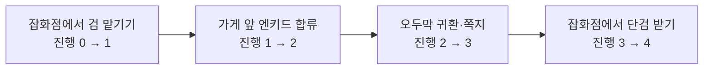
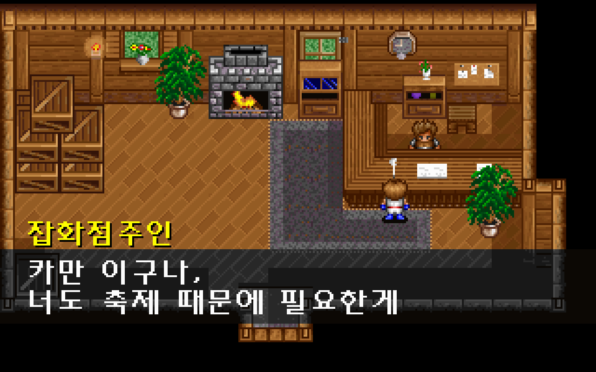
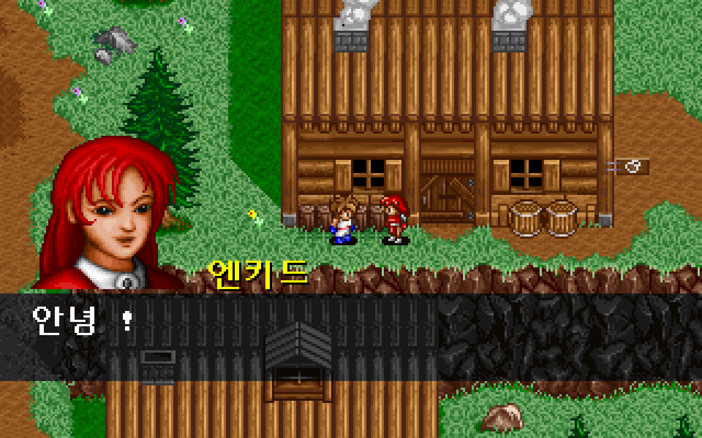
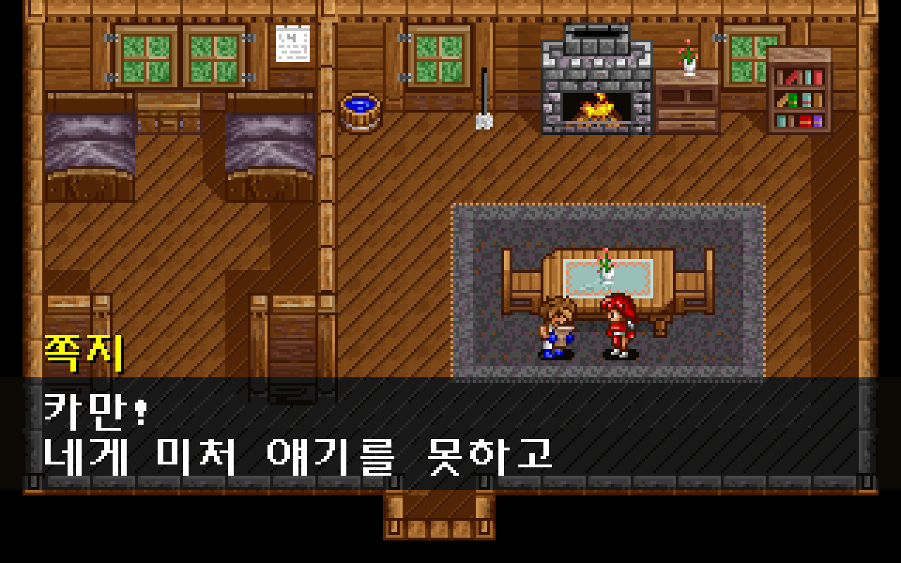
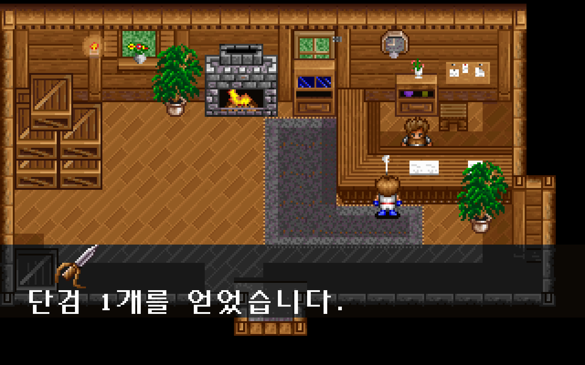

# 검 수리와 초반 스토리 진행

새 게임에서 잡화점에 검을 맡기고, 엔키드와 합류한 뒤 오두막에서 쪽지를 읽고, 잡화점으로 돌아와 단검을 받을 수 있다. [이슈 #19](https://github.com/bnjjong/protocoss-remaster/issues/19)의 범위다. 원작 이벤트 함수의 상태 변경과 실제 앱의 입력·저장·화면을 대조했다.



검을 맡긴 후, 합류 후, 쪽지 확인 후, 검 회수 후에 저장하고 다시 시작해도 해당 단계에서 이어진다. 대화·연출 중에는 이동과 저장 메뉴가 열리지 않는다. 검을 받은 뒤 같은 주인에게 다시 말해도 보상이 늘어나지 않는다.

| 검 맡기기 | 엔키드 합류 |
| --- | --- |
|  |  |
| 쪽지 확인 | 단검 획득 |
|  |  |

## 원작의 상태 변경

`AMOS.EXE`의 이벤트 함수 `0x25304`에 `AREA00.G&M`을 넣어 잡화점 그룹 4·인자 2, 마을 그룹 3·인자 15, 오두막 그룹 1·인자 1을 실행했다. 진행 변수 8의 0~5단계마다 소지품·장비·파티 상태를 달리한 **54개 표본**을 [실행 기록](sword-native-verification.json)에 보존했다.

| 진행 변수 8 | 동작 | 저장 상태 |
| --- | --- | --- |
| 0 | 주인과 검 맡기기 대화 | 1로 변경. 소지품과 장착 무기는 그대로 |
| 1 | 주인은 수리 중이라고 답함. 가게 앞에서 AUTOANI.005 실행 | 엔키드 합류 후 2로 변경 |
| 2 | 주인은 여전히 수리 중이라고 답함. 오두막 귀환 시 AUTOANI.006 실행 | 쪽지 확인·엔키드 이탈 후 3으로 변경 |
| 3 | 주인의 수리 완료 대화·획득 알림 | 장비 소지품에 단검 1개를 더하고 4로 변경 |
| 4 이상 | 주인의 상점 인사 | 보상과 진행은 그대로 |

원작은 첫 대화에서 장착 무기를 빼지 않는다. 회수할 때도 단검을 **소지품에 넣으며 자동 장착하지 않는다.** 저장 오프셋 162의 개수를 원작처럼 1바이트 덧셈 후 최대 99로 제한한다. 장착 무기 오프셋 473과 다른 저장 바이트는 보존한다.

엔키드 합류는 원작 `0x1255C(1)`과 대조했다. 파티 활성·갱신 표시를 설정하고 현재 체력·마력과 사용 중인 변신 상태를 복구한다. 쪽지 뒤 이탈은 기존 원작 이탈 처리와 연결하며, 액세서리 반환도 검사한다. 검사에는 이미 다른 무기를 장착한 경우, 단검 98개·255개, 손상된 체력·마력, 변신 2종, 액세서리 2개와 관계없는 진행 변수도 포함한다.

이 검사는 원작 저장 읽기 함수가 배치한 메모리에서 상태를 다시 모아 Kotlin 결과와 비교한다. 화면·입력 대기와 실제 맵 전환은 원작 실행에서 건너뛴다. 연출의 마지막 이벤트 인자는 별도로 확인한 대화 호출 값을 넣는다. 오두막 이동 좌표는 앞선 [보행·문 왕복 검사](field-travel.md)에서 대조한 값이며, 이번 54개 표본 비교에서는 해당 좌표 구간을 제외한다.

## 연출·획득 알림·음악

합류 연출은 `AUTOANI.005`의 이동·자세·스크롤과 두 대화 호출을 추출했다. 원작 체크포인트의 인물 좌표·프레임과 Kotlin 실행을 대조한다. 끝나면 마을 맵 4, 스크롤 14·7, 화면 좌표 160·104, 자세 8로 돌아온다. 원작 `0x10A54`의 mode=0에 따라 화면을 어둡게 전환하지 않고 열린 문·주민·배경 애니메이션 상태를 유지한다. 연출 중에도 마을 주민은 움직인다.

단검 이름과 그림 번호는 `WEAPON.LST`에서 읽는다. `COMMON.IMG`의 68번 그림과 원작 획득 문구를 사용한다. 알림은 오른쪽에서 70Hz 기준 한 번에 16픽셀씩 들어오고, 글자 x=14·y=158, 그림 x=30·y=134에서 멈춘다. 입력으로 다음 주인 대화로 진행한다.

합류는 음악 24, 쪽지 연출은 음악 27, 쪽지 이후 오두막은 음악 25를 사용한다. 전환 때 이전 음악을 정리한다. 새 게임부터 검 회수까지 실행하면서 동시에 재생되는 음악이 하나를 넘지 않는지 확인한다.

## 검증 범위와 재현

- Kotlin **69개**, Python 추출기 **30개** 검사 통과.
- `verifySwordStory`: 실제 NEW START부터 **468걸음**, 진행 0→1→2→3→4, 합류·쪽지 각 1회, 반복 대화·중복 수령 방지·단계별 저장과 불러오기를 확인한다.
- [화면 대조 기록](sword-render-verification.json): 실제 앱의 대화·합류·쪽지·획득 알림 **10장·640,000픽셀**이 같은 타일·인물·스크롤 상태의 원작 VGA 함수 출력과 일치한다.
- 기존 건물 출입·마을 왕복·주민·오두막·시작 연출·프롤로그·타이틀 저장·필드 경계 검사도 함께 실행한다.

일반 거래 화면, 다른 실내 퀘스트, 장비 메뉴·전투·다음 지역은 이번 범위에 없다. 진행 4 이후 상점 인사 다음에는 대화가 닫힌다. 획득 알림의 퇴장 애니메이션과 전체 팔레트·음량 변화, 부팅부터 이어지는 시계의 위상까지 DOSBox 녹화 전체와 일치한다고 검증한 것은 아니다. 화면 비교는 명시한 상태의 지정 장면을 대상으로 한다.

```bash
./gradlew test :desktop:verifySwordStory :desktop:verifyBuildings \
  :desktop:verifyTownTravel :desktop:verifyNpcs :desktop:verifyFieldTravel \
  :desktop:verifyOpening :desktop:verifyPrologue :desktop:verifyTitleSave \
  :desktop:verifyFieldBounds
python3 -m unittest discover -s tools/extractor/tests
```

원작 기준을 다시 만들려면 Pillow·Unicorn이 설치된 Python으로 아래 명령을 실행한다. 실행 파일과 원본 데이터는 읽기만 한다.

```bash
python3 tools/extractor/sword_story.py --game-dir /path/to/Protocoss_Game
python3 tools/extractor/decode_opening.py --game-dir /path/to/Protocoss_Game
./gradlew :desktop:verifySwordStory
python3 tools/extractor/verify_sword_render.py --game-dir /path/to/Protocoss_Game
```

자동 실행은 원본 폴더 없이 패키지 자산과 임시 저장 폴더를 사용하며 시험 앱의 음악·효과음만 음소거한다. 사용자 DOS 저장과 다른 앱의 오디오는 바꾸지 않는다. 비교 PNG와 상태는 `desktop/build/reports/sword`에 생성한다.
