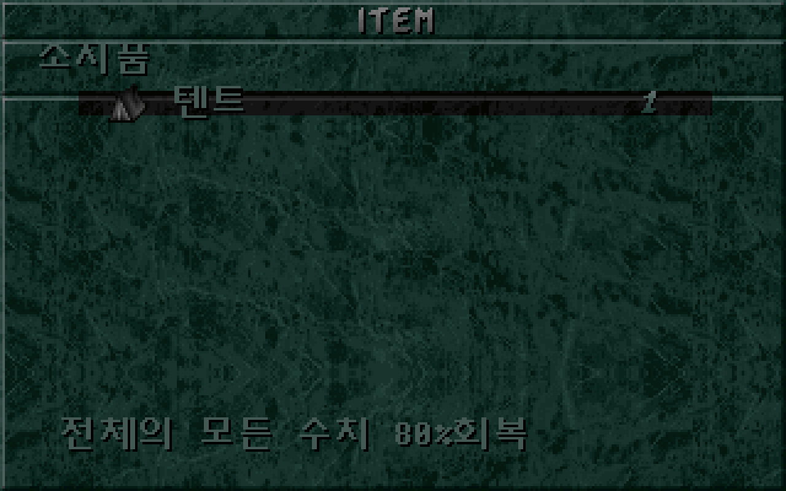
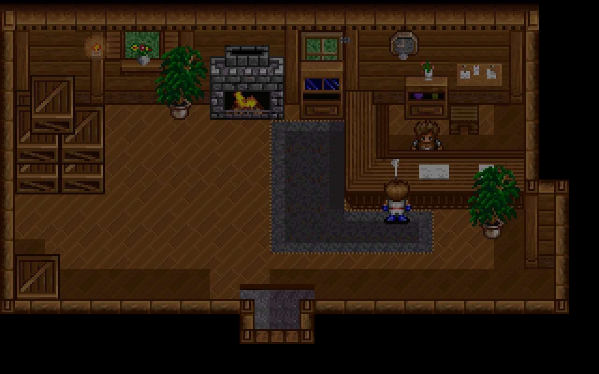

# 텐트 사용·휴식 복원

소지품의 텐트로 원작 휴식 화면·음악·회복을 실행하고 필드로 돌아온다. 원작이 기록한 허용 상태에서만 시작하며, 회복은 휴식 화면 진입 후, 텐트 한 개 차감은 화면과 음악 복구가 끝난 뒤에 일어난다. [이슈 #29](https://github.com/bnjjong/protocoss-remaster/issues/29)의 범위다.

## 조작과 사용 조건

필드 Esc → `소지품` → 텐트 → Enter·Space로 시작한다. 메뉴가 어두워지고 전용 그림·음악이 나타난다. **휴식 화면에서 새 키를 누르면 종료**하며, 다시 어두워진 뒤 원래 필드와 음악으로 복귀한다. 휴식 음악은 반복 재생하며 음악 한 곡이 끝나도 자동 종료하지 않는다.

사용 허용 조건은 **소지 수량이 양수이고 이벤트 변수 2가 정확히 1**인 것이다. 이 변수는 원작 스토리가 저장에 기록한 값이며 지형에서 추측하지 않는다. 허용 값이 아니면 거부 효과음 13을 내고 수량·상태를 유지한다. 현재 초반 새 게임 상태는 허용 값이 0이므로 이 상태에서는 사용할 수 없다. 실행 검사는 허용 값이 있는 별도 저장 표본으로 진행했다. 새 게임에 텐트를 지급하거나 허용 값을 임의로 바꾸지 않았다.

사용 전 목록에서 Esc로 나가면 소비하지 않는다. **시작 후의 Esc는 휴식 종료 키**이며 이미 적용한 회복을 취소하지 않는다. 전환 도중 누른 키는 휴식 종료로 넘기지 않고, 휴식 화면에서 새로 누른 키만 받는다. 메뉴·휴식·복귀 중 필드와 주민은 멈추며 저장 메뉴도 열리지 않는다. 앱을 일시정지하면 전환과 재생도 멈추고 다시 이어진다.

## 원작 회복과 수량 처리

| 대상 | 원작 처리 |
| --- | --- |
| 참가 중인 캐릭터 | 체력·마력을 최대치의 80% 이상으로 올린다. |
| 참가 중인 캐릭터의 구슬 잔량 12개 | 각 최대 잔량의 80% 이상으로 올린다. |
| 참가 중인 캐릭터의 일반 상태 | 정상 값 1로 바꾼다. 죽음 상태도 포함한다. |
| 저장의 추가 캐릭터 7개 | 활성 레코드의 체력만 최대치의 80% 이상으로 올린다. |
| 비참가자·비활성 추가 레코드 | 유지한다. |

80% 계산은 소수점 아래를 버린다. 이미 그 이상이면 현재 값을 유지하므로 가득 찬 체력이나 구슬 잔량이 줄지 않는다. 장비·구슬 장착 상태·능력치·진행·좌표·망토 이동 속도는 유지한다. 다른 회복 아이템과 달리 모두 회복된 상태여도 허용 조건을 만족하면 휴식을 실행하고 한 개를 소비한다.

휴식 화면에서 회복을 적용할 때는 텐트 수량을 유지한다. 새 키를 받은 뒤 휴식 화면을 감추고 필드 음악·화면을 복구한 다음 수량을 하나 줄인다. 이때 필드로 복귀하며 소지품 선택 메뉴에 머물지 않는다. 결과는 기존 DOS 저장 형식에 남긴다.

## 화면과 음악

`IMENU.IMG`의 289번 그림을 원작 함수로 검증해 320×200 검정 화면의 `(88,48)`에 배치했다. 원본 그림은 114×94, **10,716픽셀**이다. 전환은 원작의 색 강도·음량 64→0→64→0→64 순서를 따른다. 원작 VGA의 색 강도 0~63을 정수 나눗셈으로 바꾸는 표를 직접 실행해 얻고, 화면을 그릴 때도 같은 정수 계산을 적용한다.

휴식 전에는 필드 음악을 줄여 종료하고 `S&W/SLEEP.MFA`를 재생한다. 휴식 종료 후 저장의 음악 번호에 해당하는 필드 음악을 **처음부터 다시 재생**한다. 동시에 둘 이상을 재생하지 않는다. 이번 실행 검사는 현재 패키지의 필드 음악 10·24·25번 복귀를 포함한다.

[SLEEP 음원 기록](../assets/tent/audio.json)은 원작 `PROLOGUE.EXE`의 MFA 재생·FM(주파수 변조 방식) 음원 쓰기 코드를 이용한 기존 변환 경로로 만들었다. 첫 반복은 **53.490136초**, 44,100Hz 스테레오 2,358,915개 표본 프레임이며 무음이 아님을 확인했다. 게임에서는 이 음원을 반복한다. 공통 변환 도구에 임의 MFA 파일 지정을 추가한 뒤 기존 25번 음악을 다시 변환해 PCM, 즉 압축 전 음원 데이터의 해시가 기존과 같은지도 확인했다.

전환은 현재 앱의 70Hz(초당 70회) 시계에서 각 65단계로 진행한다. 원작의 색·음량 단계와 순서를 보존했으며, DOS 장치·CPU에 따른 전환 시간까지 동일하다고 주장하지 않는다.

| 휴식 화면 | 메뉴가 어두워지는 중 | 필드 복귀 중 |
| --- | --- | --- |
|  |  |  |

## 검사와 비교 근거

[원작 상태 기록](tent-native.json)은 참가자 구성이 다른 6개 파티·12개 수치 표본·7개 허용 값/수량 조합의 **504개 표본**이다. 참가자 11명, 0·1·65535 등 최대치, 80% 바로 아래·같음·초과, 상태 이상·죽음, 구슬 잔량 12개, 추가 캐릭터 7개의 활성/비활성을 포함한다. 각 표본에서 원작 소지품 제어 함수를 실행해 허용·거부 효과음, 회복 직후와 완료 후의 저장 **2,944바이트 전체**, 수량·이동 속도·음악 파일 순서를 대조한다. 키 대기는 원작 키 처리기가 기록하는 값을 검사 도구에서 전달하고, 실제 상태 변경 기계어는 그대로 실행한다.

| 원작 함수·위치 | 확인한 내용 |
| --- | --- |
| `0x176AC`·`0x176BD` | 텐트 소지 수량과 변수 2의 허용 판정 |
| `0x16F38` | 휴식 화면·음악·회복·복구 순서 |
| `0x147D5`·`0x17242` | 새 키 상태 기록, 전환 후 키 대기 |
| `0x2B838` | 원작 색 강도 변환. 65×64개 결과를 직접 실행해 수집 |
| `0x176D6` | 모든 복구가 끝난 뒤 텐트 수량 차감 |

[텐트 화면 기록](tent-render.json)은 **260장·16,640,000픽셀**의 일치를 보존한다. 휴식 화면은 원작 그림 함수 출력, 전환은 직접 실행한 원작 색 변환표를 기준으로 비교했다. 메뉴는 [별도 원작 메뉴 비교 119장](tent-menu-render.json)에 포함되며, 복귀 필드는 앱의 휴식 전후 화면이 같음을 확인한 뒤 같은 변환표로 비교했다. 이를 DOSBox 전체 화면 녹화와 동일한 검사로 표현하지 않는다.

실제 앱의 `verifyTent`는 기존 새 게임→검 회수 **468걸음**, 수동·자동 장비·19종 소지품 검사에 이어 텐트를 실행한다. 허용 값 0·2·65535와 수량 0 거부, 시작 전 취소, 전환 중 키 무시, 회복 시점, 앱 시계를 120초 진행해도 새 키 전까지 유지, 일시정지·재개, 필드·주민 정지, 저장 파일 무변경, 필드·음악 복귀 후 수량 차감, 두 번 연속 사용과 저장 재개를 확인했다.

Kotlin **86개**, Python **31개** 검사와 기존 건물·마을·주민·필드 이동·오프닝·프롤로그·저장·경계 실행 검사를 통과했다. 원본 게임·DOS 저장은 읽기만 하고 시험 저장은 임시 폴더를 쓴다. 시험 앱의 음량 변경은 별도 음원 객체에서 항상 음소거하므로 사용자 소리를 바꾸지 않는다.

## 재현과 남은 범위

```bash
./gradlew test :desktop:verifyTent :desktop:verifyBuildings \
  :desktop:verifyTownTravel :desktop:verifyNpcs :desktop:verifyFieldTravel \
  :desktop:verifyOpening :desktop:verifyPrologue :desktop:verifyTitleSave \
  :desktop:verifyFieldBounds
python3 -m unittest discover -s tools/extractor/tests
```

원작 추출에는 Pillow·Unicorn, 음원 변환에는 NumPy·SoundFile·Clang을 사용한다. 원작 EXE를 압축 해제한 결과는 메모리에서만 사용한다.

```bash
python3 tools/extractor/tent_rest.py --game-dir /path/to/Protocoss_Game
python3 tools/extractor/render_prologue_audio.py --game-dir /path/to/Protocoss_Game \
  --source-name 'S&W/SLEEP.MFA' --asset-directory assets/tent
python3 tools/extractor/verify_tent_render.py --game-dir /path/to/Protocoss_Game
python3 tools/extractor/verify_equipment_render.py --game-dir /path/to/Protocoss_Game \
  --report-name tent-menu-render.json
```

방울·적 출현·전투·장소별 퀘스트 아이템과 후속 지역의 스토리는 이번 범위에 포함하지 않는다. 허용 상태인 후반 저장의 수치와 휴식 동작을 검사했으며 후반 스토리 전체를 플레이한 것은 아니다.
