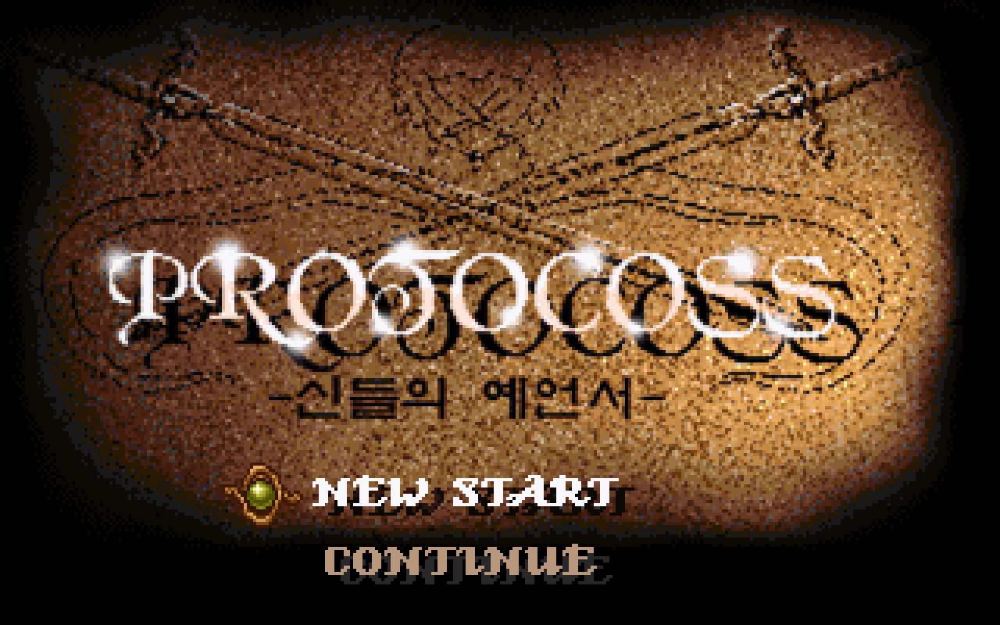
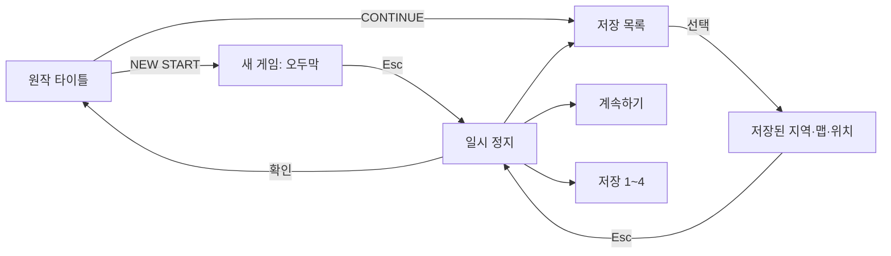
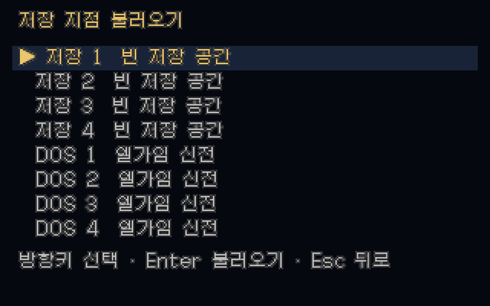
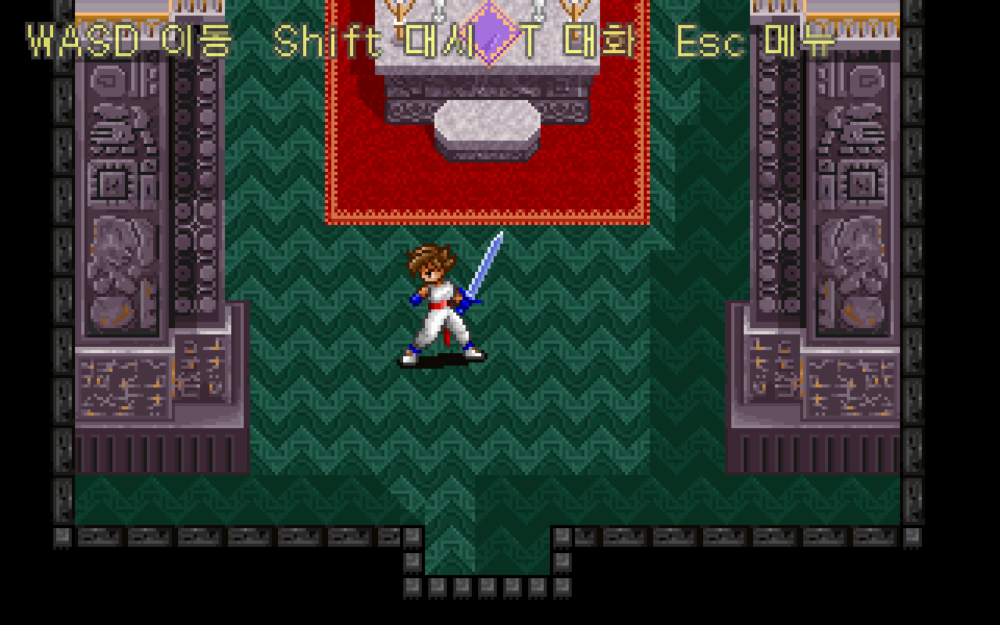
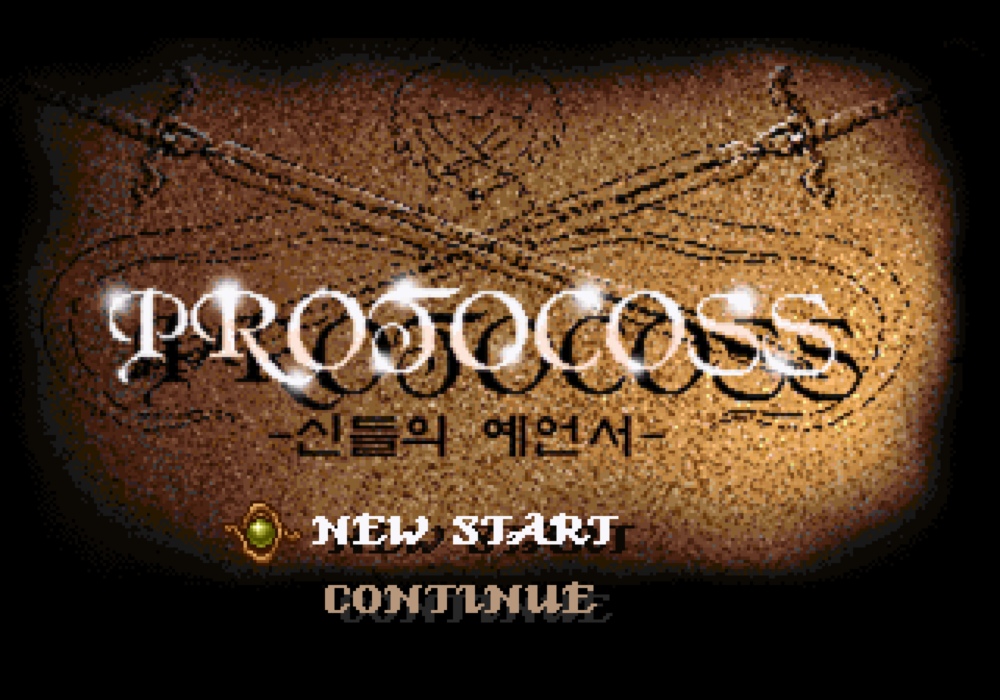

# 원작 시작 화면과 DOS 저장 불러오기

실행하면 원작 `STATMENU.IMG`의 타이틀이 먼저 나온다. `NEW START`는 원작 초기 스크립트가 지정하는 오두막으로 들어가고, `CONTINUE`는 저장 목록을 연다. 원본 `SAVE0.DAT`부터 `SAVE3.DAT`까지 읽어 기록된 지역·맵·위치를 불러오며, 새 저장은 사용자 전용 폴더에 쓴다.

이번 구현은 **시작 메뉴, 저장 파일 호환, 필드 진입**을 다룬다. DOS 저장의 파티·아이템·이벤트 상태는 바이트 그대로 보존한다. 아직 복원하지 않은 NPC·이벤트 실행기·전투에 그 상태를 연결한 것은 아니다. 현재 이어서 실행할 수 있는 동작은 필드 이동과 기존 대화 데모다. 원작 타이틀 선택 애니메이션과 오프닝 영상도 이번 범위에 포함하지 않았다.





## 조작과 저장 위치

- 타이틀·목록은 방향키 또는 W/S로 선택하고 Enter·Space로 확인한다. 마우스 왼쪽 클릭도 지원한다.
- 필드에서 Esc를 누르면 계속하기·저장하기·불러오기·메인 화면 메뉴가 나온다. 메뉴가 열린 동안 이동과 대화 진행은 멈춘다.
- 기존 저장을 덮거나 메인 화면으로 돌아갈 때 확인한다. 빈 슬롯·손상 파일을 선택하면 현재 게임을 바꾸지 않는다.
- 대화 중간 페이지는 아직 DOS 이벤트 위치와 연결하지 않았으므로, 대화를 마친 필드 상태에서 저장한다. 대화 중 저장 선택에는 안내를 표시한다.
- 새 저장은 `~/Library/Application Support/Protocoss/Saves/SAVE0.DAT`부터 `SAVE3.DAT`까지 기록한다. 원본 `DATA`에는 쓰지 않는다.
- `SAVE*.DAT.json`은 대화 데모의 다음 세그먼트 번호만 담는 선택적 부가 정보다. DAT의 SHA-256이 맞을 때만 읽으며, 파일이 없어도 DOS 본문을 불러온다.



현재 사용자 폴더의 DOS 저장 4개는 모두 `AREA00`의 서브맵 16, 엘가임 신전을 가리킨다. 이 맵은 320×400픽셀이며, 저장된 화면 스크롤과 좌표를 합쳐 필드 위치를 계산한다. 아래는 첫 DOS 저장을 불러온 실제 실행 화면이다. 캐릭터는 기존 복원 PNG를 계속 사용한다.



## 원본 게임 경로

기본 원본 경로는 `~/Downloads/Protocoss/Protocoss_Game`이다. `PROTOCOSS_GAME_DIR` 환경 변수나 실행 인자로 다른 폴더를 지정할 수 있다.

```bash
./gradlew :desktop:run
./gradlew :desktop:run --args='--game-dir=/path/to/Protocoss_Game'
```

검사용 저장 폴더도 `--save-dir=/path/to/test-saves`로 분리할 수 있다. 원본이 없어도 포함된 타이틀과 새 게임 오두막은 실행된다. 다른 DOS 저장 지역을 불러오려면 해당 원본 `MAP/AREA*.MDA`, `MAP`, `SDA`, `SOC`가 필요하다. 원본이 없거나 맵이 잘못되면 목록에서 오류를 알리고 현재 게임을 유지한다.

원본 맵은 필요할 때 직접 읽는다. 타일셋 번호는 파일명 뒤에 남은 점·문자열 대신 원작 함수 `0x1E6D6`이 참조하는 맵 헤더 32번 바이트를 사용한다. 6개 지역의 364개 맵 모두 구조 로딩을 확인했다. 전체 맵의 NPC·상호작용·동적 타일 변경이 복원되었다는 뜻은 아니다.

## 원작 코드로 확인한 형식

`AMOS.EXE`가 푸는 실행 파일의 동일 판본을 사용한다. [기존 맵 검증 도구](../tools/extractor/verify_original_map.py)의 판본 해시 검사와 메모리 내 압축 해제를 재사용하며, 원본 실행 파일은 저장소에 쓰지 않는다.

| 대상 | 원작 위치 | 확인한 내용 |
| --- | --- | --- |
| 시작 메뉴 | `0x1D674` | `STATMENU.IMG`의 0번 그림을 배경으로 사용 |
| 선택 표시 | `0x1D330` | NEW START 1번, CONTINUE 7번, 커서 13번 프레임과 좌표 |
| 그림 그리기 | `0x2D11A` | IMG는 USER.SPR 프레임과 달리 크기 헤더 없이 4개 VGA 평면의 열·구간을 저장 |
| 저장 읽기 | `0x1BB74` | 407회 읽기로 2,944바이트를 메모리 상태에 배치 |
| 저장 쓰기 | `0x1C57C` | 같은 순서로 기록하고 마지막 시각 검사값을 추가 |
| 새 게임 위치 | `AREA00.G&M` 첫 분기, 명령 `0x16` | 서브맵 2, 스크롤 0·0, 화면 좌표 96·56 |

선택 그림은 원작이 쓰는 좌표에서 화면 가장자리 16픽셀을 빼서 합성한다. 18개 원본 프레임의 색 번호·투명도·RGBA 77,850픽셀을 원작 함수와 비교했다. 완성된 메뉴 PNG 2장도 그 원본 결과로 합성한 그림과 비교했다.

저장 파일에서 확인한 핵심 위치는 다음과 같다. 모든 수치는 리틀 엔디언이다.

| 파일 위치 | 길이 | 내용 |
| --- | --- | --- |
| 0 | 80 | 조합형 한글로 된 장소 이름 |
| 80 | 12 | 원작 상태 필드 3개, 보존 |
| 92 | 4 | 지역 번호 |
| 96 | 4 | 서브맵 번호 |
| 100, 104 | 각각 4 | 스크롤 X·Y, 8픽셀 타일 단위 |
| 108, 112 | 각각 4 | 원작 화면의 X·Y 좌표 |
| 116 | 221 | 방향·소지품 등 원작 상태 일부, 보존 |
| 337 | 11×153 | 캐릭터 레코드, 보존 |
| 2020 | 7×46 | 원작 추가 레코드, 보존 |
| 2342 | 600 | 이벤트 상태 300개 uint16, 보존 |
| 2942 | 2 | DOS 수정 시각과 `0x7F7F`의 XOR |

의미를 확정하지 않은 필드는 이름을 추정해 다시 직렬화하지 않는다.

필드 좌표는 `X = scrollX×8 + screenX - 16`, `Y = 맵 높이 - (scrollY×8 + screenY - 16)`으로 변환한다. 화면의 기준점을 현재 플레이어 모델의 위치에 연결하며, 스프라이트와 카메라에는 기존 맵 경계 제한을 적용한다. 화면 스크롤 범위를 벗어나 이동한 뒤 저장하면 스크롤을 다시 계산해 같은 월드 위치가 DOS 형식에도 남도록 한다. DOS 정수 좌표로 저장하므로 소수점 위치는 가장 가까운 픽셀로 반올림한다.

원작은 마지막 값을 DOS 파일 수정 **시각**과 비교하고, 다르면 일부 능력치를 초기화한다. 리마스터는 복사·압축 해제 중 시각이 달라진 원본의 상태를 지우지 않는다. 새 파일은 DOS의 2초 단위 시각과 검사값을 함께 설정한다. 원작으로 가져갈 때도 파일의 수정 시각을 보존해야 한다.

## 검사 재현

```bash
./gradlew test
./gradlew :desktop:verifyTitleSave :desktop:verifyFieldBounds
PYTHONPATH=tools/extractor .venv/bin/python -m unittest discover -s tools/extractor/tests
.venv/bin/python tools/extractor/decode_title.py --game-dir /path/to/Protocoss_Game
.venv/bin/python tools/extractor/verify_original_title_save.py \
  --game-dir /path/to/Protocoss_Game --report docs/title-save-verification.json \
  --save-file desktop/build/reports/title-save/SAVE0.DAT
```

Python 도구는 Pillow·Unicorn을 사용한다. 설치 방법은 [기존 추출 안내](../README.md)를 따른다.

- Kotlin 단위 검사 28개, Python 검사 26개 통과.
- 실제 macOS 그래픽 환경에서 타이틀·마우스 선택·빈 슬롯·DOS 로딩·이동 후 저장·앱 인스턴스 재생성·재로딩·덮어쓰기 취소/확인·손상 파일·메인 복귀·창 크기 변경의 63개 단계 통과.
- 이 실행에서 타이틀과 두 진입 필드의 361,803픽셀을 비교해 차이 0개. 필드 비교는 상단 안내와 캐릭터 사각형을 제외한다.
- 기존 필드 경계 실행 검사도 새 게임 메뉴를 거쳐 20개 시나리오·1,033,600픽셀 일치를 확인했다.
- 원작 함수로 초기 데이터와 실제 저장 4개를 각각 407회·2,944바이트 읽어 대조했다. 새로 기록한 DAT도 실제 파일 수정 시각을 전달해 원작 함수가 상태를 초기화하지 않고 읽는 것을 확인했다.
- 새 게임 배경 64,000픽셀과 DOS 저장 배경 128,000픽셀은 원작 타일 그리기 함수로 만든 그림과 일치한다. [검증 수치](title-save-verification.json)를 함께 보관한다.
- 검사 중 원본 저장 4개의 SHA-256이 바뀌지 않았다. 시험 저장은 임시 폴더에 만들고 자동 정리한다.

창 크기 변경 뒤에도 원작 타이틀의 비율과 마우스 선택 위치를 유지한다. F11 전체화면 전환 자체는 자동 시나리오에 포함하지 않았다.


