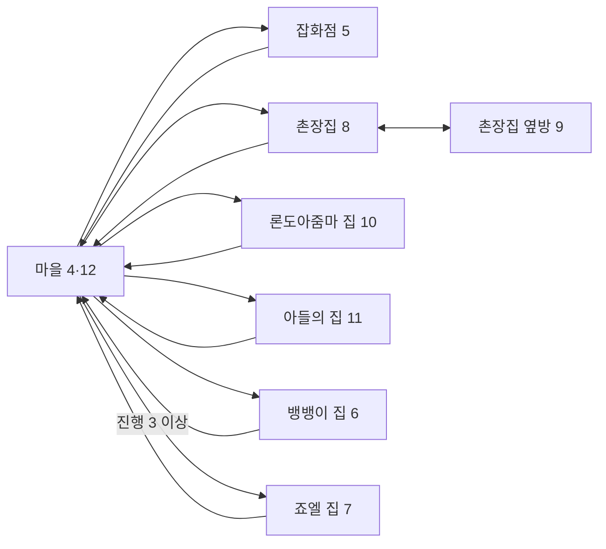

# 엘가임 마을의 건물 출입

마을에서 잡화점과 주민의 집에 들어갔다가 원작 출구로 돌아올 수 있다. 실내 맵 5~11의 배경·주민·충돌과 방 사이 연결, 진행 상태에 따른 출입 제한, 실내 저장·불러오기를 연결했다. [Issue #17](https://github.com/bnjjong/protocoss-remaster/issues/17)의 작업이며 [주민 이동·대화 복원](town-npcs.md)에서 이어진다.

[열린 문](images/buildings/open-door.png) · [초반의 잠긴 문](images/buildings/locked-door.png) · [잡화점 실내](images/buildings/shop.png) · [촌장집 옆방](images/buildings/mayor-side-room.png)

## 이번 단계에서 할 수 있는 일

닫힌 문 앞에서 위쪽으로 이동하면 원작 타일로 문이 열리고 통과할 수 있다. 열린 문은 해당 맵에 있는 동안 유지하며, 실내에서 나와 맵을 다시 읽으면 초기 상태로 돌아간다. 들어간 실내에서도 원래 가구·벽·주민의 통과 판정을 사용한다. 주민은 원작 이동 영역과 속도로 움직이며, 페이드인 중에도 갱신한다.

마을에는 건물 이동 스크립트 분기 7개가 있지만 **실제 활성 입구는 6개**다. 잡화점 옆문은 이벤트 사각형과 이동 분기만 남아 있고, 맵 4·12의 타일에는 이동·조작 키 이벤트 속성이 모두 없다. 잡화점 안쪽의 옆 출구도 같은 상태다. 이 분기를 확인 자료에 남기되, 게임에서 임의로 활성화하지 않았다.

죠엘의 집은 진행 변수 8이 3보다 작으면 “문이 잠겼네 ...”라는 카만의 대화가 나온다. 이후 마을 맵 12에서는 해당 문이 열린다. 따라서 보통 새 게임의 초기 마을에서는 건물 5곳에 들어갈 수 있고, 쪽지 이후의 마을에서는 6곳에 들어갈 수 있다. 변수 8의 진행 자체를 바꾸는 잡화점 수리·쪽지 등 퀘스트는 이번에 새로 구현하지 않았다.



실내에서의 NPC 대화·상자·책·거래·퀘스트, 전투, 마을 밖의 다음 지역은 제외한다. Space·Enter·E를 누른다고 모든 실내 이벤트가 실행되는 단계는 아니다.

## 원작에서 확인한 이동

원작 `0x25304`에 `AREA00.G&M`의 건물 분기를 직접 실행했다. [실행 기록](buildings-native-verification.json)의 96개 분기는 그룹 3~10, 진행 상태 0~5의 결과다. 목적지뿐 아니라 스크롤·화면 좌표·자세·높이 층·음악·이벤트 그룹과 마지막 호출 인자를 대조한다. 진행 변수·소지품·파티 등 다른 저장 바이트는 보존한다.

아래 좌표는 원작의 화면 좌표다. 그림 왼쪽 위는 `스크롤 × 8 + 화면 좌표 - 16`이다. 실내에서 바깥으로 나올 때 진행 3 미만이면 맵 4, 이후에는 맵 12를 선택한다.

| 마을 인자 | 실내 맵·그룹 | 진입 스크롤 | 진입 화면 좌표·자세 | 음악 | 실제 입구 |
| --- | --- | --- | --- | --- | --- |
| 2 | 잡화점 5·4 | 0,0 | 152,176·0 | 10 | 정문 |
| 3 | 잡화점 5·4 | 0,0 | 296,152·12 | 10 | 비활성 옆문 |
| 4 | 촌장집 8·5 | 0,25 | 232,152·0 | 24 | 정문 |
| 5 | 론도아줌마 집 10·7 | 0,0 | 304,120·12 | 24 | 가로 출입구 |
| 6 | 아들의 집 11·8 | 0,0 | 176,176·0 | 24 | 정문 |
| 7 | 뱅뱅이 집 6·9 | 0,0 | 192,176·0 | 24 | 정문 |
| 8 | 죠엘 집 7·10 | 0,25 | 136,184·0 | 10 | 초반 잠김 |

촌장집에서 옆방으로 가는 그룹 5·인자 1은 맵 9·그룹 6으로 이동한다. 옆방의 인자 0은 맵 8·그룹 5로 돌아온다. 이 통로를 마을로 나가는 출구와 구분한다.

## 문과 이벤트 타일

이벤트 사각형이 있다는 사실만으로 출입을 활성화하지 않는다. 원작 `0x20C10`은 발 앞쪽 타일의 속성 `8`을 확인한 뒤 사각형을 찾으며, 조작 키 함수 `0x1204C`는 별도의 속성 `4`를 확인한다. 두 함수를 주변 좌표에서 직접 실행한 **13,084개 표본**을 Kotlin 판정과 대조했다. 잡화점 옆문이 비활성인 근거도 이 검사에 포함한다.

마을 문은 `0x11CDC`를 직접 실행해 추출했다. 문 하나마다 3×3의 **9개 셀**을 바꾸고, 통과 판정 **8개**를 갱신한다. 원작의 타일 연결 표를 한 번 적용하고, 막힘·이벤트 속성을 함께 바꾼다. 두 마을 맵에서 각각 5개의 문 상태를 검증했다. 맵 4의 죠엘 문은 진행 3 이상으로 해당 분기를 직접 실행한 경우의 결과도 포함한다.

게임에서는 열린 문마다 판정 변경을 따로 적용한다. 다른 문을 열지 않아도 함께 뚫리는 방식이 아니다. 각 문 하나를 연 전체 이동 판정의 해시와, 모든 문을 연 원작 결과를 역순으로 문을 여는 Kotlin 결과에 대조했다. 타일·이벤트·통과 상태는 맵 재진입 때 함께 초기화한다. DOS 저장에는 이 실시간 맵 변경을 추가하지 않았다.

실내를 포함한 패키지 맵은 이제 맵 0~12다. 지형 이동 판정은 총 **480,000개**이며, 주민은 초기 위치를 표에 굳히지 않고 실행 중의 좌표로 검사한다. 새 실내 주민들의 이동 **4,900틱**도 원작 `0x23DA4`와 대조했다. 필드 인물 그림은 21종·12프레임의 **145,152픽셀**을 원작 스프라이트 함수와 비교했다.

## 음악과 효과음

잡화점·죠엘 집의 원작 음악 10을 FM 재생 함수로 합성했다. [음악 기록](../assets/opening/music-10/audio.json)은 약 49.84초의 한 주기, 원작 이벤트 322개와 OPL 레지스터 쓰기 4,432회를 기록한다. 해당 실내 저장을 불러와도 음악 10을 복구한다. 실내·마을 전환 때 이전 음악을 정리하며, 실행 검사에서 동시에 재생되는 음악이 하나를 넘지 않는지 확인한다.

문과 해당 출입 분기의 효과음 0은 기존 `e0000.wav`를 사용한다. 원작 `0x11CDC`와 효과음 함수 `0x2B6F0(0)`이 같은 샘플 포인터를 사용함을 확인했고, WAV의 992개 PCM 샘플이 원본 EFF와 일치한다. 음원 변환기와 기존 효과음 파일을 바꾸지는 않았다.

## 검사 결과와 한계

- Kotlin **63개**, Python 추출기 **30개** 검사 통과.
- `verifyBuildings`: 원본 폴더 없이 실제 키 입력으로 **1,967걸음**, 건물 **11회 왕복**, 잠긴 문·비활성 옆문·촌장집 방 연결·실내 저장과 불러오기·음악 중복 방지·효과음을 확인한다.
- [화면 대조 기록](buildings-render-verification.json): 열린 문 2장, 잠긴 문 대화, 실내와 옆방 등 **12장·768,000픽셀**이 같은 타일·인물·스크롤 상태의 원작 VGA 함수 출력과 일치한다. 배경·인물·가구 앞뒤 가림과 대화 초상화·글꼴을 포함한다.
- 기존 마을 왕복·주민 대화·오두막·시작 연출·프롤로그·타이틀 저장·필드 경계 실행 검사도 모두 통과했다. 지형의 비정렬 좌표 1,750개 검사도 다시 실행했다.

이는 명시한 출입 분기·이동과 지정 화면의 검증이다. 실내 이벤트 전체나 게임 완주를 복원한 결과가 아니다. 출입 시 현재 게임의 페이드인을 사용하며, 원작의 전환 전후 모든 팔레트·음량 변화와 부팅부터의 시계 위상을 DOSBox 녹화 전체와 비교하지는 않았다.

## 재현

일반 게임은 `./gradlew :desktop:run`으로 실행한다. 마을의 문 앞에서 방향키·WASD로 들어가고 실내 출구로 나온다. 실내에서 Esc 메뉴를 열어 저장·불러오기를 확인할 수 있다.

```bash
./gradlew test :desktop:verifyBuildings :desktop:verifyTownTravel :desktop:verifyNpcs \
  :desktop:verifyFieldTravel :desktop:verifyOpening :desktop:verifyPrologue \
  :desktop:verifyTitleSave :desktop:verifyFieldBounds
python3 -m unittest discover -s tools/extractor/tests
```

원작 자료 재추출에는 Pillow·Unicorn이 필요하다. 음악 합성에는 NumPy·SoundFile·clang도 필요하다. 아래 순서로 기본 판정·인물 자산을 추출한 뒤 건물 분기와 문 변경을 덧붙인다.

```bash
python3 tools/extractor/original_field.py /path/to/Protocoss_Game --verify
python3 tools/extractor/decode_opening.py --game-dir /path/to/Protocoss_Game
python3 tools/extractor/extract_buildings.py --game-dir /path/to/Protocoss_Game
python3 tools/extractor/render_prologue_audio.py --game-dir /path/to/Protocoss_Game --track 10
./gradlew :desktop:verifyBuildings
python3 tools/extractor/verify_building_render.py --game-dir /path/to/Protocoss_Game
```

실행 검사는 전용 임시 저장 폴더를 정리하며, 시험 앱의 음악·효과음만 음소거한다. 사용자 원본·DOS 저장·다른 앱의 오디오는 바꾸지 않는다. 비교 화면·상태·원작 기준 PNG는 `desktop/build/reports/buildings`에 생성한다.
