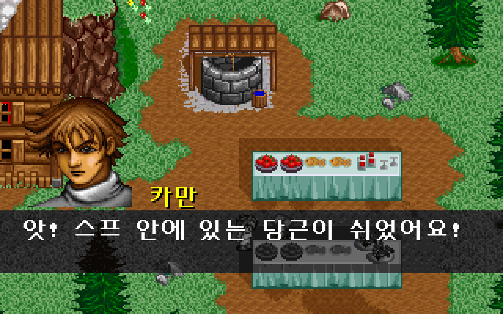
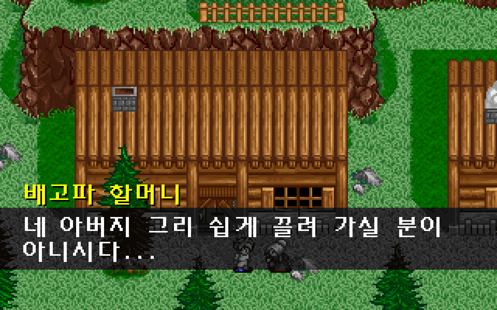

# 엘가임 주민의 이동과 대화

엘가임 마을의 주민이 원작에 기록된 범위·속도로 움직이고, 앞에서 Space·Enter·E를 누르면 진행 상태에 맞는 대화를 한다. 대화 상대가 카만 쪽으로 다가와 바라보고, 대화가 끝나면 원래 방향과 동작으로 돌아간다. [Issue #15](https://github.com/bnjjong/protocoss-remaster/issues/15)의 작업이며 [마을 진입 복원](town-travel.md)에서 이어진다.





## 이번에 연결한 범위

초기 마을 맵 4의 주민 7명과 이후 마을 맵 12의 주민 5명을 연결했다. 고정 인물, 제자리에서 동작하는 인물, 정해진 영역을 걷는 인물을 구분한다. 샤론·죠엘·엘론·죠엘부인·샤론부인·꼬마·할머니의 이벤트 인자 10·11·12·13·14·18·19를 지원한다.

`AREA00.G&M`을 원작 이벤트 함수 `0x25304`로 실행하고, 대화 함수 `0x1F8B0`에 실제로 전달되는 문자열을 추출했다. 진행 변수 8의 값이 3보다 작은 때, 3인 때, 4 이상인 때의 대사를 구분한다. 화자·초상화 변경과 `/D`의 마지막 줄 유지도 보존한다. 필요한 글꼴은 221자로 늘렸으며 한글 모양은 원작 합성 함수와 대조했다.

대화 중에는 카만의 이동과 메뉴 진입이 잠긴다. **상대 주민만 멈추며 다른 주민과 배경 애니메이션은 계속 움직인다.** 장소명이 표시되는 동안에도 주민은 움직인다. 저장 메뉴에서는 게임의 기존 일시 정지 정책대로 멈춘다.


## 원작에서 확인한 규칙

`AREA00.MAP`의 NPC 레코드는 54바이트다. 마지막 여섯 바이트의 의미를 추정하지 않고, 원작의 인물 갱신 함수 `0x23DA4`와 대조했다.

| 위치 | 의미 |
| --- | --- |
| `+0x00` | PEOPLE.SPR 인물 번호 |
| `+0x04`, `+0x08` | 현재 그림의 왼쪽 위 픽셀 좌표 |
| `+0x14`, `+0x18` | 이동 목표의 8픽셀 격자 좌표 |
| `+0x1C`~`+0x28` | 이동 영역의 최소·최대 격자 좌표 |
| `+0x2C` | 대화 이벤트 인자 |
| `+0x30` | 방향: 위 1, 오른쪽 2, 아래 4, 왼쪽 8 |
| `+0x31` | 0~15의 논리 프레임 |
| `+0x32` | 유형: 고정 0, 제자리 동작 1, 이동 2 |
| `+0x33` | 한 번의 화면 갱신에 움직이는 픽셀 수 |
| `+0x34` | 정상 0, 접근 중 자동 이동 잠금 1, 대화 중 정지 2 |
| `+0x35` | 지형의 높이 층 |

원작 BIOS 시계 한 틱은 `65536 / 1193182`초다. `0x2BE54`는 4틱마다 동작·다음 목표를 갱신하고, 60틱마다 이동 인물의 방향을 다시 고른다. 목표 사이의 그림은 70Hz에서 인물별 속도 1 또는 2픽셀로 움직인다. 두 갱신이 동시에 오면 방향 갱신이 동작 갱신을 지우는 순서까지 옮겼다. 난수 함수 `0x67F1F`의 정수 계산도 그대로 사용한다.

지형이나 이동 영역 끝에 닿으면 시계 방향으로 돌고 다음 갱신을 기다린다. 인물→지형·카만 충돌은 `0x21698`, 카만→인물 충돌은 `0x1FD84`의 인물 루프를 따른다. 인물끼리의 충돌은 이 함수에 없어 추가하지 않았다. 충돌은 보이는 그림의 중간 픽셀 위치가 아니라 **이동 목표 격자**를 사용한다. 아래쪽 이동의 가로 경계가 위쪽과 다른 원작 판정도 보존했다.

기존 `movement-4.bin`, `movement-12.bin`은 초기 주민 위치까지 굳힌 표였다. 이번에 주민을 제외한 지형 판정으로 다시 추출하고, 게임 실행 중의 주민 좌표로 충돌을 검사한다. 주민이 떠난 자리가 계속 막히는 현상을 없앴다. 대각선은 기존 두 축 검사에 같은 주민 판정을 적용한다.

대화 대상은 `0x21464`의 정면 사각형과 같은 높이 층으로 고른다. 움직이는 인물은 `0x21250`의 중간 지형 검사도 거친다. `0x23804`처럼 움직이는 상대가 한 픽셀씩 접근하고, 고정 인물은 그 자리에서 방향만 바꾼다. 종료 시 `0x1F49C`처럼 원래 방향·프레임을 복구하고 현재 픽셀 위치에서 새 목표 격자를 정한다.

## 저장과 재진입

주민 대화는 마지막 이벤트 인자만 DOS 저장 상태에 기록한다. 진행 변수·파티·소지품을 초기화하지 않는다. 원작 2,944바이트 저장에는 주민의 실시간 좌표가 없으므로 **불러오기와 맵 재진입에서는 MAP의 초기 주민 배치를 다시 읽는다.** 별도 좌표 저장 형식을 만들지 않았다. 난수와 시계 상태는 맵 교체 때 이어진다.

## 검사 결과와 한계

- Kotlin **58개**, Python 추출기 **30개** 검사 통과.
- [원작 함수 실행 기록](npc-native-verification.json): 두 맵에서 각각 카만이 멀리 있는 경우와 주민 앞을 막는 경우를 1,400틱씩 실행했다. 전체 5,600틱의 좌표·목표·방향·프레임·정지 상태를 해시와 중간 기록으로 대조한다.
- 같은 기록의 **7,920개 충돌**, **3,360개 대화 대상**, **48개 접근 경로**, 진행 0~5의 **42개 대사 분기**를 대조한다.
- `verifyNpcs`: 원본 폴더 없이 실제 앱에서 주민과의 충돌·떠난 자리 통과, 진행 0·3·4의 주민 대화 **17건**, 다른 주민의 이동, 글자·페이지 진행, 메뉴 정지와 저장·불러오기를 확인한다.
- [원작 화면 대조 기록](npc-render-verification.json): GPU로 기록한 대화 화면 10장을 같은 인물 상태·타일 애니메이션·스크롤의 원작 VGA 함수 출력과 비교했다. 초상화·이름·이어지는 대사·어두운 배경과 인물까지 **640,000픽셀**이 일치한다. 움직임 규칙은 위의 독립된 원작 함수 실행 기록으로 검사한다.
- 기존 마을 왕복·오두막·프롤로그·타이틀 저장·필드 경계 실행 검사도 통과한다. 지형 판정표의 비정렬 좌표 1,750개를 다시 대조했다.

이 검사는 같은 시계·난수 입력에서의 인물 규칙과 지정한 화면을 검증한다. 부팅부터 메뉴 체류·전투까지 포함한 DOS 전체의 시계 위상과 난수 소비 순서를 재현한 것은 아니다. 이번 범위는 맵 4·12의 위 주민들이다. 상점, 건물 출입, 전투, 엔키드 합류와 전체 AREA 이벤트 실행기는 후속 작업이다.

## 재현

일반 게임 실행에는 원본 폴더나 Python이 필요 없다. 마을에서 주민을 바라보고 **Space·Enter·E**로 말을 건다. 같은 키로 글자를 모두 표시하거나 다음 페이지로 넘긴다. 대화를 마친 뒤 Esc 메뉴에서 저장할 수 있다.

```bash
./gradlew test :desktop:verifyNpcs :desktop:verifyTownTravel \
  :desktop:verifyFieldTravel :desktop:verifyOpening :desktop:verifyPrologue \
  :desktop:verifyTitleSave :desktop:verifyFieldBounds
python3 -m unittest discover -s tools/extractor/tests
```

원작 자료를 다시 추출·대조하려면 Pillow·Unicorn이 필요하다. 지원 판본 확인과 EXE 압축 해제는 기존 `unpack_game`을 사용하며, 원작 EXE와 저장 파일을 수정하거나 복제 산출물로 넣지 않는다.

```bash
python3 tools/extractor/original_field.py /path/to/Protocoss_Game --verify
python3 tools/extractor/decode_opening.py --game-dir /path/to/Protocoss_Game
python3 tools/extractor/verify_npcs.py --game-dir /path/to/Protocoss_Game
./gradlew :desktop:verifyNpcs
python3 tools/extractor/verify_npc_render.py --game-dir /path/to/Protocoss_Game
```

화면 대조 도구는 직전 `verifyNpcs`가 `desktop/build/reports/npcs`에 기록한 화면과 상태를 읽는다. 원작 기준 PNG도 같은 폴더에 남긴다. 실행 검사는 임시 저장 폴더를 만들었다가 지우고, 시험 앱의 음악만 음소거한다.
