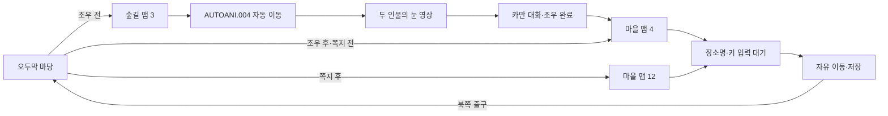

# 마을 진입과 검은 망토 조우

오두막 마당에서 숲길의 검은 망토 조우를 거쳐 엘가임 마을로 들어갈 수 있다. 조우를 본 뒤에는 숲길을 생략하며, 쪽지 연출 전후의 마을 맵을 구분한다. [Issue #13](https://github.com/bnjjong/protocoss-remaster/issues/13)의 작업이며 [오두막 이동 복원](field-travel.md)에서 이어진다.



[조우 영상](images/town-travel/eyes.png) · [숲길 대화](images/town-travel/forest.png) · [마을 첫 화면](images/town-travel/town.png) · [장소명](images/town-travel/place.png)

## 원작에서 확인한 이동과 상태

`AREA00.G&M`의 그룹 1·2·3을 원작 `0x25304` 함수로 실행해 36개 분기를 기록했다. [원작 실행 기록](town-native-verification.json)의 맵 이동 24개는 Kotlin 검사에서도 목적지·스크롤·화면 좌표·자세·높이 층·음악·진행 변수를 대조한다.

좌표는 원작 화면 좌표다. 스크롤 한 칸은 8픽셀이며, 인물 그림의 왼쪽 위는 화면 좌표보다 16픽셀 작다.

| 출발·조건 | 목적지 맵 | 스크롤 | 화면 좌표 | 자세·층 | 음악·그룹 |
| --- | --- | --- | --- | --- | --- |
| 마당 출구, 변수 7=0 | 3 | 0,0 | 120,16 | 8·0 | 25·2 |
| 마당 출구, 변수 7=1, 변수 8<3 | 4 | 0,0 | 88,24 | 8·0 | 24·3 |
| 마당 출구, 변수 7=1, 변수 8≥3 | 12 | 0,0 | 88,24 | 8·0 | 24·3 |
| 숲길 남쪽 출구 | 4 | 0,0 | 88,24 | 8·0 | 24·3 |
| 숲길 북쪽 또는 마을 북쪽 출구 | 0 | 40,25 | 304,184 | 12·0 | 25·1 |

숲길의 인자 2 이벤트는 변수 7=0일 때만 `AUTOANI.004`를 실행한다. 연출을 마치면 변수 7=1과 마지막 `/C3`의 인자를 보존하고, 그림 왼쪽 위 216,104(원작 화면 232,120)에서 조작을 돌려준다. 시작 프롤로그나 오두막 연출을 다시 호출하지 않는다. 대각선 입력도 두 축의 앞쪽 이벤트를 확인해 길목의 첫 조우를 건너뛰지 않게 한다. 진행 상태 2의 **마을 출구**와 오두막 **입구**를 구분해, 마을로 나가면서 쪽지 연출이 호출되지 않도록 검사한다.

원작 `0x1EB30`의 장소명은 위쪽에서 오른쪽→가운데로 들어오고 키 입력을 기다린 뒤 왼쪽으로 나간다. 이동은 그동안 잠긴다. 새로 들어간 장소명과 음악 번호를 DOS 저장 상태에도 기록한다. 마을 저장을 불러올 때는 음악 24를 다시 연다.

## 조우 영상 복원

`GRP/#0.VIS`는 머리말의 첫 숫자 5가 묶음 수, 둘째 숫자 26이 종료 프레임 번호다. 원작 `0x134B8`은 **0~24의 25프레임**을 표시한다. 묶음은 파일에서 시간순으로 놓여 있지 않다. 각 프레임은 이전 화면을 유지하면서 바뀐 픽셀만 덮어쓰며, 네 바이트의 보조 머리말은 화면 위치로 쓰지 않는다.

기존 `decode_vis.py`의 결과를 재사용하지 않고 `decode_encounter.py`로 다시 추출했다. 같은 파일을 원작 로딩·디코딩 함수 `0x2C5A4`, `0x2C50C`, `0x2C748`에도 입력해 **25프레임·1,600,000픽셀**을 모두 대조했다. [영상 해시와 시간 기록](../assets/encounter/manifest.json)을 함께 제공한다.

원작은 `0x2C207`에서 등록한 BIOS `INT 1Ch` 횟수를 `0x2BE6E`에서 세고, 조우 명령의 인자 3만큼 프레임 사이를 기다린다. 표시 프레임 간격은 기본 BIOS 시계의 3틱(`3 × 65536 / 1193182`초)이다. 영상 마지막 팔레트 감쇠는 화면 갱신을 기다리는 별도 루프다. 이 둘을 모두 70Hz로 계산하지 않는다.

영상은 기존 프롤로그의 `PrologueStream`으로 읽을 수 있는 별도 `encounter.pvid`에 담았다. 재생 중에는 자동 이동·대화 실행이 멈추며, 영상 종료 후 원래 명령의 다음 위치에서 이어진다. 조우 음악 27과 마을 음악 24는 기존 원작 FM 재생 함수로 합성했다. 조우 중 음악 25를 멈추고, 조우 음악을 정리한 뒤 25를 다시 시작한다. 시험 실행은 이 앱의 음악만 음소거한다.

## 자산과 검사

맵 3(40×25, SOC 18), 맵 4·12(120×75, SOC 3), 필요한 필드 인물을 패키지에 넣었다. 열린 오두막 문은 맵 번호와 별개인 `0-open` 판정으로 분리했다. 현재 이동 판정은 총 **348,000개**, 별도 비정렬 좌표 교차 검사는 **1,750개**다. 마을 인물은 원본에 기록된 초기 위치·자세·높이 층으로 표시하고 충돌을 판정한다. **NPC의 자율 이동과 대화는 이번에 연결하지 않았다.**

- 수정 전 Kotlin 검사 43개 통과. 수정 후 **51개** 통과.
- Python 추출기 검사 **30개** 통과. 누적 프레임, 변화 없는 프레임, 잘린 명령과 화면 범위 초과를 확인한다.
- `verifyTownTravel`: 원본 폴더 없이 새 게임→기상→마당→조우 전 숲길 왕복→조우 영상→대화→마을을 실제 입력으로 실행한다. 조우 이후 재진입, 상태 0·2·3의 마을 선택, 장소명 대기 중 이동 잠금, 저장 메뉴·불러오기도 포함한다. **109걸음**을 이동한다.
- 원작 영상 0·12·24프레임, 숲길 대화, 상태 0·2·3의 마을 첫 화면에서 GPU 출력 **443,392픽셀**이 기준과 일치한다. 마을 연기 등 타일 애니메이션 사각형만 위상 차이로 제외한다. 숲길과 영상은 전 화면을 비교한다.
- 조우 중 두 음악이 겹치지 않음, 앱 일시 정지·복귀, 마을 저장 후 음악 재개를 확인한다. 사용자 원본과 저장은 수정하지 않는다.
- 기존 `verifyFieldTravel`, `verifyOpening`, `verifyPrologue`, `verifyTitleSave`, `verifyFieldBounds`도 통과한다.

픽셀 비교는 지정한 장면의 결과다. 필드 암전과 장소명 이동의 모든 중간 프레임을 DOSBox 녹화와 비교한 검사는 아니다. 장소명의 기본 위치·대기·퇴장 흐름은 원작 코드에서 확인했고, 세부 팔레트와 키 입력의 모든 경우까지 동일하다고 주장하지 않는다.

다음 범위는 마을 NPC의 자율 이동·대화, 건물 문 열기·상점 진입과 거래다. 전투·전체 AREA 이벤트 실행기도 아직 포함하지 않는다.

## 재현

```bash
python3 tools/extractor/original_field.py /path/to/Protocoss_Game --verify
python3 tools/extractor/decode_opening.py --game-dir /path/to/Protocoss_Game
python3 tools/extractor/decode_encounter.py --game-dir /path/to/Protocoss_Game
python3 tools/extractor/render_prologue_audio.py --game-dir /path/to/Protocoss_Game --track 24
python3 tools/extractor/render_prologue_audio.py --game-dir /path/to/Protocoss_Game --track 27
./gradlew test :desktop:verifyTownTravel :desktop:verifyFieldTravel \
  :desktop:verifyOpening :desktop:verifyPrologue :desktop:verifyTitleSave :desktop:verifyFieldBounds
./gradlew :desktop:run
```

추출에는 Pillow·Unicorn, 음악 합성에는 NumPy·SoundFile·clang이 필요하다. 일반 게임 실행에는 원본 폴더·Python·DOSBox가 필요 없다. 마을 이름이 나오면 Enter 또는 Space로 진행한다.
